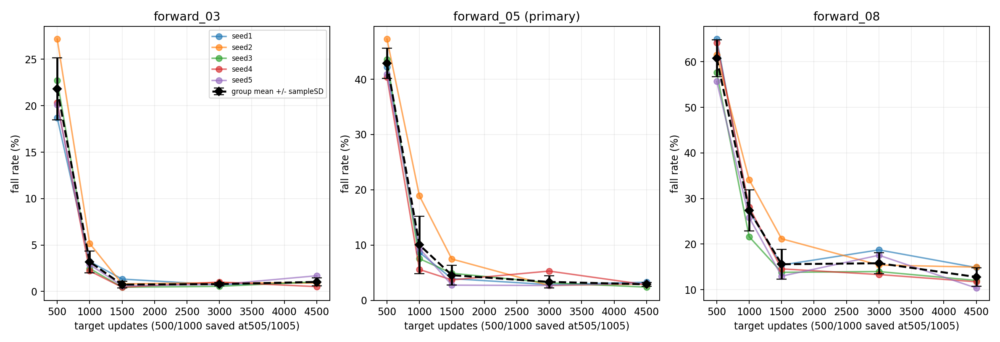
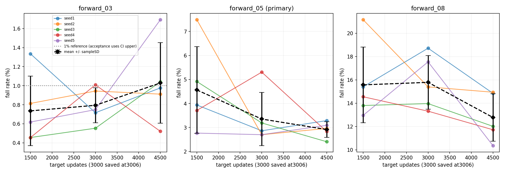

# Issue #10: requested training-budget curves and conditional continuation

Issue: https://github.com/weiguang52/HUMANOID_TW/issues/10 . Base2e1a2ae. All artifacts generated remotely. Defaults unchanged.

## Frozen design and provenance

Five requested training seeds1/2/3/4/5 from issues6/9 are all retained. No applied policies, new randomization/reward changes or seed selection. All share one robust05 parent; this is conditional budget analysis, not independent parent replication.

Nearest saved targets500/1000 are model8000/model8500: actual505/1005 completed logged updates from the initial7496 label. Final1500 is model8995. RSL checkpoints are saved after the labeled update; the label is not the number of updates in this branch. Small offsets are disclosed and chosen before results. Target updates are used on the plot, with actual counts in the table.

Unchanged issue7 bounded-combined protocol:1024env, eval seeds1/2/3, forward0.3/0.5/0.8m/s,20s, deterministic, paired resets, requested last_action, evaluation push+/-0.3m/s. The15 final1500 eval jobs are reused byte-for-byte from hash-checked issue7/9 archives; legacy issue7 files predate last_action metadata, so requested policy/critic empty params are verified from saved configs. New evaluations use the same requested semantics. See reused_evaluation_provenance.json. Each seed/speed point has3072trials. StatisticalN=5training seeds, not trial count.

## Gate fixed before intermediate outcomes

D=0.5m/s mean at target1000 minus mean at1500. Threshold=half the endpoint1500 cross-seed sampleSD(ddof1). The issue did not specify which SD timepoint; endpoint1500 was prospectively frozen in the plan and Notion before reading intermediate outcomes. SD1000 and paired-changeSD are reported only as context. EnterB iff D>0 and D>threshold (1e-12rate tolerance for numerical equality).

| Quantity | Value (percentage points unless mean) |
|---|---:|
| 1000 mean fall rate | 10.0326% |
| 1500 mean fall rate | 4.5638% |
| Decline1000-minus1500 | +5.4688 pp |
| SD1500 | 1.8038 pp |
| HalfSD1500 threshold | 0.9019 pp |
| SD1000 (context only) | 5.1686 pp |
| Paired-changeSD (context only) | 3.8149 pp |
| Gate passed | True |
| Decision | still_improving_enter_B |

All five own1500 checkpoints and full optimizer states were resumed for exactly3000 additional updates,4096env, no std reset. Recipe is otherwise identical. Target3000 uses model10500(actual3006logged total); target4500 uses model11994(exact4500logged total). RSL resumes the saved iteration label once, so labels repeat at the resume boundary. Five continuation config audits allow only run/log names, resume source and max_iterations, and verify optimizer step growth. No checkpoint is chosen by performance. Policy/critic/optimizer/iteration state is restored; simulator and rollout state are reconstructed under the same seed at the resume boundary, so this is not a byte-identical uninterrupted4500-update trajectory.

## Per-training-seed curves

Rates pool exactly3072trials per seed/speed/checkpoint. Within-policy Wilson intervals in all_evaluation_rates.csv are descriptive evaluation uncertainty, not training-seed uncertainty.

| Target updates | Actual logged | Speed | Seed | Falls /3072 | Fall rate |
|---:|---:|---|---:|---:|---:|
| 500 | 505 | forward_03 | 1 | 575 | 18.7174% |
| 500 | 505 | forward_05 | 1 | 1297 | 42.2201% |
| 500 | 505 | forward_08 | 1 | 1996 | 64.9740% |
| 500 | 505 | forward_03 | 2 | 835 | 27.1810% |
| 500 | 505 | forward_05 | 2 | 1452 | 47.2656% |
| 500 | 505 | forward_08 | 2 | 1888 | 61.4583% |
| 500 | 505 | forward_03 | 3 | 698 | 22.7214% |
| 500 | 505 | forward_05 | 3 | 1338 | 43.5547% |
| 500 | 505 | forward_08 | 3 | 1770 | 57.6172% |
| 500 | 505 | forward_03 | 4 | 625 | 20.3451% |
| 500 | 505 | forward_05 | 4 | 1241 | 40.3971% |
| 500 | 505 | forward_08 | 4 | 1971 | 64.1602% |
| 500 | 505 | forward_03 | 5 | 618 | 20.1172% |
| 500 | 505 | forward_05 | 5 | 1257 | 40.9180% |
| 500 | 505 | forward_08 | 5 | 1711 | 55.6966% |
| 1000 | 1005 | forward_03 | 1 | 99 | 3.2227% |
| 1000 | 1005 | forward_05 | 1 | 267 | 8.6914% |
| 1000 | 1005 | forward_08 | 1 | 838 | 27.2786% |
| 1000 | 1005 | forward_03 | 2 | 159 | 5.1758% |
| 1000 | 1005 | forward_05 | 2 | 581 | 18.9128% |
| 1000 | 1005 | forward_08 | 2 | 1048 | 34.1146% |
| 1000 | 1005 | forward_03 | 3 | 76 | 2.4740% |
| 1000 | 1005 | forward_05 | 3 | 232 | 7.5521% |
| 1000 | 1005 | forward_08 | 3 | 664 | 21.6146% |
| 1000 | 1005 | forward_03 | 4 | 68 | 2.2135% |
| 1000 | 1005 | forward_05 | 4 | 172 | 5.5990% |
| 1000 | 1005 | forward_08 | 4 | 863 | 28.0924% |
| 1000 | 1005 | forward_03 | 5 | 89 | 2.8971% |
| 1000 | 1005 | forward_05 | 5 | 289 | 9.4076% |
| 1000 | 1005 | forward_08 | 5 | 794 | 25.8464% |
| 1500 | 1500 | forward_03 | 1 | 41 | 1.3346% |
| 1500 | 1500 | forward_05 | 1 | 121 | 3.9388% |
| 1500 | 1500 | forward_08 | 1 | 473 | 15.3971% |
| 1500 | 1500 | forward_03 | 2 | 25 | 0.8138% |
| 1500 | 1500 | forward_05 | 2 | 230 | 7.4870% |
| 1500 | 1500 | forward_08 | 2 | 650 | 21.1589% |
| 1500 | 1500 | forward_03 | 3 | 14 | 0.4557% |
| 1500 | 1500 | forward_05 | 3 | 151 | 4.9154% |
| 1500 | 1500 | forward_08 | 3 | 424 | 13.8021% |
| 1500 | 1500 | forward_03 | 4 | 14 | 0.4557% |
| 1500 | 1500 | forward_05 | 4 | 114 | 3.7109% |
| 1500 | 1500 | forward_08 | 4 | 447 | 14.5508% |
| 1500 | 1500 | forward_03 | 5 | 19 | 0.6185% |
| 1500 | 1500 | forward_05 | 5 | 85 | 2.7669% |
| 1500 | 1500 | forward_08 | 5 | 398 | 12.9557% |
| 3000 | 3006 | forward_03 | 1 | 22 | 0.7161% |
| 3000 | 3006 | forward_05 | 1 | 88 | 2.8646% |
| 3000 | 3006 | forward_08 | 1 | 575 | 18.7174% |
| 3000 | 3006 | forward_03 | 2 | 29 | 0.9440% |
| 3000 | 3006 | forward_05 | 2 | 83 | 2.7018% |
| 3000 | 3006 | forward_08 | 2 | 473 | 15.3971% |
| 3000 | 3006 | forward_03 | 3 | 17 | 0.5534% |
| 3000 | 3006 | forward_05 | 3 | 98 | 3.1901% |
| 3000 | 3006 | forward_08 | 3 | 429 | 13.9648% |
| 3000 | 3006 | forward_03 | 4 | 31 | 1.0091% |
| 3000 | 3006 | forward_05 | 4 | 163 | 5.3060% |
| 3000 | 3006 | forward_08 | 4 | 409 | 13.3138% |
| 3000 | 3006 | forward_03 | 5 | 23 | 0.7487% |
| 3000 | 3006 | forward_05 | 5 | 83 | 2.7018% |
| 3000 | 3006 | forward_08 | 5 | 539 | 17.5456% |
| 4500 | 4500 | forward_03 | 1 | 30 | 0.9766% |
| 4500 | 4500 | forward_05 | 1 | 101 | 3.2878% |
| 4500 | 4500 | forward_08 | 1 | 456 | 14.8438% |
| 4500 | 4500 | forward_03 | 2 | 28 | 0.9115% |
| 4500 | 4500 | forward_05 | 2 | 91 | 2.9622% |
| 4500 | 4500 | forward_08 | 2 | 459 | 14.9414% |
| 4500 | 4500 | forward_03 | 3 | 32 | 1.0417% |
| 4500 | 4500 | forward_05 | 3 | 74 | 2.4089% |
| 4500 | 4500 | forward_08 | 3 | 369 | 12.0117% |
| 4500 | 4500 | forward_03 | 4 | 16 | 0.5208% |
| 4500 | 4500 | forward_05 | 4 | 87 | 2.8320% |
| 4500 | 4500 | forward_08 | 4 | 360 | 11.7188% |
| 4500 | 4500 | forward_03 | 5 | 52 | 1.6927% |
| 4500 | 4500 | forward_05 | 5 | 95 | 3.0924% |
| 4500 | 4500 | forward_08 | 5 | 318 | 10.3516% |

## Group means, sampleSD and seed-level intervals

| Target updates | Speed | Mean | SampleSD (pp,ddof1) | Seed-bootstrap95% mean |
|---:|---|---:|---:|---|
| 500 | forward_03 | 21.8164% | 3.3262 | [19.6029%,24.5964%] |
| 500 | forward_05 | 42.8711% | 2.7449 | [40.9701%,45.2474%] |
| 500 | forward_08 | 60.7813% | 4.0410 | [57.6172%,63.9453%] |
| 1000 | forward_03 | 3.1966% | 1.1722 | [2.4544%,4.2448%] |
| 1000 | forward_05 | 10.0326% | 5.1686 | [6.8359%,14.7396%] |
| 1000 | forward_08 | 27.3893% | 4.5129 | [24.0430%,31.2565%] |
| 1500 | forward_03 | 0.7357% | 0.3658 | [0.4883%,1.0547%] |
| 1500 | forward_05 | 4.5638% | 1.8038 | [3.3789%,6.0677%] |
| 1500 | forward_08 | 15.5729% | 3.2505 | [13.6133%,18.5156%] |
| 3000 | forward_03 | 0.7943% | 0.1836 | [0.6576%,0.9375%] |
| 3000 | forward_05 | 3.3529% | 1.1099 | [2.7344%,4.3620%] |
| 3000 | forward_08 | 15.7878% | 2.3059 | [13.9909%,17.5846%] |
| 4500 | forward_03 | 1.0286% | 0.4229 | [0.7161%,1.4062%] |
| 4500 | forward_05 | 2.9167% | 0.3300 | [2.6302%,3.1576%] |
| 4500 | forward_08 | 12.7734% | 2.0337 | [11.2305%,14.3164%] |

## StepB acceptance
- 4500-update0.3m/s mean95% upper strictly below1%: False.
- 0.5m/s decline1500-minus4500: +1.6471 pp, paired seed-bootstrap95% [+0.3060,+3.3138] pp; excludes0: True.

Middle-speed improvement is supported by the prespecified paired interval, but low-speed acceptance fails. The4500 low-speed mean is worse than1500; longer training does not improve every speed monotonically. The3000 low-speed upper happens below1%, but that checkpoint is not selected or promoted after observing the curve. The final4500 result and every seed remain in the report.

## Statistical limits

All5^5=3125with-replacement seed-index vectors are enumerated. The same indices resample both checkpoints for change intervals, preserving seed pairing. Linear2.5/97.5percentiles form intervals.3125bootstrap draws do not add training seeds. With only five observed seeds, tail/coverage uncertainty is large. SeedSD includes finite evaluation error; fixed evaluation streams and a shared parent limit generalization. Secondary speed/timepoint intervals are not simultaneous familywise95% intervals. The stopping gate is heuristic and was not converted into a hypothesis test. No defaults are promoted.

## Colored worst-command videos

For every evaluated checkpoint, the command with the highest sum of falls over evaluation seeds1/2/3 gets front/side diagnostic videos; ties use0.3,0.5,0.8 order. Existing final1500 videos are hash-validated remote copies from their original archives and are explicitly identified in video_plan.json. New videos use one environment/20s; they are visual diagnostics, not1024-env acceptance results. Cameras follow translation and heading. Exact precoloredUSD preserves original physics, limits and non-material relationships; no dynamic material binding. Colors:joint_colors.json. Stage1 velocity commands have no HumanML3D sourceNPY (N/A).

- [requested_s1_u1000_worst_front_forward_08_front](videos/requested_s1_u1000_worst_front_forward_08_front.mp4)
- [requested_s1_u1000_worst_side_forward_08_side](videos/requested_s1_u1000_worst_side_forward_08_side.mp4)
- [requested_s1_u1500_worst_front_forward_08_front](videos/requested_s1_u1500_worst_front_forward_08_front.mp4)
- [requested_s1_u1500_worst_side_forward_08_side](videos/requested_s1_u1500_worst_side_forward_08_side.mp4)
- [requested_s1_u3000_worst_front_forward_08_front](videos/requested_s1_u3000_worst_front_forward_08_front.mp4)
- [requested_s1_u3000_worst_side_forward_08_side](videos/requested_s1_u3000_worst_side_forward_08_side.mp4)
- [requested_s1_u4500_worst_front_forward_08_front](videos/requested_s1_u4500_worst_front_forward_08_front.mp4)
- [requested_s1_u4500_worst_side_forward_08_side](videos/requested_s1_u4500_worst_side_forward_08_side.mp4)
- [requested_s1_u500_worst_front_forward_08_front](videos/requested_s1_u500_worst_front_forward_08_front.mp4)
- [requested_s1_u500_worst_side_forward_08_side](videos/requested_s1_u500_worst_side_forward_08_side.mp4)
- [requested_s2_u1000_worst_front_forward_08_front](videos/requested_s2_u1000_worst_front_forward_08_front.mp4)
- [requested_s2_u1000_worst_side_forward_08_side](videos/requested_s2_u1000_worst_side_forward_08_side.mp4)
- [requested_s2_u1500_worst_front_forward_08_front](videos/requested_s2_u1500_worst_front_forward_08_front.mp4)
- [requested_s2_u1500_worst_side_forward_08_side](videos/requested_s2_u1500_worst_side_forward_08_side.mp4)
- [requested_s2_u3000_worst_front_forward_08_front](videos/requested_s2_u3000_worst_front_forward_08_front.mp4)
- [requested_s2_u3000_worst_side_forward_08_side](videos/requested_s2_u3000_worst_side_forward_08_side.mp4)
- [requested_s2_u4500_worst_front_forward_08_front](videos/requested_s2_u4500_worst_front_forward_08_front.mp4)
- [requested_s2_u4500_worst_side_forward_08_side](videos/requested_s2_u4500_worst_side_forward_08_side.mp4)
- [requested_s2_u500_worst_front_forward_08_front](videos/requested_s2_u500_worst_front_forward_08_front.mp4)
- [requested_s2_u500_worst_side_forward_08_side](videos/requested_s2_u500_worst_side_forward_08_side.mp4)
- [requested_s3_u1000_worst_front_forward_08_front](videos/requested_s3_u1000_worst_front_forward_08_front.mp4)
- [requested_s3_u1000_worst_side_forward_08_side](videos/requested_s3_u1000_worst_side_forward_08_side.mp4)
- [requested_s3_u1500_worst_front_forward_08_front](videos/requested_s3_u1500_worst_front_forward_08_front.mp4)
- [requested_s3_u1500_worst_side_forward_08_side](videos/requested_s3_u1500_worst_side_forward_08_side.mp4)
- [requested_s3_u3000_worst_front_forward_08_front](videos/requested_s3_u3000_worst_front_forward_08_front.mp4)
- [requested_s3_u3000_worst_side_forward_08_side](videos/requested_s3_u3000_worst_side_forward_08_side.mp4)
- [requested_s3_u4500_worst_front_forward_08_front](videos/requested_s3_u4500_worst_front_forward_08_front.mp4)
- [requested_s3_u4500_worst_side_forward_08_side](videos/requested_s3_u4500_worst_side_forward_08_side.mp4)
- [requested_s3_u500_worst_front_forward_08_front](videos/requested_s3_u500_worst_front_forward_08_front.mp4)
- [requested_s3_u500_worst_side_forward_08_side](videos/requested_s3_u500_worst_side_forward_08_side.mp4)
- [requested_s4_u1000_worst_front_forward_08_front](videos/requested_s4_u1000_worst_front_forward_08_front.mp4)
- [requested_s4_u1000_worst_side_forward_08_side](videos/requested_s4_u1000_worst_side_forward_08_side.mp4)
- [requested_s4_u1500_worst_front_forward_08_front](videos/requested_s4_u1500_worst_front_forward_08_front.mp4)
- [requested_s4_u1500_worst_side_forward_08_side](videos/requested_s4_u1500_worst_side_forward_08_side.mp4)
- [requested_s4_u3000_worst_front_forward_08_front](videos/requested_s4_u3000_worst_front_forward_08_front.mp4)
- [requested_s4_u3000_worst_side_forward_08_side](videos/requested_s4_u3000_worst_side_forward_08_side.mp4)
- [requested_s4_u4500_worst_front_forward_08_front](videos/requested_s4_u4500_worst_front_forward_08_front.mp4)
- [requested_s4_u4500_worst_side_forward_08_side](videos/requested_s4_u4500_worst_side_forward_08_side.mp4)
- [requested_s4_u500_worst_front_forward_08_front](videos/requested_s4_u500_worst_front_forward_08_front.mp4)
- [requested_s4_u500_worst_side_forward_08_side](videos/requested_s4_u500_worst_side_forward_08_side.mp4)
- [requested_s5_u1000_worst_front_forward_08_front](videos/requested_s5_u1000_worst_front_forward_08_front.mp4)
- [requested_s5_u1000_worst_side_forward_08_side](videos/requested_s5_u1000_worst_side_forward_08_side.mp4)
- [requested_s5_u1500_worst_front_forward_08_front](videos/requested_s5_u1500_worst_front_forward_08_front.mp4)
- [requested_s5_u1500_worst_side_forward_08_side](videos/requested_s5_u1500_worst_side_forward_08_side.mp4)
- [requested_s5_u3000_worst_front_forward_08_front](videos/requested_s5_u3000_worst_front_forward_08_front.mp4)
- [requested_s5_u3000_worst_side_forward_08_side](videos/requested_s5_u3000_worst_side_forward_08_side.mp4)
- [requested_s5_u4500_worst_front_forward_08_front](videos/requested_s5_u4500_worst_front_forward_08_front.mp4)
- [requested_s5_u4500_worst_side_forward_08_side](videos/requested_s5_u4500_worst_side_forward_08_side.mp4)
- [requested_s5_u500_worst_front_forward_08_front](videos/requested_s5_u500_worst_front_forward_08_front.mp4)
- [requested_s5_u500_worst_side_forward_08_side](videos/requested_s5_u500_worst_side_forward_08_side.mp4)

## Validation and tracking

Five targeted tests cover gate direction/strict equality/endpointSD, joint seed resampling, sampleSD and invalid data. Input checkpoint SHA/iteration/finite tensors/nonempty optimizer state, baseline source identity, saved configuration and continuation semantics are audited. Video encoding/frame/color/framing and manual attachment review accompany the report. The input/model hashes and archive manifest allow independent verification. Original raw logs remain remote; archive logs remove ANSI and trailing whitespace. No mounted data was copied to local storage.

Notion replaces Linear: https://www.notion.so/403325d8231d8172995bf19510b8d760 . GitHub issue reply records the gate, whether training actually ran and the final evidence.
