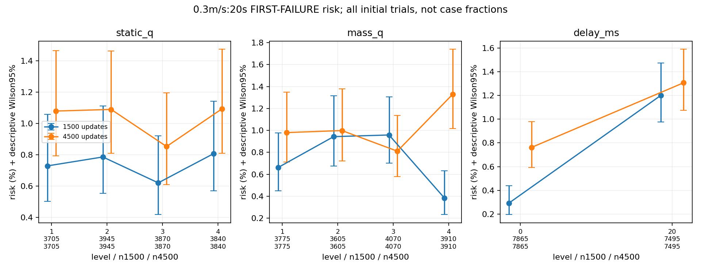
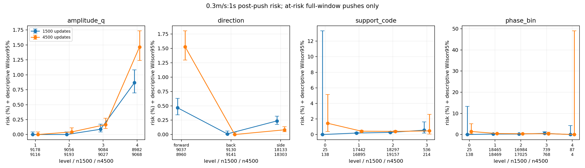
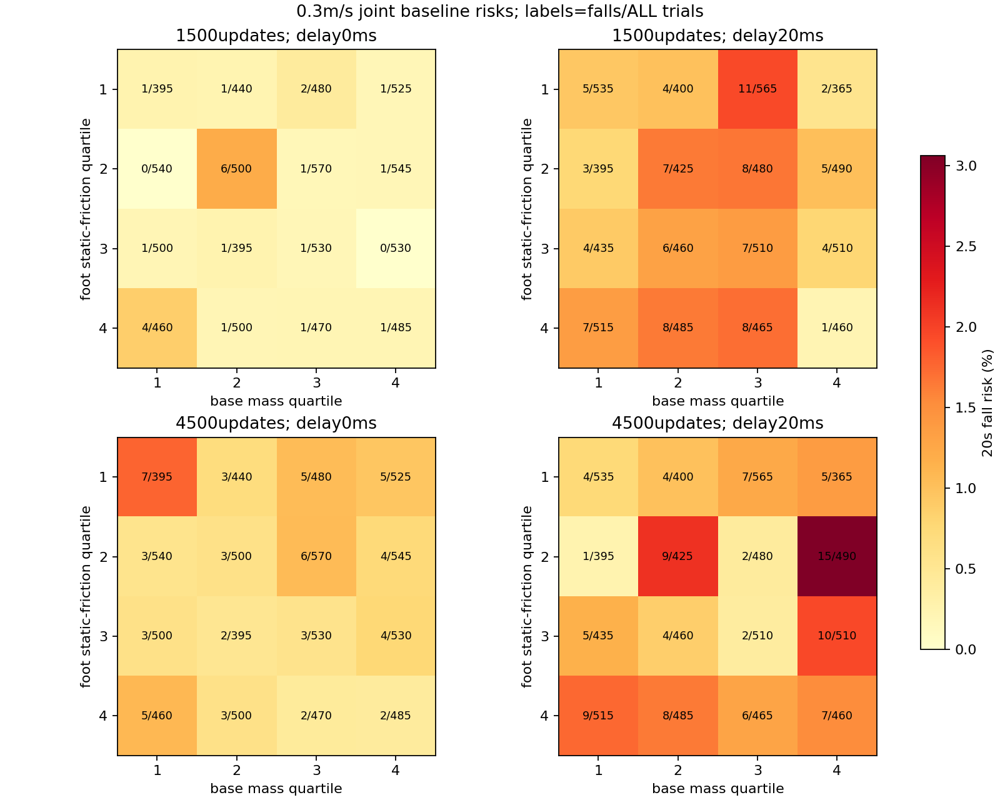
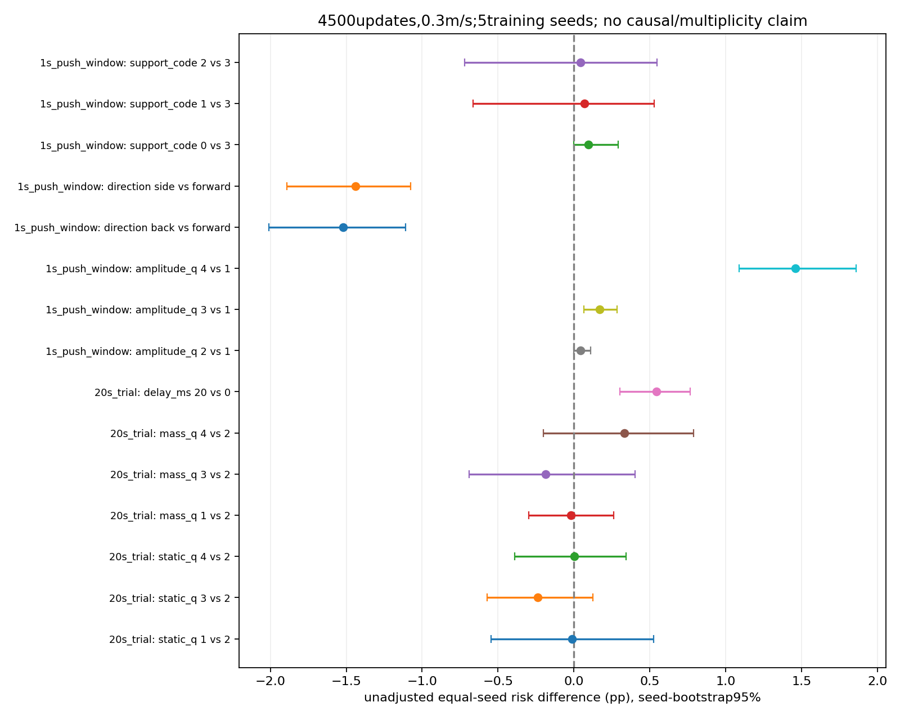
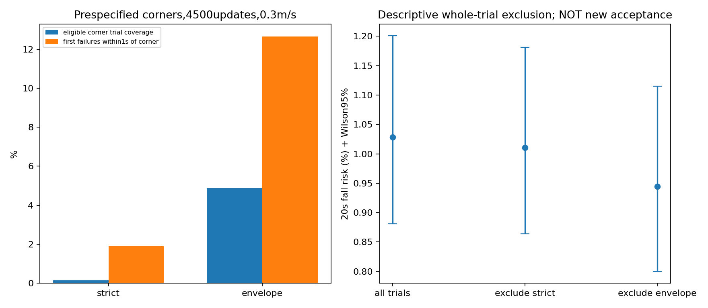
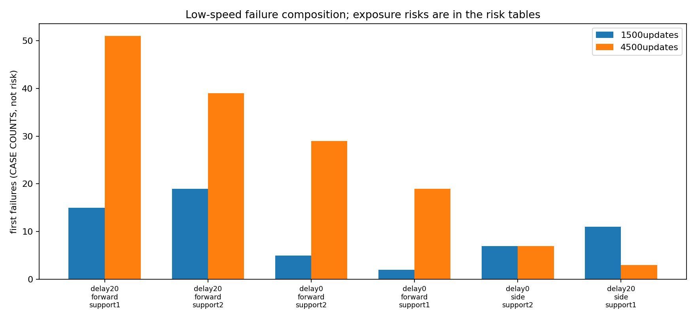

# Issue #11: all-trial low-speed risk strata and extreme corners

Issue: https://github.com/weiguang52/HUMANOID_TW/issues/11 . Base5fa8823. **Analysis only: no training and no policy/reward/randomization/default changes.**

## Main conclusion

Low-speed failures are **not dominated by the predefined mass/friction extreme corners**. The larger envelope touches 4.876% of initial trials but precedes only 20/158 (12.658%) first failures. Excluding WHOLE exposed trials leaves 138/14611=0.9445% (descriptive Wilson95% [0.8000%,1.1147%]); it is not a new acceptance test.

This does **not** mean uniform risk. Large pushes in Q4 touch 49.297% of initial trials, so a quarter of pushes is not a tiny trial subset. The observed Q4+forward subset touches 13.828% of trials and precedes 123/158 (77.848%) low-speed first failures. This is substantial dynamic-stress enrichment, not proof of an infeasible physical-parameter corner or independent confirmation of a discovered subset. The held-out-seed diagnostics capture 33.544% of failures with 19.824% baseline coverage, and 70.886% with 19.616% push-subset trial coverage. Neither meets the frozen >=80%capture/<=20%coverage criterion; 'broader' means residual failures across measured physical settings, not absence of predictive pushing states.

At4500,20ms delay is associated with a seed-mean trial risk ratio 1.714 versus0ms (conditional seed-bootstrap95% [1.431,2.011]). The amplitude-Q4 window has133/9068 events, whereas Q1 has0/9116; an infinite risk ratio is not manufactured from the zero reference. Single support occupies36052/36404 eligible windows; its large CASE count alone is not evidence of a large support-phase risk effect. Double-support references and some phase bins are sparse, with wide or non-estimable intervals.

Longer training reduced observed no-recent-push low-speed cases26->2 and20ms side/right-support cases20->3, while20ms forward/left-support cases grew15->51 and forward/right-support19->39. These are same-label sample changes, not proof that a mechanism was eliminated. At4500,140/158 low-speed failures are both within1s of a push and terminally sagittal. All158 failing initial mass/friction/delay settings have a successful other-seed trial, but exact pushing/COM/phase trajectories differ: **exact failed-state physical recoverability remains unidentified**.

The single next proposal is a **low-speed forward-push recovery reward targeting pitch/COM restoration**, tested under unchanged acceptance, rather than assuming a few mass/friction combinations are impossible. This issue does not implement the proposal, train models or promote defaults.
Frozen primary-corner classification: **broader_failures_relative_to_predefined_corners**. Overall measured-subset assessment: **broader_failures_across_measured_subsets**.
test a low-speed post-push recovery reward targeting pitch/COM recovery under unchanged evaluation; not implemented. This is the only proposed next step; it is NOT implemented.

The classification is relative to the two measured, prospectively defined corners. It does not exclude every conceivable rare combination and does not prove a failed state is physically unrecoverable. Original acceptance criteria and the default configuration remain unchanged.

## Cohort and observer validation

Fixed requested training seeds1/2/3/4/5, each at1500 and4500 updates. Five-seed variance is conditional on the common parent. #7 protocol: bounded combined,1024environments, evaluation seeds1/2/3,0.3/0.5m/s,20s, deterministic policy, paired resets. Thirty jobs and61440 initial trials; every successful trial is retained in the denominators. Command indices0/1 match issue10. No checkpoint is selected by performance.

The opt-in observer calls the original push sampler exactly once, adds no random draws or physics writes, and reuses the original first-failure recorder. The final64-env baseline-vs-expanded recheck includes complete NumPy cursor/Gaussian-cache fields and Python Gaussian-cache/version, not just principal RNG arrays. It showed bitwise-identical root/joint states, complete CPU/CUDA/NumPy/Python RNG and first-failure traces for both speeds. Initial preliminary smoke and complete recheck artifacts are both retained; the formal recorder class hash is unchanged, and formal evaluations do not enable the optional end-state audit helper. Nine tests cover fixed windows, censoring, post-failure exclusion, full denominators, outcome-blind bins and paired training-seed effects. See observer_equivalence_audit.json and statistics_tests.log. Each observing callback checks Torch RNG invariance. Baseline count agreement is recorded rather than substituted for new outcomes.

## Original full-cohort fall rates

| Updates | Speed | Falls / all trials | Mean over5seeds | SampleSD (pp) | Seed-bootstrap95% mean |
|---:|---|---:|---:|---:|---|
| 1500 | forward_03 | 113/15360 | 0.7357% | 0.3658 | [0.4883%,1.0547%] |
| 1500 | forward_05 | 701/15360 | 4.5638% | 1.8038 | [3.3789%,6.0677%] |
| 4500 | forward_03 | 158/15360 | 1.0286% | 0.4229 | [0.7161%,1.4062%] |
| 4500 | forward_05 | 448/15360 | 2.9167% | 0.3300 | [2.6302%,3.1576%] |

Individual policy rates: policy_rates.csv. Within-policy Wilson intervals describe evaluation trials; seed-bootstrap intervals describe the five trained policies conditional on the fixed evaluation streams. Same mass/material draws are reused across models, so61440trials are not61440independent physical settings. See randomization_pairing_audit.json.

## Two distinct risk units and raw records

1. **20s initial-trial risk:** one initial environment/command, first true termination. Initial mass/friction/delay strata include all survivors and failures. After an automatic reset, that environment does not become a new independent trial.
2. **1s post-push risk:** every at-risk push with a full administrative1s followup. First failure in(0,1s] is an event; post-first-failure pushes are archived but excluded. Tail pushes after19s are excluded from this fixed-window risk. Intervening pushes/censoring are explicitly checked; none may be silently called a success.

Recorded 160847 total pushes and 1420 first-failure windows. Raw NPZ files include actual/nominal mass ratios for every link, every shape static/dynamic friction/restitution, shape-to-body mapping, initial and at-push delay, actual world/body delta-v, support feet/forces, contact-onset inferred phase, COM and foot states. CSVs: all_trial_records.csv and all_push_records.csv.gz (lossless gzip; original CSV remains remote). Raw integrity checks reconcile trial outcomes, first-failure traces, coordinate transforms, push bounds, delays and contact codes.

Frozen feature cuts (chosen from initial covariates without using outcomes):
- Base mass ratio quartiles: [0.75, 1.0, 1.25] (configuredU(.5,1.5)).
- Minimum assigned static friction over both foot shapes: [0.5441721677780151, 0.7077827453613281, 0.9069987833499908].
- Corresponding dynamic-friction cuts: [0.41255611181259155, 0.5449075698852539, 0.7553287744522095].
- Actual3D push delta norm cuts: [0.16925687506432688, 0.2393653682408596, 0.29316150714175193] from the square-uniform configured distribution.

Foot mass ratios and non-variation are in fixed_foot_mass_audit.json; a constant foot mass has no estimable effect. Static and dynamic friction are reported separately. Contact phase is inferred from measured contact onsets/previous periods, not an assumed commanded gait phase. Support codes:0flight,1left-only,2right-only,3double. Phase-bin0 means unavailable. Direction is forward/back when|dx|>=|dy|, side otherwise.

## Full-denominator stratified risks and factor effects

Tables include empty cells as NA, not zero risk, and flag n<30. Marginal factors: static/dynamic friction quartile, base mass quartile,0/20ms delay; push tables additionally include amplitude quartile, direction, support and contact phase. Full joint tables cross static-friction/mass/delay, with amplitude/direction/support for push windows. The dynamic-friction factor is secondary rather than silently substituted for static.

- trial_stratified_risks.csv and trial_joint_strata.csv: full20s trial denominators, falls, Wilson95%, exposure/failure fractions and descriptive relative risk versus the cohort.
- push_stratified_risks.csv and push_joint_strata.csv: at-risk1s push-window denominators, successes included, same measures.
- factor_effects.csv and factor_seed_effects.json: explicit reference levels, equal-weight mean seed risks, risk differences/relative risks and jointly resampled seed-bootstrap intervals. Reference quartile2 for mass/friction, delay0; push references amplitudeQ1, forward, double support, phaseQ1. Zero/sparse reference effects are explicitly not estimable.
- stage_joint_comparison.csv: same full joint cells side by side with both denominators/Wilson intervals and descriptive changes; empty cells remain NA.
- stage_stratum_comparison.csv:4500-minus1500 changes under the SAME cuts and references, with paired seed-index intervals and common-exposure limitations.

These are unadjusted observational associations, not independent adjusted causal effects. Joint tables expose confounding and sparse combinations; no regression or test of causal recoverability is claimed. Wilson intervals assume Bernoulli independence and can be too narrow for repeated pushes/shared draws. Training-seed intervals use all5^5=3125joint resamples, not3125new seeds; five-seed tails are uncertain, material-bucket/evaluation-stream uncertainty is not fully represented, and multiple exploratory comparisons have no simultaneous95% guarantee.

Selected4500 low-speed factor contrasts (all full tables remain available):

| Unit | Factor/target vs reference | Target n | Ref n | Equal-seed RR | Seed-bootstrap95% RR | Equal-seed risk difference (pp) |
|---|---|---:|---:|---:|---|---:|
| 20s_trial | static_q 1 vs 2 | 3705 | 3945 | 0.990 | [0.532,1.517] | -0.0104 |
| 20s_trial | static_q 3 vs 2 | 3870 | 3945 | 0.782 | [0.529,1.116] | -0.2373 |
| 20s_trial | static_q 4 vs 2 | 3840 | 3945 | 1.003 | [0.662,1.341] | +0.0038 |
| 20s_trial | mass_q 1 vs 2 | 3775 | 3605 | 0.981 | [0.764,1.393] | -0.0185 |
| 20s_trial | mass_q 3 vs 2 | 4070 | 3605 | 0.812 | [0.405,1.361] | -0.1878 |
| 20s_trial | mass_q 4 vs 2 | 3910 | 3605 | 1.332 | [0.815,1.749] | +0.3313 |
| 20s_trial | delay_ms 20 vs 0 | 7495 | 7865 | 1.714 | [1.431,2.011] | +0.5447 |
| 1s_push_window | amplitude_q 2 vs 1 | 9193 | 9116 | NA | NA | +0.0439 |
| 1s_push_window | amplitude_q 3 vs 1 | 9027 | 9116 | NA | NA | +0.1681 |
| 1s_push_window | amplitude_q 4 vs 1 | 9068 | 9116 | NA | NA | +1.4596 |
| 1s_push_window | direction back vs forward | 9141 | 8960 | 0.000 | [0.000,0.000] | -1.5214 |
| 1s_push_window | direction side vs forward | 18303 | 8960 | 0.054 | [0.030,0.068] | -1.4392 |
| 1s_push_window | support_code 0 vs 3 | 138 | 214 | 1.273 | NA | +0.0974 |
| 1s_push_window | support_code 1 vs 3 | 16895 | 214 | 1.195 | NA | +0.0695 |
| 1s_push_window | support_code 2 vs 3 | 19157 | 214 | 1.127 | NA | +0.0454 |

## Predefined extreme corners and whole-trial exclusion

STRICT: staticQ1 AND baseQ4 AND20ms AND body-forward delta>=.3m/s AND single support. ENVELOPE: (staticQ1 OR dynamicQ1) AND base(Q1 OR Q4) AND20ms AND amplitudeQ4 AND single support. Numeric cuts were derived only from covariates under the frozen rule. No best-looking corner was selected after failures.

Concentration requires ENVELOPE trial coverage<=20% AND at least80% of low-speed first failures within1s of an eligible corner push. Case co-occurrence and proximal association are reported separately.

| Updates | Corner | Exposed / all trials | Coverage | Proximal failures / all failures | Proximal share | Remaining20s falls / trials | Remaining risk + Wilson95% |
|---:|---|---:|---:|---:|---:|---:|---|
| 1500 | strict | 30/15360 | 0.1953% | 1/113 | 0.8850% | 112/15330 | 0.7306% [0.6076%,0.8783%] |
| 1500 | envelope | 750/15360 | 4.8828% | 14/113 | 12.3894% | 97/14610 | 0.6639% [0.5446%,0.8092%] |
| 4500 | strict | 21/15360 | 0.1367% | 3/158 | 1.8987% | 155/15339 | 1.0105% [0.8640%,1.1815%] |
| 4500 | envelope | 749/15360 | 4.8763% | 20/158 | 12.6582% | 138/14611 | 0.9445% [0.8000%,1.1147%] |

Secondary held-out-training-seed concentration sensitivity (fixed after partial record acquisition, before stratified outcome analysis):

| Candidate cells | Held-out exposed / trials | Coverage | Captured / ALL first failures | Capture | <=20%coverage and>=80%capture |
|---|---:|---:|---:|---:|---|
| baseline | 3045/15360 | 19.8242% | 53/158 | 33.5443% | False |
| push | 3013/15360 | 19.6159% | 112/158 | 70.8861% | False |

For each held-out seed, cells are ranked using only the other four seeds, min20training observations, with a union-of-trials20% training coverage budget. Push-cell budgets also count unique initial trials. This guards against declaring global spread solely because a narrow primary mask failed. Folds overlap and share physical evaluation streams; it is a secondary diagnostic, not independent confirmation. Selected cells and full rules: secondary_concentration_cv.json and frozen_secondary_concentration.md.

Both speeds, per-seed sensitivities, sparse corner push risks, co-occurring failures and seed-bootstrap failure coverage are in corner_diagnostics.json. **Exclusion removes whole exposed trials, including successes; it does not remove only cases.** Exposure membership depends on surviving until a push, so complement risks are descriptive selection analyses, not counterfactual improvements and not acceptance replacements. Late pushes excluded by administrative followup are reported. Zero observed corner failures with few exposures do not establish safety.

## 1500vs4500 failure patterns

failure_mode_comparison.csv compares low-speed case composition under common delay/direction/support labels. These case shares are not risk estimates; denominators are in the stratified risk tables. A mode not seen in this sample is not proven eliminated. Common baseline strata allow comparison, but support/phase are policy-dependent states, so within-push-stratum changes are not randomized causal mediation effects.

Largest observed mode decreases/increases (same labels, all initial-trial denominators fixed; push-window exposure can differ):

| Case mode |1500 cases |4500 cases | Change |1500 push events/n |4500 push events/n |
|---|---:|---:|---:|---:|---:|
| no_recent_push | 26 | 2 | -24 | 0/0 | 0/0 |
| delay20__side__support2 | 20 | 3 | -17 | 19/4501 | 3/4692 |
| delay20__side__support1 | 11 | 3 | -8 | 11/4159 | 3/4150 |
| delay20__forward__support2 | 19 | 39 | +20 | 19/2184 | 39/2261 |
| delay0__forward__support2 | 5 | 29 | +24 | 5/2367 | 28/2412 |
| delay20__forward__support1 | 15 | 51 | +36 | 15/2103 | 49/2012 |

Full same-mode counts, exposure risks and intervals are in failure_mode_changes.csv. A0/0 push denominator for no_recent_push means not applicable, not zero risk; that label is case composition only. An observed zero in4500 is not proof that training eliminated a physical mechanism.

| Updates | Speed | First failures | Terminal sagittal share | Recent<=1s push share | Both |
|---:|---|---:|---:|---:|---:|
| 1500 | forward_03 | 113 | 85.8407% | 76.9912% | 71.6814% |
| 1500 | forward_05 | 701 | 97.1469% | 95.1498% | 92.2967% |
| 4500 | forward_03 | 158 | 89.8734% | 98.7342% | 88.6076% |
| 4500 | forward_05 | 448 | 91.2946% | 91.0714% | 82.3661% |

## Physical recoverability: what these records can establish

| Updates | Low-speed failures | Failures with another-seed success under identical initial mass/friction/delay | Fraction | Initial-draw groups where all5seeds fail |
|---:|---:|---:|---:|---:|
| 1500 | 113 | 113 | 100.0000% | 0 |
| 4500 | 158 | 158 | 100.0000% | 0 |

Identical initial physical draws succeeding in another policy refute only that baseline randomization alone is universally impossible. Actual push streams, COM states and phases can differ, so this is not proof that the exact failed compound state is recoverable. physical_stress_summary.csv reports successful/failed-window COM/foot-center capture-distance and friction-limited stopping-distance descriptors. The capture estimate uses pre-push whole-bodyCOM velocity plus actual root delta; instantaneous foot centers omit finite feet and future foot placement. Stopping estimates assume horizontal constant mu*g and conservative supporting-foot dynamic friction. Walking, angular momentum, joint/actuator limits and alternative recovery controllers are not solved. **Observed policy failure cannot establish physical unrecoverability; the records do not justify labeling a subset physically impossible.** See physical_recoverability_limits.json.

## Exact representative low-speed failure replays

The original two highest-count coarse4500 low-speed case strata and the two highest-event-count full static/mass/delay/amplitude/direction/support strata are shown; successful pushes stay in their risk denominators. The two additional full-joint examples are specified before stratified outcome analysis in representative_selection_addendum.md; sparse cells remain visible with denominators and are not promoted into general risk claims. Selection is deterministic (nearest median stratum amplitude, then seed/eval/env/step; no-recent-push uses earliest failure). These are EXACT recorded pre-reset root/joint states, not a fresh1env policy rollout or a counterfactual controller. The camera follows translation and heading. Original physics/non-material relationships and1876attributes are preserved in the precoloredUSD; no runtime material binding. Joint legend:joint_colors.json.

### Representative1: delay20__forward__support1
Model requested_s5_u4500, eval seed3, env13, first failure step941. Case stratum count/share: 51 / 32.2785%; eligible push-window events/n: 49/2012 (case counts above are a distinct unit). Base ratio=0.848863, foot static min=0.429557, dynamic min=0.690411, initial delay=20ms.
Actual body delta-v=(+0.237546,+0.004316,-0.010261)m/s; support=1, phases=(0.2857,0.8500); source row=2222.
[Front](videos/mode1_front.mp4) | [Side](videos/mode1_side.mp4) | [Selection/source](representative_mode1.json)

### Representative2: delay20__forward__support2
Model requested_s5_u4500, eval seed2, env1015, first failure step624. Case stratum count/share: 39 / 24.6835%; eligible push-window events/n: 39/2261 (case counts above are a distinct unit). Base ratio=0.636222, foot static min=0.838625, dynamic min=0.301927, initial delay=20ms.
Actual body delta-v=(+0.206141,-0.105397,-0.010098)m/s; support=2, phases=(0.5000,0.0500); source row=1220.
[Front](videos/mode2_front.mp4) | [Side](videos/mode2_side.mp4) | [Selection/source](representative_mode2.json)

### Representative3: fulljoint_2_4_20_4_forward_1
Model requested_s2_u4500, eval seed1, env408, first failure step688. Case stratum count/share: 9 / 5.6962%; eligible push-window events/n: 9/48 (case counts above are a distinct unit). Base ratio=1.484309, foot static min=0.545189, dynamic min=0.448699, initial delay=20ms.
Actual body delta-v=(+0.264011,-0.192816,-0.009938)m/s; support=1, phases=(0.2000,0.7500); source row=1498.
[Front](videos/mode3_front.mp4) | [Side](videos/mode3_side.mp4) | [Selection/source](representative_mode3.json)

### Representative4: fulljoint_4_1_20_4_forward_2
Model requested_s3_u4500, eval seed3, env312, first failure step896. Case stratum count/share: 8 / 5.0633%; eligible push-window events/n: 8/44 (case counts above are a distinct unit). Base ratio=0.550824, foot static min=1.041630, dynamic min=0.308547, initial delay=20ms.
Actual body delta-v=(+0.298537,-0.089932,-0.015313)m/s; support=2, phases=(0.6316,0.0500); source row=2144.
[Front](videos/mode4_front.mp4) | [Side](videos/mode4_side.mp4) | [Selection/source](representative_mode4.json)

Each replay contains up to51inclusive pre-reset samples at50fps (about1s), not a20s acceptance video. Joint velocity is zero for display and physics is not integrated. Encoding/frame/source-state/color/framing and manual attachment audits accompany the files. Stage1 velocity commands have no HumanML3D sourceNPY (N/A); no synthetic source motion is invented.

## Provenance and tracking

All10 input checkpoints already exist in the issue10 versioned bundle and are linked by verified SHA in checkpoint_references.json; no new models were trained. Original raw logs/records remain remotely, archive logs strip ANSI/trailing whitespace. No mounted data is copied to local storage. Default training/evaluation configurations are unchanged except opt-in observational hooks.

Notion replaces Linear: https://www.notion.so/403325d8231d8172995bf19510b8d760 . Issue reply records the conclusion, original/complement risks, physical limits and exactly one unimplemented next recommendation.
