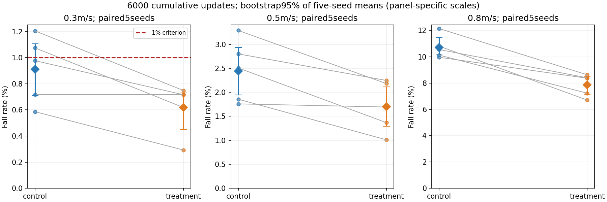
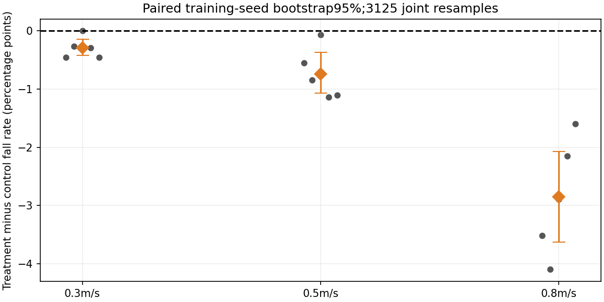
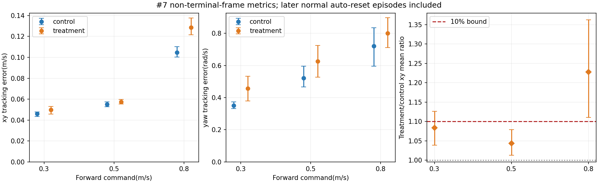
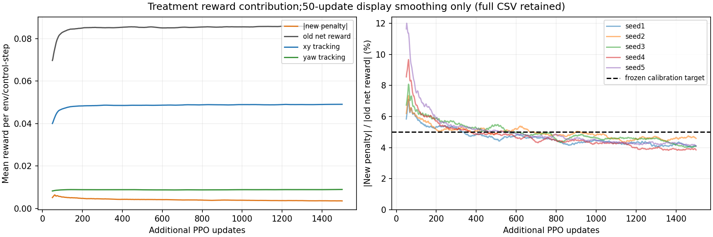
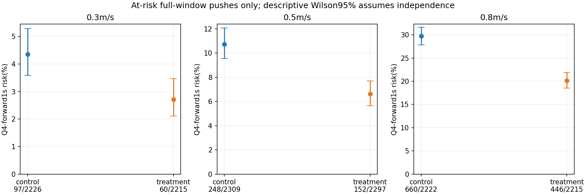
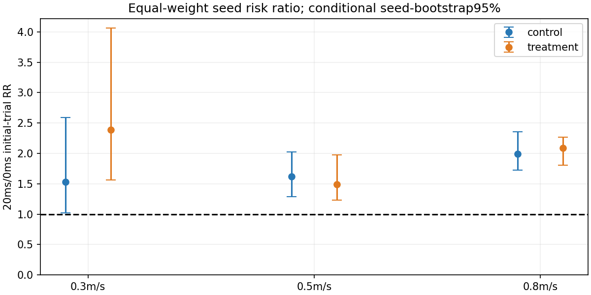

# Issue12: post-push pitch recovery, five matched training-seed pairs

Issue: https://github.com/weiguang52/HUMANOID_TW/issues/12 . Base67d9879.
**One opt-in reward; production defaults remain off/unchanged.**

## Result and frozen decision

**stop_this_scheme_no_extra_budget_or_weight_scan**. All primary/xy tracking gates passed: **False**.
Low-speed treatment minus control = -0.2930pp, paired five-training-seed95% [-0.4232,-0.1432]pp. Treatment low-speed mean95%=[0.4492%,0.7292%].
At 0.8 m/s, xy error changes from 0.1047 to 0.1285 m/s (+22.77%); the frozen 10% tracking gate fails. The fall-rate improvement therefore does not establish an accepted controller.
No weight scan, extra budget, checkpoint choice or default promotion. An ineffective/tracking-degraded scheme stops here.

| Frozen main/tracking criterion | Passed |
|---|---|
| low_speed_effect_strictly_negative95 | True |
| treatment_low_speed_mean_ci_upper_below_1percent | True |
| mid_speed_treatment_mean_not_above_control | True |
| xy_tracking_at_every_command_not_worse_than_10percent | False |

Secondary results are descriptive and are not retroactively added as significance gates.

## Fixed cohort and fall rates

Five own requested4500 parents -> control0 / treatmentw, each+1500updates,4096envs. Ten finals represent6000requested-fork updates, not the complete upstream lifetime. Parent model_11994.pt -> final model_13493.pt; actual new updates, not filenames, determine budget. All actor/critic/optimizer state is resumed, no std reset. See training_audits.json and matched_pair_config_rng_audit.json.
All10final models x3evaluation seeds x3commands x1024initial trials x20s = **92160initial trials**,30jobs/90command records. Deterministic policy, paired resets, bounded combined #7 protocol.

| Speed | Control falls/N | Control mean ± seedSD | Control mean95% | Treatment falls/N | Treatment mean ± seedSD | Treatment mean95% | Paired T-C95% |
|---|---:|---:|---|---:|---:|---|---|
| forward_03 | 140/15360 | 0.9115% ± 0.2553% | [0.7096%,1.1068%] | 95/15360 | 0.6185% ± 0.1884% | [0.4492%,0.7292%] | [-0.4232,-0.1432]pp |
| forward_05 | 375/15360 | 2.4414% ± 0.6441% | [1.9466%,2.9362%] | 261/15360 | 1.6992% ± 0.5286% | [1.2891%,2.1094%] | [-1.0677,-0.3711]pp |
| forward_08 | 1646/15360 | 10.7161% ± 0.8647% | [10.1432%,11.4714%] | 1208/15360 | 7.8646% ± 0.8465% | [7.1484%,8.4831%] | [-3.6263,-2.0768]pp |

[All90evaluation rows](evaluation_rates.csv) | [All30policy/command rows](policy_rates.csv) | [Group summaries](group_results.json) | [Five-pair differences](paired_effects.json)

Each policy/command pools3072initial trials. FIVE paired training seeds are the inference units; all5^5=3125joint index resamples give percentile95% intervals. SampleSD uses ddof1. Shared upstream parent and fixed evaluation streams limit generalization; only3072unique startup physical draws are reused across models, not92160independent settings. Fall-rate bootstrap sums and strict0/1% endpoints use exact integer percentile numerators, avoiding float subtraction falsely classifying an exact0 as negative. Five-seed tails are uncertain. Secondary intervals are not simultaneous95%; zero observed rates do not prove zero population risk.

## Velocity tracking

| Speed | Control xy(m/s) | Treatment xy(m/s) | xy T/C | xy ratio95% | <=1.10 | Control yaw(rad/s) | Treatment yaw(rad/s) |
|---|---:|---:|---:|---|---|---:|---:|
| forward_03 | 0.0459 | 0.0497 | 1.0837 | [1.0388,1.1266] | True | 0.3498 | 0.4579 |
| forward_05 | 0.0551 | 0.0575 | 1.0440 | [1.0132,1.0793] | True | 0.5223 | 0.6262 |
| forward_08 | 0.1047 | 0.1285 | 1.2277 | [1.1101,1.3621] | False | 0.7212 | 0.7995 |

The #7 metrics are non-terminal-frame means, including later ordinary auto-reset episodes; not first-initial-trial-only velocity samples. Each policy/command averages its three evaluation summaries; group means equally weight five training seeds. Full xy/yaw means, paired changes and intervals are in tracking_comparison.json. Only xy has the frozen10% gate.

## One reward and prospective weight calculation

Penalty rate **-w*(pitch^2+0.1*pitch_rate^2)** for1.0s after each original push, zero otherwise. ZYX Euler pitch; exact pitch_rate=cos(roll)*body_omega_y-sin(roll)*body_omega_z. No COM, direction, velocity or support gate is added. Privileged timing is reward-only; policy101/critic134 dimensions and networks remain unchanged.
Reward is computed before reset and interval pushes. A push at global counterk affects the next50actual rewards k+1..k+50 atdt=.02; reset clears only affected IDs. The original push sampler/physics callback is called exactly once. Default None changes no config/events; explicit0/w study arms share pure clock/reset instrumentation.
Calibration: five fixed parents, original training distribution,4096envs x1024steps=20.48s each, stochastic frozen actor and randomized initial episode lengths. No optimizer, parameter or normalizer updates. R is old positive net reward/step; Q is gated raw cost including window-outside zeros.
R=0.087891874927, Q=0.006336143225. Fix **w=.05*R/(.02*Q)=34.67877532210905**, before formal training. Expected new contribution=-0.004394593746/step:5% pooled, subject to float32 arithmetic. This is not exactly5% for every seed or every later iteration.

| Calibration seed | Old reward/step | Gated raw cost | Active fraction | Implied new/old magnitude |
|---:|---:|---:|---:|---:|
| 1 | 0.088822468 | 0.005644693 | 9.8773% | 4.4077% |
| 2 | 0.086096040 | 0.006519283 | 9.9174% | 5.2518% |
| 3 | 0.088426600 | 0.006352901 | 9.9201% | 4.9829% |
| 4 | 0.087686118 | 0.006918547 | 9.9119% | 5.4724% |
| 5 | 0.088428149 | 0.006245292 | 9.9378% | 4.8984% |

[Frozen weight/input rows](frozen_weight.json) | [Protocol](protocol_plan.md) | [Protocol SHA](protocol_plan_sha256.json) | [Weight SHA](frozen_weight_sha256.json)

## Actual training contribution

Every PPO update records mean PER ENV/CONTROL-STEP over4096x24samples:1500rows/model. Manager dt weighting is included. Ratios divide mean contributions, avoiding unstable per-sample denominators.

| Model | New reward/step | Old net/step | abs(new)/abs(old) | abs(new)/abs(total incl. new) | abs(new)/(xy+yaw) | Update ratio p95 | Update ratio max | Updates >tracking sum |
|---|---:|---:|---:|---:|---:|---:|---:|---:|
| control_s1 | 0.0000 | 0.0900 | 0.0000% | 0.0000% | 0.0000% | 0.0000% | 0.0000% | 0 |
| treatment_s1 | -0.0040 | 0.0863 | 4.6401% | 4.8659% | 6.8884% | 8.8953% | 23.0929% | 0 |
| control_s2 | 0.0000 | 0.0875 | 0.0000% | 0.0000% | 0.0000% | 0.0000% | 0.0000% | 0 |
| treatment_s2 | -0.0041 | 0.0832 | 4.9658% | 5.2253% | 7.3097% | 9.1456% | 26.8740% | 0 |
| control_s3 | 0.0000 | 0.0907 | 0.0000% | 0.0000% | 0.0000% | 0.0000% | 0.0000% | 0 |
| treatment_s3 | -0.0043 | 0.0859 | 4.9773% | 5.2381% | 7.4134% | 9.9770% | 25.9243% | 0 |
| control_s4 | 0.0000 | 0.0889 | 0.0000% | 0.0000% | 0.0000% | 0.0000% | 0.0000% | 0 |
| treatment_s4 | -0.0040 | 0.0857 | 4.7204% | 4.9543% | 7.0381% | 9.8985% | 28.7964% | 0 |
| control_s5 | 0.0000 | 0.0875 | 0.0000% | 0.0000% | 0.0000% | 0.0000% | 0.0000% | 0 |
| treatment_s5 | -0.0042 | 0.0833 | 4.9840% | 5.2454% | 7.3698% | 10.7744% | 36.2152% | 0 |

Ratios to old net reward and total net reward including the new term are both explicit; near-zero net reward can make a ratio large. Per-update actual-total ratios and p95/max/missing counts are retained in reward_monitor_timeseries.csv and reward_monitor_summary.csv. Display smoothing is50updates only; summaries/max/exceedances use unsmoothed rows. Claims about recorded update averages do not assert that every instantaneous sample is small. All1500rows/model and combined reward_monitor_timeseries.csv remain available. Contribution drift is reported; w is never rescaled.

## Same #11 strata: Q4-forward and latency

Exact #11 amplitude/mass/static/dynamic cuts are SHA-verified, never re-estimated from outcomes. All survivors stay in the initial-trial denominators. Push risks use at-risk full administrative1s windows: post-first-failure pushes are retained but excluded, after19s tail windows excluded, overlap censoring checked.

| Speed | Control Q4-forward events/windows | Treatment events/windows | Control exposed trials | Treatment exposed trials | Paired event-count change95% |
|---|---:|---:|---:|---:|---|
| forward_03 | 97/2226 | 60/2215 | 2118/15360 | 2126/15360 | [-12.6000,-3.6000] failures/seed |
| forward_05 | 248/2309 | 152/2297 | 2207/15360 | 2186/15360 | [-28.4000,-10.4000] failures/seed |
| forward_08 | 660/2222 | 446/2215 | 2129/15360 | 2141/15360 | [-57.6000,-31.2000] failures/seed |

| Speed | Control20/0ms RR95% | Treatment20/0ms RR95% | Paired T-C RR change95% |
|---|---|---|---|
| forward_03 | 1.5280 [1.0238,2.5926] | 2.3882 [1.5591,4.0663] | 0.8602 [0.2391,2.2869] |
| forward_05 | 1.6196 [1.2852,2.0275] | 1.4930 [1.2301,1.9722] | -0.1266 [-0.5830,0.6196] |
| forward_08 | 1.9940 [1.7235,2.3524] | 2.0861 [1.8047,2.2659] | 0.0920 [-0.1483,0.2805] |

RR compares equal-seed20/0ms initial-trial risks. Zero-reference quantities/intervals are NA, never invented infinite ratios or pseudocounts. Q4 counts, exposed trials, total failures and window risks are distinct units. Wilson intervals assume Bernoulli independence and can be too narrow for repeated pushes/shared draws. Strata are unadjusted descriptions, not independently causal effects or proof of physical irrecoverability.
[Trial strata](trial_stratified_risks.csv) | [Push strata](push_stratified_risks.csv) | [Joint physical strata](trial_joint_strata.csv) | [Five-seed Q4 rows](q4_forward_seed_windows.csv) | [Failure mechanisms](failure_mechanism_summary.csv)

## Twenty colored worst-command videos

**Independent illustrative ONE-ENV rollouts**, fixed seed1,20s/1000frames/50fps. Not the1024-env acceptance sample, exact original failures or synchronized multi-camera captures. Single-command videos use reset index0; the formal three-command protocol uses indices0/1/2. Worst command is highest pooled three-eval-seed fall rate; ties prefer0.8,0.5,0.3.
Camera follows translation AND heading. Exact precolored experiment USD, no runtime material binding,1876original physics/non-material attributes preserved. Stage1 velocity commands have no HumanML3D sourceNPY(N/A). [Joint-to-color legend](joint_colors.json).

| Model | Worst command | Formal falls/3072 | Front | Side |
|---|---|---:|---|---|
| control_s1 | forward_08 | 373/3072 | [Front](videos/control_s1_worst_front_forward_08_front.mp4) | [Side](videos/control_s1_worst_side_forward_08_side.mp4) |
| treatment_s1 | forward_08 | 265/3072 | [Front](videos/treatment_s1_worst_front_forward_08_front.mp4) | [Side](videos/treatment_s1_worst_side_forward_08_side.mp4) |
| control_s2 | forward_08 | 332/3072 | [Front](videos/control_s2_worst_front_forward_08_front.mp4) | [Side](videos/control_s2_worst_side_forward_08_side.mp4) |
| treatment_s2 | forward_08 | 206/3072 | [Front](videos/treatment_s2_worst_front_forward_08_front.mp4) | [Side](videos/treatment_s2_worst_side_forward_08_side.mp4) |
| control_s3 | forward_08 | 311/3072 | [Front](videos/control_s3_worst_front_forward_08_front.mp4) | [Side](videos/control_s3_worst_side_forward_08_side.mp4) |
| treatment_s3 | forward_08 | 222/3072 | [Front](videos/treatment_s3_worst_front_forward_08_front.mp4) | [Side](videos/treatment_s3_worst_side_forward_08_side.mp4) |
| control_s4 | forward_08 | 324/3072 | [Front](videos/control_s4_worst_front_forward_08_front.mp4) | [Side](videos/control_s4_worst_side_forward_08_side.mp4) |
| treatment_s4 | forward_08 | 258/3072 | [Front](videos/treatment_s4_worst_front_forward_08_front.mp4) | [Side](videos/treatment_s4_worst_side_forward_08_side.mp4) |
| control_s5 | forward_08 | 306/3072 | [Front](videos/control_s5_worst_front_forward_08_front.mp4) | [Side](videos/control_s5_worst_side_forward_08_side.mp4) |
| treatment_s5 | forward_08 | 257/3072 | [Front](videos/treatment_s5_worst_front_forward_08_front.mp4) | [Side](videos/treatment_s5_worst_side_forward_08_side.mp4) |

All20000frames encoding/count checked;100frames sampled for color/full-body/framing. Ten contact sheets, selected full-resolution motion frames and six figures are manually reviewed. Attachment review is sampled, not an assertion about every pixel in every frame. See video_quality_audit.json and video_physics_manual_audit.json. The render-only adapter changes static first-frame warmup12->60 and labels; the frozen formal evaluator is unchanged.

## Validation and transparent source ledger

Before training:10timer/config/monitor tests, five successful no-update calibrations, three64-env runtime arms. After diagnostic precision regression:11feature tests;8statistics tests. Original-vs-zero step rewards and complete initial/final root/joint/RNG arrays were bitwise equal. All parent actor/critic/optimizer states match exactly, including std. All five real4096-env pair starts are also state/RNG audited. Config comparisons permit only reward weight plus run metadata between arms.
All scientific settings/weight and initial29source/dependency hashes were frozen first. During the first ZERO-weight control, a diagnostic-only precision fix was added: CUDA division/multiplication bydt can yield harmless absolute roundoff>1e-6 at large correct penalties. The monitoring residual is now max(abs(reported-expected)/(1+abs(expected)))<=1e-6. Only that diagnostic expression and its test changed; reward/result/clock/policy/RNG/weight and the other27hashes did not. The zero-weight first control's old/new residual is identically0. Initial manifest and exact old source snapshots remain; latest metadata explicitly discloses this after-start audit amendment.
The first seed1calibration hit a monitor-clear inference-tensor I/O error after its no-update sampling. It was repaired before w freeze/formal training. Retry saved numerical fields are identical; not a performance retry, optimizer budget increase or weight search. Evidence retained.
[Requirement audit](delivery_integrity_audit.json) | [Runtime smoke](runtime_smoke_audit.json) | [Resume/timing sources](runtime_resume_timing_semantics.json) | [Initial hashes](frozen_training_sources_initial.json) | [Latest hashes](frozen_training_sources.json) | [Precision addendum](monitor_precision_addendum.json)

## Complete artifacts and tracking

Ten full actor+critic+optimizer finals are in models/(model-name)/model_13493.pt. Five4500parents already exist in the issue10bundle, linked with verified SHA in parent_checkpoint_references.json. Per-run configs/load/RNG audits,1500-row monitors, all raw first-failure traces and full trial/push records are included. Human-readable CSVs are losslessly gzip-partitioned by group/command solely for manageable transport; partition_records_manifest.json gives all row counts and compressed/decompressed SHA. No denominator is dropped.
All artifacts/original raw logs remain on the remote data disk. No mounted files were copied to local storage; image QA uses in-memory SSH chunks. Archived logs strip ANSI/trailing whitespace; archive SVG trailing whitespace is normalized without changing geometry. sha256.json covers every archive file except itself; staged/committed blobs and actual remote branch/tree are verified.
Notion replaces Linear: https://www.notion.so/403325d8231d8172995bf19510b8d760 . Final commit/issue reply and completion status are synchronized there.

## Final checkpoints and resume audits

| Model | Final full checkpoint | Parent SHA prefix | Config | Load/state audit | Monitor |
|---|---|---|---|---|---|
| control_s1 | [Checkpoint](models/control_s1/model_13493.pt) | 61475101e202 | [Env](run_configs/control_s1/env.yaml) | [Audit](training/control_s1/loaded_state_audit.json) | [CSV](training/control_s1/reward_contributions.csv) |
| treatment_s1 | [Checkpoint](models/treatment_s1/model_13493.pt) | 61475101e202 | [Env](run_configs/treatment_s1/env.yaml) | [Audit](training/treatment_s1/loaded_state_audit.json) | [CSV](training/treatment_s1/reward_contributions.csv) |
| control_s2 | [Checkpoint](models/control_s2/model_13493.pt) | c30b3a8a7e47 | [Env](run_configs/control_s2/env.yaml) | [Audit](training/control_s2/loaded_state_audit.json) | [CSV](training/control_s2/reward_contributions.csv) |
| treatment_s2 | [Checkpoint](models/treatment_s2/model_13493.pt) | c30b3a8a7e47 | [Env](run_configs/treatment_s2/env.yaml) | [Audit](training/treatment_s2/loaded_state_audit.json) | [CSV](training/treatment_s2/reward_contributions.csv) |
| control_s3 | [Checkpoint](models/control_s3/model_13493.pt) | 8e7aaa0a8221 | [Env](run_configs/control_s3/env.yaml) | [Audit](training/control_s3/loaded_state_audit.json) | [CSV](training/control_s3/reward_contributions.csv) |
| treatment_s3 | [Checkpoint](models/treatment_s3/model_13493.pt) | 8e7aaa0a8221 | [Env](run_configs/treatment_s3/env.yaml) | [Audit](training/treatment_s3/loaded_state_audit.json) | [CSV](training/treatment_s3/reward_contributions.csv) |
| control_s4 | [Checkpoint](models/control_s4/model_13493.pt) | 97d89093878e | [Env](run_configs/control_s4/env.yaml) | [Audit](training/control_s4/loaded_state_audit.json) | [CSV](training/control_s4/reward_contributions.csv) |
| treatment_s4 | [Checkpoint](models/treatment_s4/model_13493.pt) | 97d89093878e | [Env](run_configs/treatment_s4/env.yaml) | [Audit](training/treatment_s4/loaded_state_audit.json) | [CSV](training/treatment_s4/reward_contributions.csv) |
| control_s5 | [Checkpoint](models/control_s5/model_13493.pt) | e4315ae0c827 | [Env](run_configs/control_s5/env.yaml) | [Audit](training/control_s5/loaded_state_audit.json) | [CSV](training/control_s5/reward_contributions.csv) |
| treatment_s5 | [Checkpoint](models/treatment_s5/model_13493.pt) | e4315ae0c827 | [Env](run_configs/treatment_s5/env.yaml) | [Audit](training/treatment_s5/loaded_state_audit.json) | [CSV](training/treatment_s5/reward_contributions.csv) |
