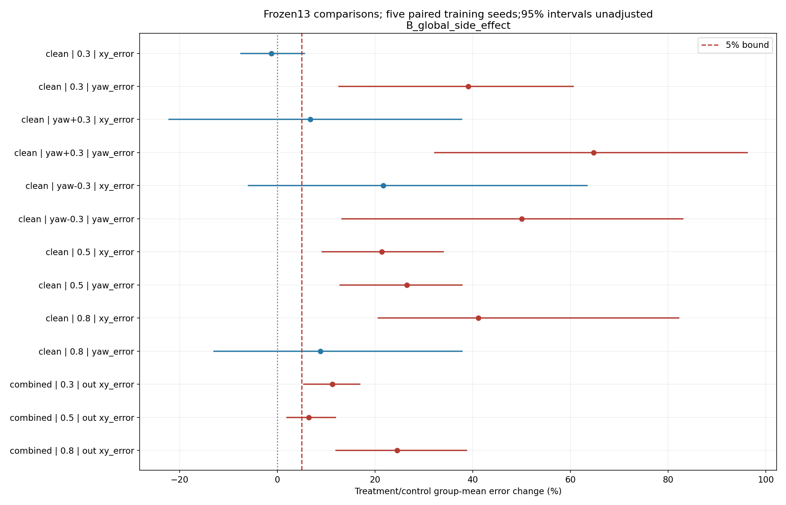
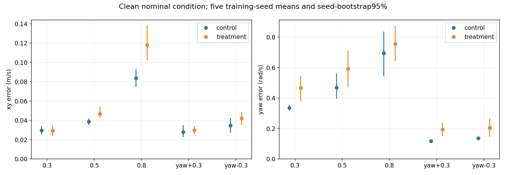
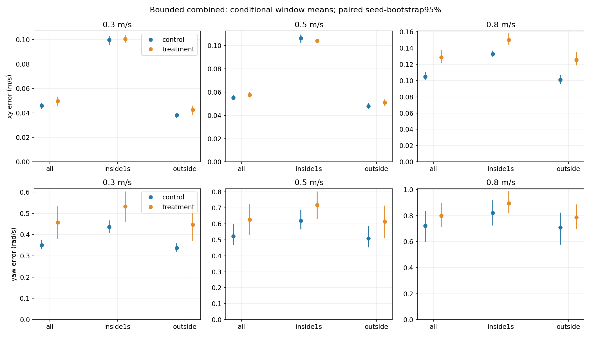
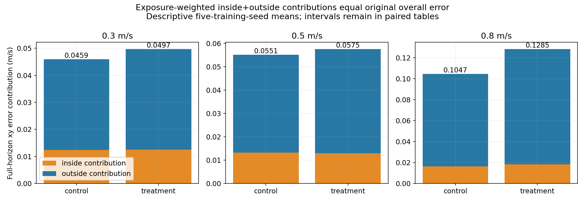
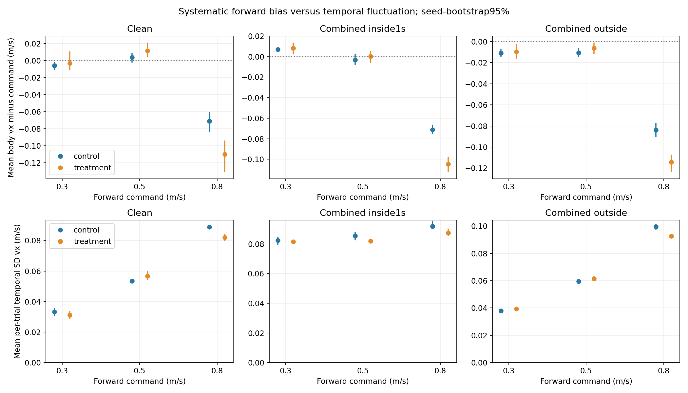
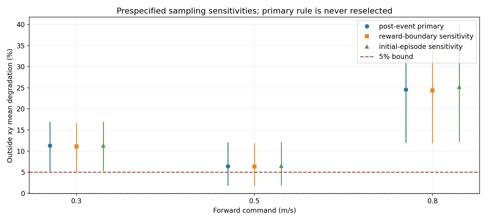

# Issue #13: where does post-push pitch recovery lose tracking?

Issue: https://github.com/weiguang52/HUMANOID_TW/issues/13 . Base commit: 0ec49f358d1634b62b7f8b149381809b54d23b9b.

**Analysis only: zero new training updates. The issue #12 rejection and all production defaults remain unchanged.**

## Result

B: at least one clean/outside tracking contrast supports a global side effect.

Frozen classification: **B_global_side_effect**. It does not grant policy acceptance or change the previous 10% tracking gate.

**The only next-step recommendation:** In a future user-authorized matched study, add the push-recovery clock to the critic only to test phase-aware value/credit assignment; do not implement it in this issue.
At least one frozen clean/outside tracking contrast worsens >5% with positive paired95% absolute difference. Reward timing is privileged but currently absent from critic observations; this is a structural hypothesis, not a proven remedy. No proposed structural change was implemented.

## Frozen decision contrasts

All clean xy/yaw errors for all five commands, plus combined OUTSIDE-window xy at all three forward speeds, are the 13 decision contrasts. A requires every treatment mean <=1.05*control mean. B requires any treatment mean >1.05*control mean AND its paired absolute-difference 95% lower endpoint >0. Otherwise the result is unresolved. A uses the specified point bounds, not an invented confidence non-inferiority test.

| Condition | Command | Metric (unit) | Control mean ± seed SD | Treatment mean ± seed SD | Relative change | Paired T-C 95% | <=5% point bound | Confirmed >5% |
|---|---|---|---|---|---|---|---|---|
| clean all | 0.3 m/s | xy_error (m/s) | 0.0296931 ± 0.00573966 | 0.0293287 ± 0.00673505 | -1.23% | [-0.00225573, 0.00186709] | True | False |
| clean all | 0.3 m/s | yaw_error (rad/s) | 0.33497 ± 0.0247277 | 0.465948 ± 0.107593 | +39.10% | [0.0427022, 0.202755] | False | True |
| clean all | yaw +0.3 rad/s | xy_error (m/s) | 0.0279598 ± 0.00808327 | 0.029836 ± 0.00530993 | +6.71% | [-0.00753446, 0.00913621] | False | False |
| clean all | yaw +0.3 rad/s | yaw_error (rad/s) | 0.117859 ± 0.016202 | 0.19418 ± 0.0586865 | +64.76% | [0.0370648, 0.115666] | False | True |
| clean all | yaw -0.3 rad/s | xy_error (m/s) | 0.034623 ± 0.0103177 | 0.0421224 ± 0.00777352 | +21.66% | [-0.00243666, 0.0174355] | False | False |
| clean all | yaw -0.3 rad/s | yaw_error (rad/s) | 0.135959 ± 0.0151008 | 0.204018 ± 0.0771415 | +50.06% | [0.0168422, 0.119308] | False | True |
| clean all | 0.5 m/s | xy_error (m/s) | 0.0386113 ± 0.00431746 | 0.046878 ± 0.00793294 | +21.41% | [0.0035472, 0.0137948] | False | True |
| clean all | 0.5 m/s | yaw_error (rad/s) | 0.467991 ± 0.102945 | 0.592221 ± 0.157202 | +26.55% | [0.0521303, 0.174903] | False | True |
| clean all | 0.8 m/s | xy_error (m/s) | 0.0837453 ± 0.0113302 | 0.118208 ± 0.0237397 | +41.15% | [0.0178267, 0.0620254] | False | True |
| clean all | 0.8 m/s | yaw_error (rad/s) | 0.695165 ± 0.186962 | 0.75623 ± 0.140912 | +8.78% | [-0.0977538, 0.217007] | False | False |
| combined outside | 0.3 m/s | xy_error (m/s) | 0.0382215 ± 0.00258031 | 0.0425308 ± 0.00501416 | +11.27% | [0.0019577, 0.00666096] | False | True |
| combined outside | 0.5 m/s | xy_error (m/s) | 0.0478622 ± 0.00350764 | 0.0509333 ± 0.00342559 | +6.42% | [0.000896189, 0.0055491] | False | True |
| combined outside | 0.8 m/s | xy_error (m/s) | 0.100772 ± 0.00653903 | 0.125512 ± 0.0105154 | +24.55% | [0.0126154, 0.0378902] | False | True |

Inference unit: FIVE matched training seeds. First average the three evaluation-seed summaries within each training seed, then give the five seeds equal weight. All 5^5=3,125 paired joint index resamples yield percentile 95% intervals. Seed SD uses ddof=1. **Multiple comparisons are not corrected**; the any-of-13 B rule and all exploratory intervals retain that limitation. Evaluation environments are not independent training replications. Shared upstream ancestry and fixed reset streams limit generalization.

Zero control means are handled explicitly: T=0 passes the point bound, T>0 is a degradation; undefined ratios are NA, with no pseudocount or invented infinity. Absolute paired intervals remain available.

[All paired differences and intervals](paired_metric_comparisons.csv) | [Full per-seed statistics](paired_comparisons.json) | [Decision](decision.json) | [Prospective protocol](protocol_plan.md)

## Cohort and clean-condition fidelity

Ten exact issue #12 final checkpoints, five control/treatment pairs; no checkpoint selection, optimizer updates or std reset. Clean: 30 jobs, 1,024 environments x three evaluation seeds x five separate commands x 20 seconds = 153,600 initial trials. Combined: 30 jobs x three forward speeds x 1,024 x 20 seconds = 92,160 initial trials. Total: **60 formal jobs, 240 command records, 245,760 initial trials**. Two later reconstruction jobs only capture selected existing trajectories and do not enlarge these denominators.

Clean uses the existing evaluator's clean switch: nominal per-link masses, actual robot static/dynamic friction 1.0/1.0, terrain friction 1.0/1.0, ordinary JointPositionAction (zero delay), no pushes, no observation noise and no material/mass randomization. These actual physics values are audited in every clean job. Policy/critic observations stay 101/134; model and optimizer state digests do not change under inference.

Clean retains the original evaluator order: forward 0.3, yaw +0.3, yaw -0.3, forward 0.5, forward 0.8. Combined retains 0.3/0.5/0.8. Paired resets use eval_seed*1000+command_index within each protocol and across models; different protocols do not claim identical physical draws.

## Falls, reported without substituting for tracking

| Condition | Command | Control falls/N | Control seed-mean 95% | Treatment falls/N | Treatment seed-mean 95% | Paired T-C 95% (percentage points) |
|---|---|---|---|---|---|---|
| clean | 0.3 m/s | 0/15360 (0.0000%) | [0, 0]% | 0/15360 (0.0000%) | [0, 0]% | [0, 0] |
| clean | yaw +0.3 rad/s | 0/15360 (0.0000%) | [0, 0]% | 0/15360 (0.0000%) | [0, 0]% | [0, 0] |
| clean | yaw -0.3 rad/s | 0/15360 (0.0000%) | [0, 0]% | 0/15360 (0.0000%) | [0, 0]% | [0, 0] |
| clean | 0.5 m/s | 0/15360 (0.0000%) | [0, 0]% | 0/15360 (0.0000%) | [0, 0]% | [0, 0] |
| clean | 0.8 m/s | 0/15360 (0.0000%) | [0, 0]% | 0/15360 (0.0000%) | [0, 0]% | [0, 0] |
| combined | 0.3 m/s | 140/15360 (0.9115%) | [0.709635, 1.10677]% | 95/15360 (0.6185%) | [0.449219, 0.729167]% | [-0.423177, -0.143229] |
| combined | 0.5 m/s | 375/15360 (2.4414%) | [1.94661, 2.9362]% | 261/15360 (1.6992%) | [1.28906, 2.10938]% | [-1.06771, -0.371094] |
| combined | 0.8 m/s | 1646/15360 (10.7161%) | [10.1432, 11.4714]% | 1208/15360 (7.8646%) | [7.14844, 8.48307]% | [-3.6263, -2.07682] |

Each policy/command pools 3,072 initial trials. Intervals use the five training seeds. Zero observed falls do not establish zero population risk. Every original issue #12 combined output field and all original trial/failure arrays were exactly reproduced by the augmented evaluator.

## Inside and outside the push-recovery window

Primary sampling matches issue #7/#12: non-terminal POST-STEP samples across the full 20 seconds, including later ordinary episodes after a failure reset. All initial environment/trial IDs remain represented. Per-trial sample counts and undefined zero-exposure cells are retained. The initial-episode-only sensitivity stops each environment at its first reset.

Primary recovery is post-event time [push, push+1s): post-step samples k..k+49 at dt=0.02. Clocks clear on reset BEFORE interval pushes, preventing cross-episode leakage. The training reward was computed before interval pushes, so its reward-aligned k+1..k+50 convention is separately reported as a one-step boundary sensitivity. They are not silently equated.

| Speed | Partition | Control xy (m/s) | Treatment xy | Paired xy T-C 95% | Control yaw (rad/s) | Treatment yaw | Paired yaw T-C 95% |
|---|---|---|---|---|---|---|---|
| 0.3 m/s | all | 0.0458909 | 0.0497298 | [0.00174183, 0.00593606] | 0.349812 | 0.45785 | [0.0269516, 0.174022] |
| 0.3 m/s | inside | 0.0996806 | 0.100332 | [-0.00128212, 0.00258404] | 0.435931 | 0.532835 | [0.0240304, 0.158108] |
| 0.3 m/s | outside | 0.0382215 | 0.0425308 | [0.0019577, 0.00666096] | 0.337531 | 0.447183 | [0.0274374, 0.177019] |
| 0.5 m/s | all | 0.0551229 | 0.0575463 | [0.000727643, 0.0043777] | 0.522311 | 0.62623 | [0.0390578, 0.159479] |
| 0.5 m/s | inside | 0.106223 | 0.103966 | [-0.00593133, 0.0026346] | 0.618635 | 0.716919 | [0.0324602, 0.155598] |
| 0.5 m/s | outside | 0.0478622 | 0.0509333 | [0.000896189, 0.0055491] | 0.508625 | 0.613309 | [0.0399348, 0.160001] |
| 0.8 m/s | all | 0.104688 | 0.128524 | [0.012068, 0.036741] | 0.721218 | 0.799527 | [-0.0543521, 0.196556] |
| 0.8 m/s | inside | 0.132795 | 0.149975 | [0.00713172, 0.028278] | 0.820866 | 0.894231 | [-0.0430959, 0.169728] |
| 0.8 m/s | outside | 0.100772 | 0.125512 | [0.0126154, 0.0378902] | 0.707335 | 0.786237 | [-0.0561733, 0.200185] |

| Speed | Partition | Control valid frame-samples | Treatment valid frame-samples | Control mean sample fraction | Treatment mean sample fraction |
|---|---|---:|---:|---|---|
| 0.3 m/s | inside | 1,916,830 | 1,913,173 | +12.48% | +12.46% |
| 0.3 m/s | outside | 13,443,028 | 13,446,732 | +87.52% | +87.54% |
| 0.5 m/s | inside | 1,911,326 | 1,915,436 | +12.44% | +12.47% |
| 0.5 m/s | outside | 13,448,293 | 13,444,298 | +87.56% | +87.53% |
| 0.8 m/s | inside | 1,878,408 | 1,890,683 | +12.23% | +12.31% |
| 0.8 m/s | outside | 13,479,791 | 13,468,009 | +87.77% | +87.69% |

Frame-samples are descriptive exposures, not the inferential sample size. The primary means pool valid frames within each evaluation job to reproduce #12; equal-trial conditional means are additionally retained as xy_equal_trial_mean/yaw_equal_trial_mean in all paired tables. Per-trial mean errors are in the losslessly compressed CSVs; both sampling scopes and both boundary conventions are fully retained in the raw moment NPZs.

| Speed | Overall xy T-C | Inside weighted contribution T-C 95% | Outside weighted contribution T-C 95% |
|---|---|---|---|
| 0.3 m/s | 0.00383895 | 5.71977e-05 [-0.00016798, 0.000276892] | 0.00378175 [0.00172061, 0.00584288] |
| 0.5 m/s | 0.0024234 | -0.00025228 [-0.000687183, 0.000353896] | 0.00267568 [0.000773768, 0.00483259] |
| 0.8 m/s | 0.0238361 | 0.00222011 [0.000930424, 0.00359253] | 0.021616 [0.0110217, 0.0331282] |

The inside/outside exposure-weighted contributions add exactly to the original overall error before and after averaging evaluation/training seeds. Contribution changes combine conditional error and occupancy/reset effects; these unadjusted comparisons do not prove a causal mechanism.

## Systematic slowing versus temporal fluctuation

Forward velocity is body-frame vx, consistent with the command. Bias = mean vx - target vx. Fluctuation = each trial's temporal population SD of vx about its own conditional mean (ddof=0), then an equal-trial mean over trials with samples. Pooled SD, weighted within-trial variance and between-trial mean variance are retained separately; within+between reconstructs total variance within each evaluation job/partition. They are not interchangeable. Signed velocity/bias contrasts use absolute paired intervals; relative changes are not interpreted for signed values.

| Condition/partition | Speed | Control vx | Treatment vx | Paired bias T-C 95% | Control temporal SD vx | Treatment temporal SD vx | Paired SD T-C 95% |
|---|---|---|---|---|---|---|---|
| clean/all | 0.3 m/s | 0.294329 | 0.297214 | 0.0028855 [-0.00341009, 0.0137319] | 0.0332191 | 0.0312617 | -0.0019574 [-0.00424848, -0.000347617] |
| clean/all | 0.5 m/s | 0.503898 | 0.511765 | 0.00786629 [-0.00168058, 0.0157171] | 0.0533954 | 0.05662 | 0.00322462 [0.000397813, 0.00672612] |
| clean/all | 0.8 m/s | 0.728932 | 0.689926 | -0.0390064 [-0.0684141, -0.0220284] | 0.0888322 | 0.0821003 | -0.00673183 [-0.00951854, -0.00394512] |
| combined/all | 0.3 m/s | 0.291395 | 0.29253 | 0.00113563 [-0.00463008, 0.00746403] | 0.0493081 | 0.0501214 | 0.000813319 [-0.000488938, 0.00211558] |
| combined/all | 0.5 m/s | 0.490402 | 0.494661 | 0.00425932 [-0.0023043, 0.0113389] | 0.066549 | 0.0671156 | 0.000566557 [-0.00193103, 0.00302337] |
| combined/all | 0.8 m/s | 0.717767 | 0.686792 | -0.0309751 [-0.0437843, -0.0186215] | 0.100788 | 0.0941632 | -0.00662462 [-0.00869307, -0.00455617] |
| combined/inside | 0.3 m/s | 0.306777 | 0.30808 | 0.00130339 [-0.00300574, 0.00723157] | 0.0824236 | 0.0815602 | -0.000863306 [-0.00231773, 0.000878542] |
| combined/inside | 0.5 m/s | 0.496693 | 0.500382 | 0.00368869 [-0.00278272, 0.0104117] | 0.085367 | 0.0818984 | -0.00346859 [-0.00677447, 0.000297413] |
| combined/inside | 0.8 m/s | 0.728777 | 0.695266 | -0.033511 [-0.0429036, -0.0235781] | 0.0919253 | 0.0875108 | -0.00441445 [-0.00998784, 0.000276871] |
| combined/outside | 0.3 m/s | 0.289201 | 0.290318 | 0.00111681 [-0.00490141, 0.00741542] | 0.0378557 | 0.0395058 | 0.00165011 [0.000547168, 0.00275306] |
| combined/outside | 0.5 m/s | 0.489508 | 0.493845 | 0.00433704 [-0.00230933, 0.0113993] | 0.0596148 | 0.0614231 | 0.00180832 [-0.000438015, 0.00409548] |
| combined/outside | 0.8 m/s | 0.716233 | 0.685604 | -0.0306289 [-0.0440021, -0.0179452] | 0.0995975 | 0.0926144 | -0.00698306 [-0.00888144, -0.00452305] |

All values in the velocity/SD table are m/s. Lateral and angular means/temporal SDs and all paired intervals are also in the complete tables.

At 0.8 m/s under clean/all, forward-speed change is -0.0390064 m/s, paired 95% [-0.0684141, -0.0220284] (lower); temporal SD change is -0.00673183 m/s, paired 95% [-0.00951854, -0.00394512].
At 0.8 m/s under combined/outside, forward-speed change is -0.0306289 m/s, paired 95% [-0.0440021, -0.0179452] (lower); temporal SD change is -0.00698306 m/s, paired 95% [-0.00888144, -0.00452305].

## Prespecified sensitivities

| Analysis | Classification |
|---|---|
| Primary full-horizon post-event window | B_global_side_effect |
| Reward-aligned one-step boundary | B_global_side_effect |
| Initial episode only | B_global_side_effect |

The primary criterion is never reselected after seeing a sensitivity result. Full sensitivity means and intervals are retained, including zero-exposure counts.

## Two representative trials and four exact-state videos

For each group choose the trial nearest the group's median full-horizon 0.8 m/s xy error across all 15,360 combined trials; ties: training seed, evaluation seed, environment ID. No survival filter is applied. These are median illustrations, not worst-case or new acceptance samples. Selected original 1,024-env evaluations are reconstructed only to capture states; all original metrics, full records and moments match exactly.

| Group | Model / eval seed / env | Selected xy / group median | Push times (s) | Reset frames | Front | Side |
|---|---|---|---|---|---|---|
| control | control_s3 / 3 / 977 | 0.103269 / 0.103272 | 5.34, 11.76, 18.40 | [] | [Front](videos/control_front.mp4) | [Side](videos/control_side.mp4) |
| treatment | treatment_s3 / 1 / 833 | 0.127183 / 0.127183 | 6.82, 12.90, 19.62 | [] | [Front](videos/treatment_front.mp4) | [Side](videos/treatment_side.mp4) |

Each clip has 1,000 frames at 50 fps, 960x720, 20 seconds. Playback writes the exact recorded post-step root/joint states and does NOT integrate new physics. The two views within a selected trial share exact source samples/times; control and treatment examples are not synchronized to each other. A red timeline marks actual push times, with the following one-second interval shaded; reset frames are explicitly labeled and excluded from metrics.

The display uses the exact precolored experiment asset: 1,876 original non-material/physics attributes preserved, no material binding after initialization. Camera follows translation AND heading. Display mass/materials are nominal; the source randomized physics are documented but not re-integrated. [Joint-color legend](joint_colors.json). Stage1 velocity commands have no HumanML source NPY: **N/A**.

All four encodings/frame counts, 24 sampled frames (including a near-push response sample per clip), two contact sheets, four full-resolution motion frames and six statistical figures were checked. Attachment/color/framing review is sampled, not a claim about every pixel of every frame. See [automated video audit](video_quality_audit.json) and [actual manual review](video_physics_manual_audit.json).

## Validation, artifacts and traceability

Ten analytic/window/reset/bootstrap unit tests pass. Original-vs-observed clean and combined runtime smoke runs have bitwise-equal original output fields, final root/joint states and full CPU/CUDA/NumPy/Python RNG states. Combined full-trial/failure arrays also match. The observer samples no RNG and writes no actions, policy observations, reward configuration or physics. Independent CPU reconstruction checks every packed time mask/count, sums/second moments, mixture/variance identity and raw reference-environment moments for all 240 command records.

The protocol and 42 behavior/dependency/statistical source hashes were frozen before formal evaluation. Later derived-analysis/plot/replay/report code is bound by source/output SHA records, rather than being falsely described as frozen before formal data. Only the requested clean evaluation condition switches differ from combined; no production or training configuration is edited.

[Requirement audit](delivery_integrity_audit.json) | [Full input/moment integrity](analysis_integrity_audit.json) | [Smoke proof](runtime_smoke_audit.json) | [Frozen sources](frozen_sources.json) | [Analysis source/output hashes](analysis_outputs_sha256.json) | [Per-trial CSV manifest](per_trial_csv_manifest.json) | [Representative selection](representative_selection.json)

Raw per-trial count/sum/sum-of-squares arrays, packed masks, per-step cohort moments, sampled raw reference values, actual startup physics/configs and full combined trial/failure records are included. The primary human-readable per-trial CSVs contain 430,080 rows: clean/all plus combined/all/inside/outside; all additional scopes/boundaries remain losslessly in raw NPZs. All IDs and zero-exposure cells remain present. Model checkpoints are unchanged and already committed in the issue #12 bundle; verified references avoid duplicating them.

| Model | Existing full checkpoint | SHA256 |
|---|---|---|
| control_s1 | [Checkpoint](../stage1_issue12_20261110/models/control_s1/model_13493.pt) | a2188ed0e259882be63a364fce71cdc614b4534291b26e285c3fcc5e7a566552 |
| treatment_s1 | [Checkpoint](../stage1_issue12_20261110/models/treatment_s1/model_13493.pt) | 40e796e5f787d2d35aa8cbb5ac53c611a879316211850d482d8a04bb2c9c90cd |
| control_s2 | [Checkpoint](../stage1_issue12_20261110/models/control_s2/model_13493.pt) | bdf2c1889f40eefa818aa0bf8bf079ccb766d3b1a47180cad4477d91c0d122c7 |
| treatment_s2 | [Checkpoint](../stage1_issue12_20261110/models/treatment_s2/model_13493.pt) | 264bbbfbdf3ecc63df601f5f1c33bd87f87861f4cbe12986a76b257ea87ca1d6 |
| control_s3 | [Checkpoint](../stage1_issue12_20261110/models/control_s3/model_13493.pt) | 3a8e1c160d1b0cefa23b300415bea0a762fd52a48141f88dac4558a5d9757e96 |
| treatment_s3 | [Checkpoint](../stage1_issue12_20261110/models/treatment_s3/model_13493.pt) | 8bfd008824e6080bfc3fa607631b192015a5888c1be45934ad4506cd6981eb90 |
| control_s4 | [Checkpoint](../stage1_issue12_20261110/models/control_s4/model_13493.pt) | ff26d6474131eed034f5f923c525c8147d5a241078e2d5e90205f3bf1f88575e |
| treatment_s4 | [Checkpoint](../stage1_issue12_20261110/models/treatment_s4/model_13493.pt) | 063fe975ddc90f0cfbc8edd29ba443c9f48523a0ce84725feaefc180ed347057 |
| control_s5 | [Checkpoint](../stage1_issue12_20261110/models/control_s5/model_13493.pt) | 09a25318b57f8ed26e63201cf734674b46cc64b6e7efeb15ee15a4b17107899f |
| treatment_s5 | [Checkpoint](../stage1_issue12_20261110/models/treatment_s5/model_13493.pt) | 0811c563f7b15234a391e1c7c2fb952aba0a1c43d9efc5071ac9eaef2894ab4a |

All originals and generated artifacts remain on the remote data disk. No mounted files were copied locally; visual review uses in-memory SSH image chunks. Archived logs strip ANSI/trailing whitespace and SVG trailing whitespace is normalized without changing geometry. sha256.json covers every archive file except itself; worktree/index/commit objects and actual GitHub branch/tree are verified on publication.

GitHub results and task status are synchronized to [Notion](https://www.notion.so/403325d8231d8172995bf19510b8d760). Notion replaces Linear. No new training or acceptance/default promotion is authorized by this diagnostic outcome.
