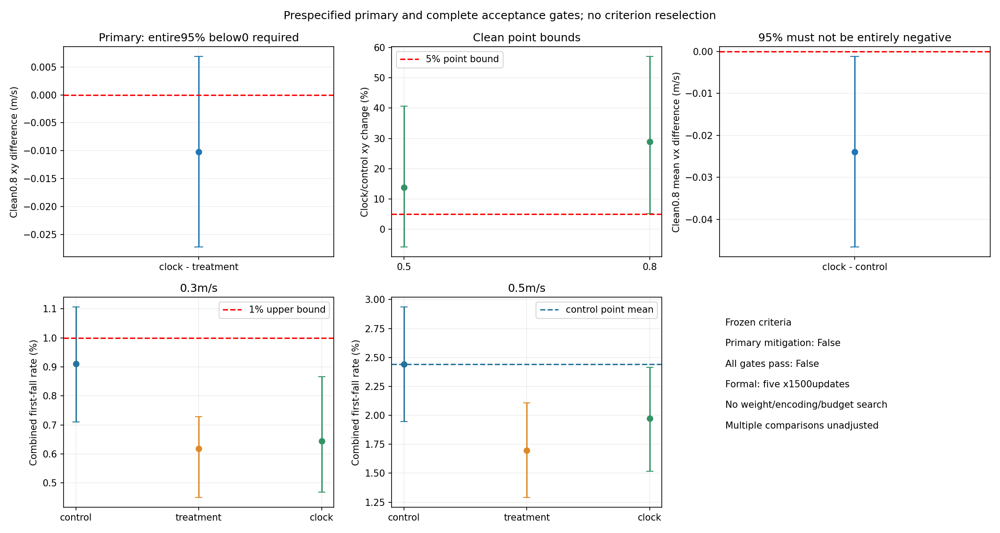
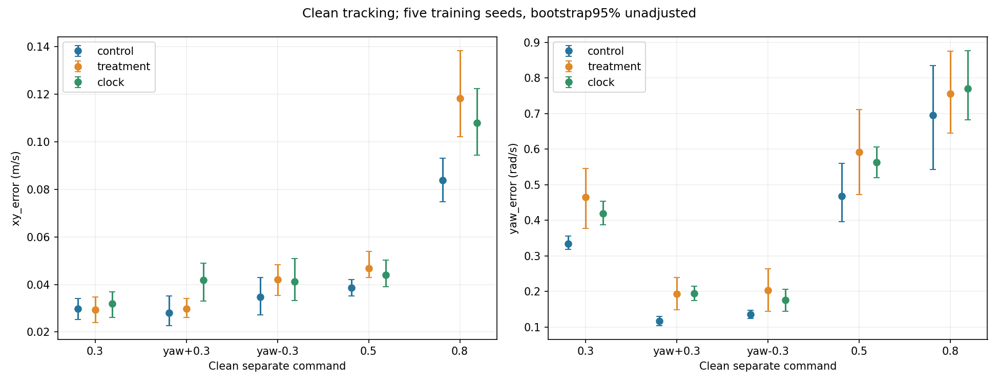
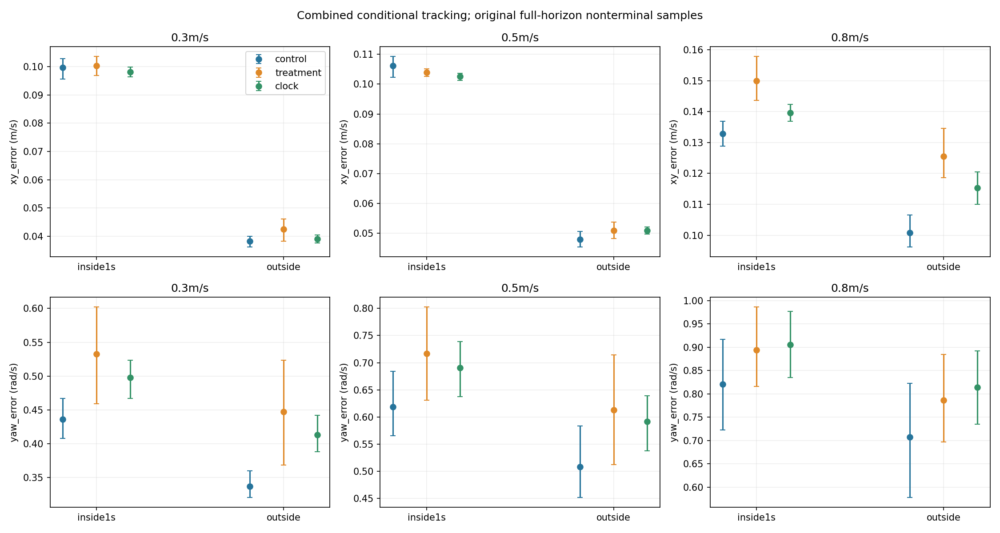
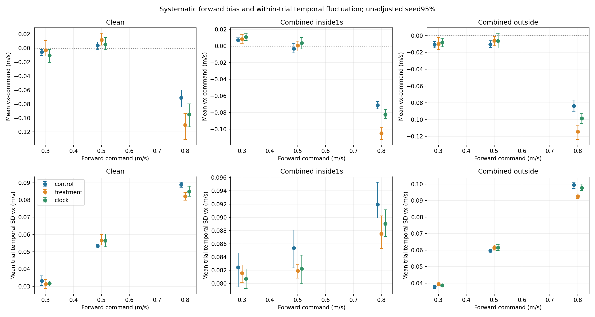
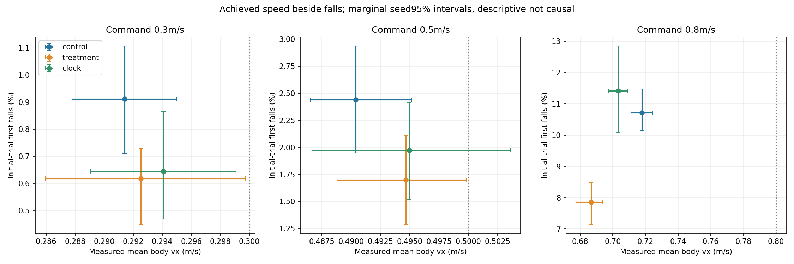
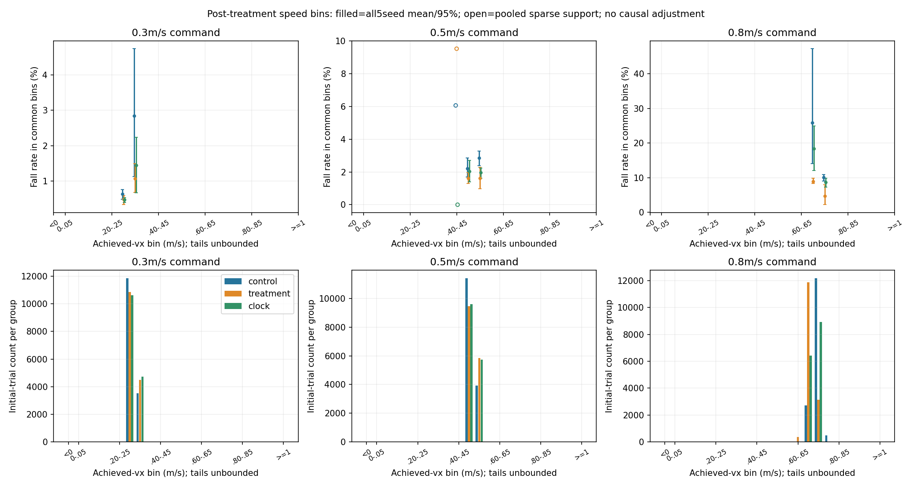

# Issue #14: critic-only push-recovery clock

Issue: https://github.com/weiguang52/HUMANOID_TW/issues/14 . Base: 5a1f8b9a96a4b5d44cd8de2bc0900332d88e07bb.

**Five fixed-budget training runs and both evaluation protocols completed. No extra formal updates, weight/encoding search, std reset or default promotion.**

## Frozen result

Primary mitigation is **NOT supported**. Clean0.8 xy CLOCK minus old TREATMENT = -0.0102037m/s, paired95% [-0.0273015, 0.00689401]. The upper endpoint must be strictly below0.
All complete acceptance gates pass: **False**.
The clock hypothesis stops after this study because its primary criterion was not supported.
The previous issue12 rejection and issue13 diagnosis are historical results, not rewritten by this comparison. Production defaults remain unchanged.

| Frozen criterion | Passed |
|---|---|
| primary_clean08_xy_vs_treatment_upper95_below_zero | False |
| clean05_xy_vs_control_mean_degradation_at_most5percent | False |
| clean08_xy_vs_control_mean_degradation_at_most5percent | False |
| clean08_mean_vx_vs_control95_interval_not_entirely_negative | False |
| combined03_clock_seed_level_fall95_upper_below1percent | True |
| combined05_clock_mean_falls_not_above_control | True |

Inference unit: FIVE matched training seeds. Within each training seed average the three evaluation-seed summaries, then weight all five seeds equally. All5^5=3,125 paired joint bootstrap index samples give percentile95% intervals; **multiple comparisons are unadjusted**. The environment count is not an independent training-replication count. Shared ancestry and reused fixed reset streams limit generalization. Point tracking bounds are the specified<=5% group-mean bounds; no confidence non-inferiority criterion is substituted. The clean0.8 vx requirement passes only if the clock-minus-control95% interval is not entirely negative.

[Prospective protocol](protocol_plan.md) | [Frozen decision](decision.json) | [All paired intervals](paired_metric_comparisons.csv) | [Per-seed statistics](paired_comparisons.json)

## The sole intervention and preserved full-state resume

Only the optional critic recovery clock differs: active0/1 and normalized remaining time, critic134->136. Actor/policy101 and hidden512/256/128 layers remain unchanged. The existing post-push pitch reward weight is exactly34.67877532210905; all original reward, physical, push/noise/delay distributions and old observation terms remain unchanged.

The feature uses the SAME original reward push_window and push_clock. At dt0.02 it is active at ages0..50 inclusive; remaining=clamp(1-age/50,0,1), zero outside. At age50 flag=1,remaining=0; at age51 both zero. Reset clears the original shared timer. Isaac ordering is reward -> reset -> interval push -> observation: a newly marked push appears in the next observation at age0 and first affects the next reward at age1. This preserves existing reward semantics rather than substituting issue13's analysis boundary.

Construct the original134-wide critic/buffers, strictly restore each original4500 parent actor/critic/full Adam/std/iteration, audit equality, THEN append two zero weight columns and two zero Adam moment columns. Old optimizer steps/parameter groups and every old tensor element are preserved. No new random initialization; same-state actor output is bitwise equal before/after migration. [Source equivalence](historical_source_equivalence_audit.json) | [Default-off AST proof](default_off_source_audit.json) | [Runtime smoke proof](runtime_smoke_audit.json)

## Fixed training budget and monitoring

Exactly the same five requested4500 parents used by issue12, seeds1..5,4096environments,1500additional PPO updates each (7500total). Full actor/critic/Adam/std restored, no std reset, no intermediate checkpoint choice. The final checkpoint iteration equals the original parent iteration+1499, following the runner's existing inclusive logging convention. The original control/treatment groups and their exact issue13 evaluations are reused, not retrained.

Preflight:10unit tests; two-update legacy vs switch-off PPO states/std exactly equal, reward CSV bytes equal; clock-on two-update smoke;1000-step clock-on deterministic parent rollout exactly equal to archived original treatment rewards/costs/root/joint/all CPU/CUDA/Python/NumPy RNG. Six smoke updates at64envs are separate from7500formal updates, and no smoke checkpoint is used as a formal candidate/parent. Two zero-update64-env evaluation adapter smokes validate clean/combined136-wide loading. Early preflight dtype/import/signature issues were corrected before the final gates/source freeze.

| Model | Parent | Additional updates | Final checkpoint | Initial critic expansion | Training audit |
|---|---|---|---|---|
| clock_s1 | [requested4500](../stage1_issue10_20261109/models/requested_s1_u4500/model_11994.pt) |1500| [Full model/optimizer](models/clock_s1/model_13493.pt) |134->136,zero new weights/moments| [Audit](training/clock_s1/critic_clock_migration.json) |
| clock_s2 | [requested4500](../stage1_issue10_20261109/models/requested_s2_u4500/model_11994.pt) |1500| [Full model/optimizer](models/clock_s2/model_13493.pt) |134->136,zero new weights/moments| [Audit](training/clock_s2/critic_clock_migration.json) |
| clock_s3 | [requested4500](../stage1_issue10_20261109/models/requested_s3_u4500/model_11994.pt) |1500| [Full model/optimizer](models/clock_s3/model_13493.pt) |134->136,zero new weights/moments| [Audit](training/clock_s3/critic_clock_migration.json) |
| clock_s4 | [requested4500](../stage1_issue10_20261109/models/requested_s4_u4500/model_11994.pt) |1500| [Full model/optimizer](models/clock_s4/model_13493.pt) |134->136,zero new weights/moments| [Audit](training/clock_s4/critic_clock_migration.json) |
| clock_s5 | [requested4500](../stage1_issue10_20261109/models/requested_s5_u4500/model_11994.pt) |1500| [Full model/optimizer](models/clock_s5/model_13493.pt) |134->136,zero new weights/moments| [Audit](training/clock_s5/critic_clock_migration.json) |

Every formal run's env/agent YAML was compared with its archived issue12 TREATMENT: only the new critic term and log/run metadata differ. Its initial4096-env physical state and complete RNG match that treatment bitwise. All1500iterations and Adam step increments are audited; original reward contribution/identity monitoring is retained. [Training audits](training_audits.json). Per-model params, load/expansion audit, initial states and all1500reward-monitor rows are included.

## Evaluation and clean-condition fidelity

New CLOCK group:30formal jobs=120commands=122,880initial trials (76,800clean +46,080combined). Old control/treatment:60jobs=240commands=245,760initial trials reused exactly from the committed issue13 bundle. Combined three-group summaries cover368,640initial trials without pretending reused trials are new replications.

Each final model:1024environments x3evaluation seeds x20s. Clean commands retain original order forward0.3,yaw+0.3,yaw-0.3,forward0.5,forward0.8; combined0.3/0.5/0.8. Deterministic actor and original paired reset seed=eval_seed*1000+command_index. Different protocols do not claim identical physical draws. Actual clean masses are nominal, robot/terrain static+dynamic friction1.0, no pushing/noise/material/mass randomization,ordinary zero-delay JointPositionAction. Policy/critic dims are101/136 only for CLOCK,101/134 for historical groups; inference never changes model/Adam state.

| Clean command | Metric | Control mean | Treatment mean | Clock mean | Clock-control difference95% | Clock-treatment difference95% |
|---|---|---|---|---|---|---|
| 0.3m/s |xy_error|0.0296931|0.0293287|0.0319065|0.00221344 [-0.000922324, 0.00534921]|0.00257783 [-0.000344844, 0.00660545]|
| 0.3m/s |yaw_error|0.33497|0.465948|0.419654|0.0846833 [0.057935, 0.115696]|-0.046294 [-0.133097, 0.0462476]|
| yaw+0.3rad/s |xy_error|0.0279598|0.029836|0.0417473|0.0137875 [-0.00186263, 0.0241487]|0.0119113 [0.0038846, 0.0202097]|
| yaw+0.3rad/s |yaw_error|0.117859|0.19418|0.194731|0.0768716 [0.0647973, 0.0889459]|0.000550955 [-0.0395395, 0.0447635]|
| yaw-0.3rad/s |xy_error|0.034623|0.0421224|0.0412682|0.00664525 [-0.00313505, 0.019786]|-0.00085415 [-0.0107144, 0.00829518]|
| yaw-0.3rad/s |yaw_error|0.135959|0.204018|0.175819|0.0398603 [0.00432245, 0.0753982]|-0.0281983 [-0.0846772, 0.0210681]|
| 0.5m/s |xy_error|0.0386113|0.046878|0.0439369|0.00532563 [-0.00239523, 0.0144756]|-0.0029411 [-0.0125817, 0.0060822]|
| 0.5m/s |yaw_error|0.467991|0.592221|0.563432|0.0954412 [0.0378117, 0.139468]|-0.0287888 [-0.107757, 0.0504196]|
| 0.8m/s |xy_error|0.0837453|0.118208|0.108004|0.0242586 [0.00462644, 0.0438907]|-0.0102037 [-0.0273015, 0.00689401]|
| 0.8m/s |yaw_error|0.695165|0.75623|0.77078|0.075615 [-0.0539301, 0.190483]|0.0145499 [-0.0780901, 0.114158]|

xy units m/s; yaw units rad/s. All group95%/seed SD and all pairwise differences are in the complete tables.

## First-fall rates, with all three groups

| Condition | Command | Group | Falls/N | Seed mean95% (%) |
|---|---|---|---|---|
|clean|0.3m/s|control|0/15360 (0.0000%)|[0, 0]|
|clean|0.3m/s|treatment|0/15360 (0.0000%)|[0, 0]|
|clean|0.3m/s|clock|0/15360 (0.0000%)|[0, 0]|
|clean|yaw+0.3rad/s|control|0/15360 (0.0000%)|[0, 0]|
|clean|yaw+0.3rad/s|treatment|0/15360 (0.0000%)|[0, 0]|
|clean|yaw+0.3rad/s|clock|1/15360 (0.0065%)|[0, 0.0195312]|
|clean|yaw-0.3rad/s|control|0/15360 (0.0000%)|[0, 0]|
|clean|yaw-0.3rad/s|treatment|0/15360 (0.0000%)|[0, 0]|
|clean|yaw-0.3rad/s|clock|0/15360 (0.0000%)|[0, 0]|
|clean|0.5m/s|control|0/15360 (0.0000%)|[0, 0]|
|clean|0.5m/s|treatment|0/15360 (0.0000%)|[0, 0]|
|clean|0.5m/s|clock|0/15360 (0.0000%)|[0, 0]|
|clean|0.8m/s|control|0/15360 (0.0000%)|[0, 0]|
|clean|0.8m/s|treatment|0/15360 (0.0000%)|[0, 0]|
|clean|0.8m/s|clock|0/15360 (0.0000%)|[0, 0]|
|combined|0.3m/s|control|140/15360 (0.9115%)|[0.709635, 1.10677]|
|combined|0.3m/s|treatment|95/15360 (0.6185%)|[0.449219, 0.729167]|
|combined|0.3m/s|clock|99/15360 (0.6445%)|[0.46875, 0.865885]|
|combined|0.5m/s|control|375/15360 (2.4414%)|[1.94661, 2.9362]|
|combined|0.5m/s|treatment|261/15360 (1.6992%)|[1.28906, 2.10938]|
|combined|0.5m/s|clock|303/15360 (1.9727%)|[1.51693, 2.41536]|
|combined|0.8m/s|control|1646/15360 (10.7161%)|[10.1432, 11.4714]|
|combined|0.8m/s|treatment|1208/15360 (7.8646%)|[7.14844, 8.48307]|
|combined|0.8m/s|clock|1754/15360 (11.4193%)|[10.0911, 12.8451]|

[All paired fall differences](fall_results.json). Every seed pools3072initial trials per command. Zero observed falls do not establish zero population risk. Fall reduction cannot substitute for failed tracking/speed gates.

## Inside/outside push windows and bias versus fluctuation

The issue13 analysis definition is preserved: full20s nonterminal POST-STEP samples, including ordinary episodes after failure resets. Main push window is[push,push+1s),ages0..49; a separate ages1..50 reward-aligned boundary and initial-episode-only scope remain in raw moment/stat tables. These descriptive partitions do not change the training clock. Per-trial count/sum/sumsq, packed masks, per-step moments and raw reference-environment samples are retained. Exposure-weighted inside+outside contributions reconstruct overall error; counts/exposures and equal-trial means remain available.

| Speed | Partition | Group | xy(m/s) | yaw(rad/s) | vx(m/s) | mean trial temporal SD vx(m/s) |
|---|---|---|---|---|---|---|
|0.3m/s|all|control|0.0458909|0.349812|0.291395|0.0493081|
|0.3m/s|all|treatment|0.0497298|0.45785|0.29253|0.0501214|
|0.3m/s|all|clock|0.0463464|0.423848|0.29407|0.0492314|
|0.3m/s|inside|control|0.0996806|0.435931|0.306777|0.0824236|
|0.3m/s|inside|treatment|0.100332|0.532835|0.30808|0.0815602|
|0.3m/s|inside|clock|0.0980669|0.497936|0.310804|0.0807166|
|0.3m/s|outside|control|0.0382215|0.337531|0.289201|0.0378557|
|0.3m/s|outside|treatment|0.0425308|0.447183|0.290318|0.0395058|
|0.3m/s|outside|clock|0.0389968|0.413321|0.291692|0.0386135|
|0.5m/s|all|control|0.0551229|0.522311|0.490402|0.066549|
|0.5m/s|all|treatment|0.0575463|0.62623|0.494661|0.0671156|
|0.5m/s|all|clock|0.0572795|0.604212|0.494963|0.0672278|
|0.5m/s|inside|control|0.106223|0.618635|0.496693|0.085367|
|0.5m/s|inside|treatment|0.103966|0.716919|0.500382|0.0818984|
|0.5m/s|inside|clock|0.102604|0.690631|0.503242|0.0822271|
|0.5m/s|outside|control|0.0478622|0.508625|0.489508|0.0596148|
|0.5m/s|outside|treatment|0.0509333|0.613309|0.493845|0.0614231|
|0.5m/s|outside|clock|0.0508124|0.591882|0.493781|0.061587|
|0.8m/s|all|control|0.104688|0.721218|0.717767|0.100788|
|0.8m/s|all|treatment|0.128524|0.799527|0.686792|0.0941632|
|0.8m/s|all|clock|0.118262|0.824808|0.703307|0.0988441|
|0.8m/s|inside|control|0.132795|0.820866|0.728777|0.0919253|
|0.8m/s|inside|treatment|0.149975|0.894231|0.695266|0.0875108|
|0.8m/s|inside|clock|0.1396|0.905655|0.717259|0.0890368|
|0.8m/s|outside|control|0.100772|0.707335|0.716233|0.0995975|
|0.8m/s|outside|treatment|0.125512|0.786237|0.685604|0.0926144|
|0.8m/s|outside|clock|0.115307|0.813607|0.701375|0.0977712|

Bias=mean body vx minus command. Temporal fluctuation is EACH trial's population SD about its own conditional mean(ddof0), then an equal-trial mean among trials with samples. Pooled SD and within/between-trial variance are separately retained and their identity audited; they are not interchangeable. Signed bias/velocity ratios are not interpreted. Undefined zero-exposure cells remain present, with no pseudocounts.

## Secondary achieved-speed/fall comparison

| Condition | Command | Group | Measured vx95%(m/s) | Temporal SD vx | First-fall seed mean95%(%) |
|---|---|---|---|---|
|clean|0.3m/s|control|0.294329 [0.289486, 0.298122]|0.0332191|0.0000 [0, 0]|
|clean|0.3m/s|treatment|0.297214 [0.288538, 0.310967]|0.0312617|0.0000 [0, 0]|
|clean|0.3m/s|clock|0.289884 [0.279263, 0.298114]|0.0316928|0.0000 [0, 0]|
|clean|0.5m/s|control|0.503898 [0.497829, 0.508862]|0.0533954|0.0000 [0, 0]|
|clean|0.5m/s|treatment|0.511765 [0.504056, 0.52138]|0.05662|0.0000 [0, 0]|
|clean|0.5m/s|clock|0.505452 [0.497916, 0.515368]|0.0564947|0.0000 [0, 0]|
|clean|0.8m/s|control|0.728932 [0.715795, 0.740071]|0.0888322|0.0000 [0, 0]|
|clean|0.8m/s|treatment|0.689926 [0.669037, 0.706181]|0.0821003|0.0000 [0, 0]|
|clean|0.8m/s|clock|0.705015 [0.687272, 0.720095]|0.0848719|0.0000 [0, 0]|
|combined|0.3m/s|control|0.291395 [0.287795, 0.294994]|0.0493081|0.9115 [0.709635, 1.10677]|
|combined|0.3m/s|treatment|0.29253 [0.285936, 0.299706]|0.0501214|0.6185 [0.449219, 0.729167]|
|combined|0.3m/s|clock|0.29407 [0.289067, 0.299073]|0.0492314|0.6445 [0.46875, 0.865885]|
|combined|0.5m/s|control|0.490402 [0.486544, 0.495163]|0.066549|2.4414 [1.94661, 2.9362]|
|combined|0.5m/s|treatment|0.494661 [0.488798, 0.499824]|0.0671156|1.6992 [1.28906, 2.10938]|
|combined|0.5m/s|clock|0.494963 [0.486674, 0.503603]|0.0672278|1.9727 [1.51693, 2.41536]|
|combined|0.8m/s|control|0.717767 [0.711083, 0.724362]|0.100788|10.7161 [10.1432, 11.4714]|
|combined|0.8m/s|treatment|0.686792 [0.677491, 0.693924]|0.0941632|7.8646 [7.14844, 8.48307]|
|combined|0.8m/s|clock|0.703307 [0.697373, 0.709242]|0.0988441|11.4193 [10.0911, 12.8451]|

At 0.3m/s, common achieved-speed-bin coverage (control/treatment/clock) = 100.0% / 99.9% / 100.0%.
clock_vs_control: direction_unresolved_not_equivalence; fewer_falls. The achieved-speed direction is unresolved; inclusion of zero is not evidence of speed equivalence, so a slowing contribution cannot be excluded.
clock_vs_treatment: direction_unresolved_not_equivalence; fall_difference_unresolved. This contrast does not establish a fall-rate reduction, so it cannot demonstrate improved recovery. The achieved-speed direction is unresolved; inclusion of zero is not evidence of speed equivalence, so a slowing contribution cannot be excluded.

At 0.5m/s, common achieved-speed-bin coverage (control/treatment/clock) = 100.0% / 100.0% / 100.0%.
clock_vs_control: direction_unresolved_not_equivalence; fall_difference_unresolved. This contrast does not establish a fall-rate reduction, so it cannot demonstrate improved recovery. The achieved-speed direction is unresolved; inclusion of zero is not evidence of speed equivalence, so a slowing contribution cannot be excluded.
clock_vs_treatment: direction_unresolved_not_equivalence; fall_difference_unresolved. This contrast does not establish a fall-rate reduction, so it cannot demonstrate improved recovery. The achieved-speed direction is unresolved; inclusion of zero is not evidence of speed equivalence, so a slowing contribution cannot be excluded.

At 0.8m/s, common achieved-speed-bin coverage (control/treatment/clock) = 96.8% / 97.6% / 99.9%.
clock_vs_control: slower; fall_difference_unresolved. This contrast does not establish a fall-rate reduction, so it cannot demonstrate improved recovery. Lower achieved speed remains a plausible contributor to any observed lower fall rate.
clock_vs_treatment: faster; more_falls. This contrast does not establish a fall-rate reduction, so it cannot demonstrate improved recovery. This candidate is faster on the marginal mean; a lower marginal mean speed does not explain any observed fall reduction in these summaries. This is not proof of a recovery mechanism.

The table explicitly compares falls at the speeds each group ACTUALLY achieved; equal commanded speed is not claimed to be equal achieved speed. Secondary fixed0.05m/s bins over0..1 with under/overflow retain every trial and provide common-support counts/falls for all three groups. Five-seed paired bootstrap intervals are given ONLY where all five paired seed denominators are nonzero; unsupported cells remain NA. Open plot markers show pooled sparse-support descriptive rates, not invented seed-level estimates.

**Achieved speed is post-treatment and can itself be affected by falls/resets.** Conditioning on its full-horizon trial mean has survival/occupancy bias. These tables can expose remaining speed mismatch or lack of common support, but do not identify a causal speed-adjusted recovery effect. A lower fall rate with lower achieved speed remains compatible with slowing; matched bins alone cannot prove a recovery mechanism.

[Per-trial achieved speeds/failures](actual_speed_trial_rows.csv) | [Common-bin counts/rates](actual_speed_fall_bins.csv) | [Supported paired bin intervals](actual_speed_bin_paired_comparisons.json). Initial-episode sensitivity is reported without reselecting the primary criterion: [Sensitivity](classification_sensitivity.json).

## Three true-median examples and six colored videos

Each group's0.8 combined example is nearest its group median xy error across all15360initial trials, no survival filter; ties trainingseed,evalseed,envid. Median examples illustrate, not determine acceptance. Historical selections/media are byte-identically reused; the new selected1024-env evaluation is reconstructed only to capture the same source states, with original results/arrays/moments exactly reproduced and no new formal denominator.

| Group | Model/eval seed/env | xy/group median | Actual push times(s) | Reset frames | Front | Side |
|---|---|---|---|---|---|---|
|control|control_s3/3/977|0.103269/0.103272|5.34, 11.76, 18.40|[]|[Front](videos/control_front.mp4)|[Side](videos/control_side.mp4)|
|treatment|treatment_s3/1/833|0.127183/0.127183|6.82, 12.90, 19.62|[]|[Front](videos/treatment_front.mp4)|[Side](videos/treatment_side.mp4)|
|clock|clock_s3/3/475|0.117613/0.117611|7.12, 14.80|[]|[Front](videos/clock_front.mp4)|[Side](videos/clock_side.mp4)|

All clips20s,1000frames,50fps,960x720,H264. Exact recorded root pose/world velocity and joint positions are displayed with NO physics re-integration; display joint velocities are set to zero, so this is a pose replay rather than a new dynamics rollout; front/side share exact source frames within each group, while different groups are NOT synchronized. Numeric push times, red ticks/window shading and reset labels are shown. Video recovery labels/shading use the issue13 POST-EVENT ANALYSIS interval[push,push+1s),ages0..49; they are not a visualization of the critic feature/reward mask, whose existing inclusive age50 endpoint is separately preserved. Camera follows translation AND heading. Display uses the separately precolored exact experiment asset with1876original attributes preserved; no runtime material rebinding. Nominal display materials/masses do not re-integrate source randomization. [Joint-color legend](joint_colors.json). Stage1 velocity commands have no HumanML sourceNPY: **N/A**.

Six encodings and36sampled frames, three contact sheets, six full-resolution motion/near-push frames and six statistical figures were actually checked. Review is sampled attachment/color/framing, not exhaustive every-frame pixel validation. [Video audit](video_quality_audit.json) | [Actual manual observations](video_physics_manual_audit.json). Any initial cosmetic ground grain is described in that review, without changing source trajectories.

## Raw evidence and reproducibility

[Requirement audit](delivery_integrity_audit.json) | [Raw-data/moment audit](analysis_integrity_audit.json) | [Frozen43training dependencies](frozen_training_sources.json) | [Derived source/output binding](analysis_outputs_sha256.json) | [Per-trial645120row manifest](per_trial_csv_manifest.json) | [Representative selection](representative_selection.json) | [Old input file references](historical_artifact_references.json)

New raw clean/combined moments, original full-trial/failure records, startup physics/configs, all1500-update monitors and full final checkpoints/Adam states are archived here. Historical raw inputs and ten checkpoints remain in their original committed bundles with exact verified references; no duplicate retraining/re-evaluation is represented as new evidence. All645120human-readable primary per-trial rows are included, while both sampling scopes and both boundaries remain losslessly in raw moments. Derived analysis/plot/media/report code was written after the formal freeze and is bound by actual source/output SHA, not falsely described as prospectively frozen.

| Model | Full checkpoint | SHA256 |
|---|---|---|
|clock_s1|[Checkpoint](models/clock_s1/model_13493.pt)|ef3eb4c67f6084aaf73b0d79a89a0be98424cd40835bc34dcfa0feec4cd7a761|
|clock_s2|[Checkpoint](models/clock_s2/model_13493.pt)|6f050e7596fc4474fd0ea830b81596a585a712e7f35421ddf247999496deb047|
|clock_s3|[Checkpoint](models/clock_s3/model_13493.pt)|bcef096b80452c64398a411f4362f3b01658b1958db4c779787b0537510e8c8d|
|clock_s4|[Checkpoint](models/clock_s4/model_13493.pt)|b0e0638a84bdc4b6fcacce760839ea70567ca3a5a944fd8a6b07c029c4a33500|
|clock_s5|[Checkpoint](models/clock_s5/model_13493.pt)|14c373f9d5052b306b72cd16d3337e21a153434e97a1b6e4624d21f538dd9ce7|
|control_s1|[Checkpoint](../stage1_issue12_20261110/models/control_s1/model_13493.pt)|a2188ed0e259882be63a364fce71cdc614b4534291b26e285c3fcc5e7a566552|
|treatment_s1|[Checkpoint](../stage1_issue12_20261110/models/treatment_s1/model_13493.pt)|40e796e5f787d2d35aa8cbb5ac53c611a879316211850d482d8a04bb2c9c90cd|
|control_s2|[Checkpoint](../stage1_issue12_20261110/models/control_s2/model_13493.pt)|bdf2c1889f40eefa818aa0bf8bf079ccb766d3b1a47180cad4477d91c0d122c7|
|treatment_s2|[Checkpoint](../stage1_issue12_20261110/models/treatment_s2/model_13493.pt)|264bbbfbdf3ecc63df601f5f1c33bd87f87861f4cbe12986a76b257ea87ca1d6|
|control_s3|[Checkpoint](../stage1_issue12_20261110/models/control_s3/model_13493.pt)|3a8e1c160d1b0cefa23b300415bea0a762fd52a48141f88dac4558a5d9757e96|
|treatment_s3|[Checkpoint](../stage1_issue12_20261110/models/treatment_s3/model_13493.pt)|8bfd008824e6080bfc3fa607631b192015a5888c1be45934ad4506cd6981eb90|
|control_s4|[Checkpoint](../stage1_issue12_20261110/models/control_s4/model_13493.pt)|ff26d6474131eed034f5f923c525c8147d5a241078e2d5e90205f3bf1f88575e|
|treatment_s4|[Checkpoint](../stage1_issue12_20261110/models/treatment_s4/model_13493.pt)|063fe975ddc90f0cfbc8edd29ba443c9f48523a0ce84725feaefc180ed347057|
|control_s5|[Checkpoint](../stage1_issue12_20261110/models/control_s5/model_13493.pt)|09a25318b57f8ed26e63201cf734674b46cc64b6e7efeb15ee15a4b17107899f|
|treatment_s5|[Checkpoint](../stage1_issue12_20261110/models/treatment_s5/model_13493.pt)|0811c563f7b15234a391e1c7c2fb952aba0a1c43d9efc5071ac9eaef2894ab4a|

All originals/products stay on the remote data disk; no mounted files were copied locally. Logs strip ANSI/trailing whitespace and SVG whitespace is normalized without changing geometry. sha256.json covers every archive file except itself; expected worktree/index/commit blobs and actual GitHub branch/tree are checked at publication.

GitHub issue replies and status synchronize to [Notion](https://www.notion.so/403325d8231d8172995bf19510b8d760); Notion replaces Linear. This fixed-budget study does not authorize additional updates or tuning after a failed primary result.
