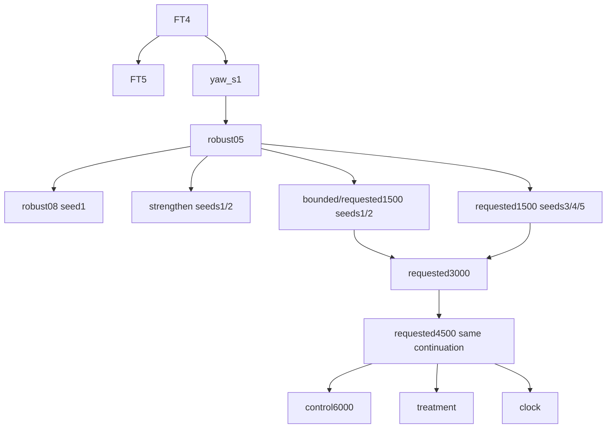
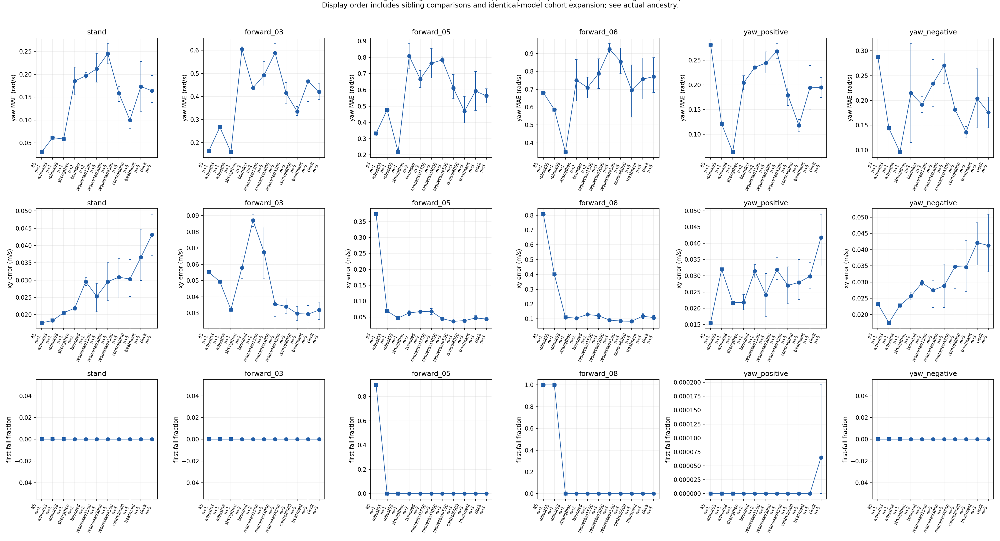
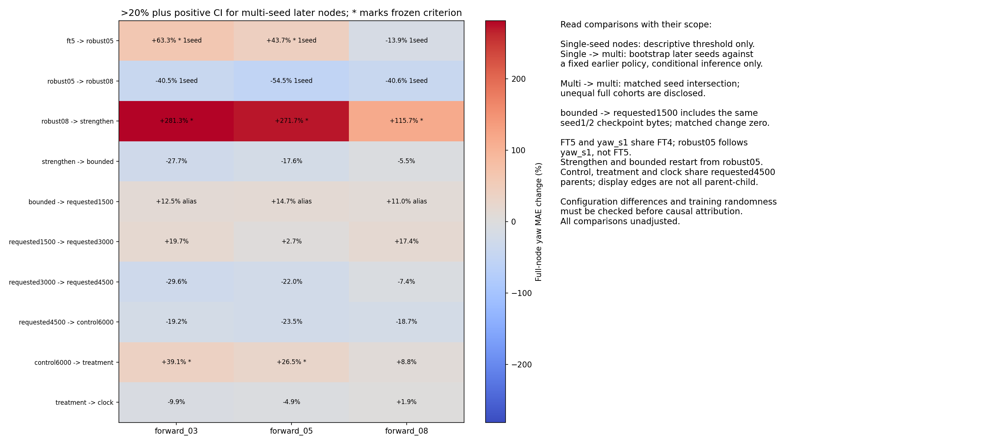
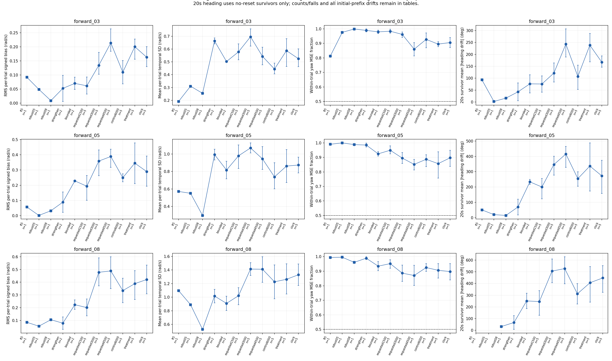
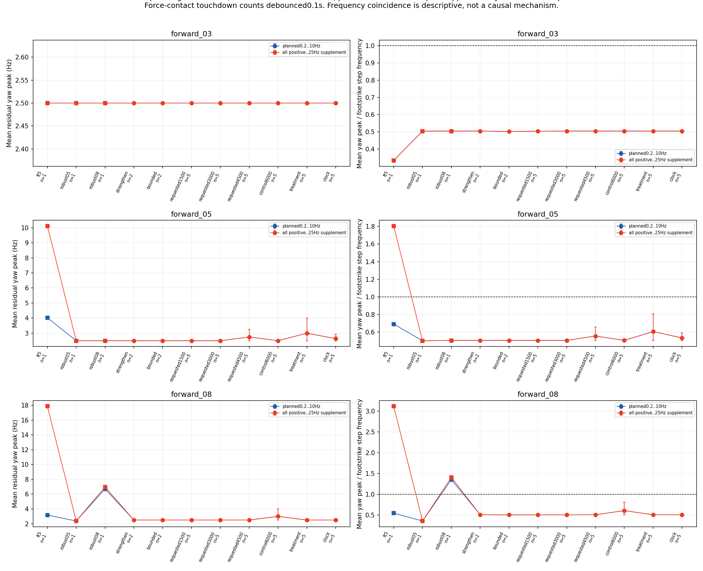
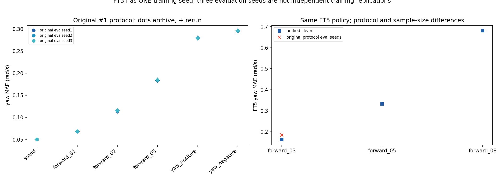
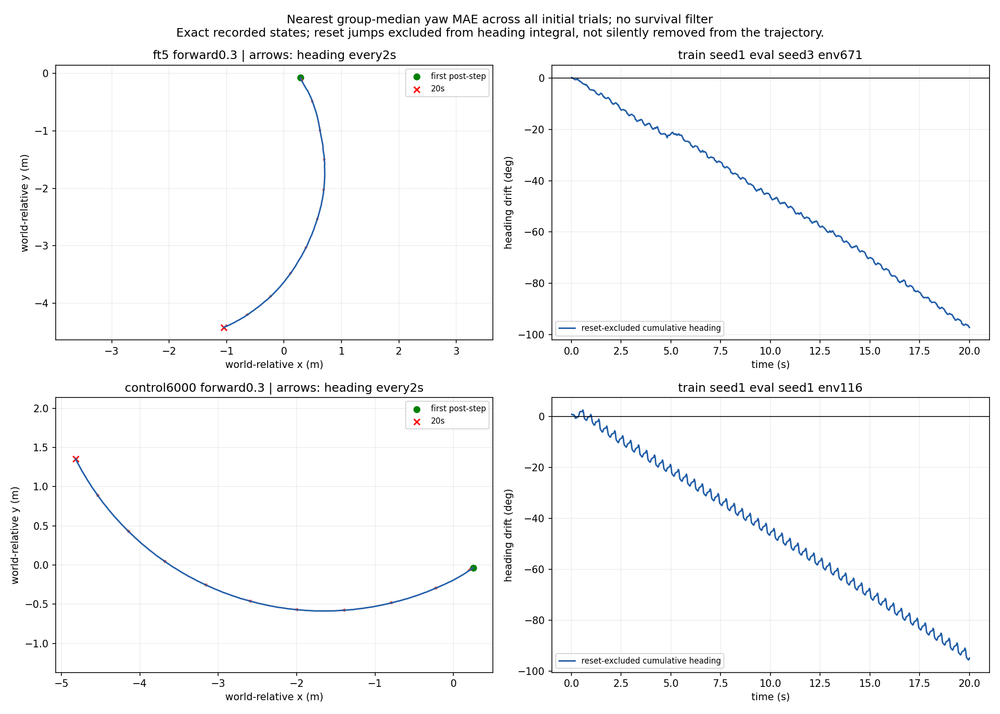

# Issue #15: straight-yaw lineage audit

Issue: https://github.com/weiguang52/HUMANOID_TW/issues/15 . Base 60a8cc25ccce3a8ae22fcf7e5dd6f8d53db7613b.
**Evaluation-only study completed: zero training updates, no training configuration changes and no default promotion.**

## Findings

The frozen >20% criterion identifies 5 multi-seed positive-interval comparisons and 2 single-seed descriptive comparisons across the fixed30 straight-command diagnostic contrasts. These are unadjusted comparisons, not independent causal discoveries.
Every node/speed is explicitly classified as curve-dominant, oscillation-dominant or uncertain in the decomposition table. Single-seed classifications are descriptive. Do not cancel opposite per-trial curves using only the group signed mean.
**Exactly one next recommendation, not implemented:** Add one independent straight-heading acceptance gate based on reset-aware quaternion20s heading drift alongside existing xy/fall gates; retain body-z yaw MAE/SD and gait spectra as diagnostic companion evidence. Freeze numerical bounds and failure/censoring handling before any separately authorized future training; implement no reward/configuration change in this issue.

Five multiseed-positive-interval yaw contrasts and two single-seed descriptive >20% contrasts meet their prospectively fixed definitions. The three robust08->strengthen contrasts use two later seeds against one fixed robust08 policy (conditional inference); the two control->treatment contrasts use five matched pairs.

At clean0.3m/s FT5 yaw MAE=0.163370rad/s and control=0.334970rad/s (2.050x). The original approximately0.184rad/s FT5 protocol is reproduced with the same policy; its protocol/sampling difference does not remove the observed unified-protocol lineage difference.

All33node/speed mean within-trial MSE shares exceed0.5 (range81.16..100.00%). All24multiseed intervals lie above0.5; the nine single-seed cells remain descriptive. Time-varying error dominates this energy decomposition, not a proof that every trajectory is periodic or straight.

Low-speed body-yaw peaks are2.5Hz, matching the configured0.4s gait-phase input (2.5Hz). Later-node force-threshold contact events are approximately4.95..4.98/s, giving roughly one yaw oscillation per full gait/stride cycle, or half the two-foot event cadence. FT5 has approximately7.50events/s under this contact-crossing proxy; it is not an independent anatomical step measurement. Frequency coincidence does not establish causation.

Curving coexists with the dominant oscillatory energy: mean absolute20s heading drift at0.3m/s is FT592.94deg, control107.11deg, treatment238.55deg and clock167.05deg. All these low-speed trials survive, so these particular endpoints are not survivor-selected.

Body-z rate error and world heading cannot substitute for each other. FT5->robust05 raises0.3m/s body-yaw MAE by63.32% while mean absolute20s quaternion-heading drift changes92.94->2.40deg. That comparison has one training seed per node and multiple recipe/ancestry differences, so it has no unique configuration attribution.

For failing out-of-range FT5 conditions, high-frequency residual peaks and full-horizon variability include failure/transient behavior; they are not evidence of a stable healthy gait. The raw support and censored heading endpoints remain explicit.

The gait-phase input uses the [unchanged0.4s period](../../source/unitree_rl_lab/unitree_rl_lab/tasks/locomotion/robots/tw/velocity_env_cfg.py#L39). Contact counts are force-threshold event proxies; they are not assumed to be exact anatomical steps.

## Frozen scope, protocol and read-only validation

37requested lineage entries correspond to35distinct checkpoints. Bounded seeds1/2 are byte-identical aliases of requested1500 seeds1/2; no duplicate independent-policy claim. All35 policies were newly evaluated under the same clean protocol, three evaluation seeds each:105jobs,630commands,645120initial trials. Three original-protocol FT5 jobs add2304trials, total108jobs/647424initial trials. No new training or checkpoint selection.
Clean:1024environments x20s per command; deterministic actor, nominal masses, robot/terrain friction1.0, no pushes/observation noise,0ms delay, original requested-action observation. Command order forward0.3,yaw+0.3,yaw-0.3,forward0.5,forward0.8,stand preserves issue13/14 reset ordinals0..4 and appends stand5. Paired START reset seed=eval_seed*1000+ordinal. Policies that fail at different times may have different subsequent episode/reset/RNG paths; identical post-failure draws are not claimed. All policies101actor inputs; only existing CLOCK models use136critic inputs, others134. FT5 out-of-range commands are retained with actual failures.
9prospective unit tests passed, plus two post-freeze supplementary spectral-coverage tests (not extra acceptance gates).64-env original-evaluator versus observational FT5 smoke gave exact metrics and bitwise-equal final root/joint state and CPU/CUDA/Python/NumPy RNG;136-wide CLOCK/stand smoke passed. These are zero-update preflight evaluations, not formal replications. Every job audits unchanged model/optimizer hash, actual clean physical properties and original metrics.221sources plus protocol/cohort/config/preflight inputs were frozen before formal evaluation. Derived analysis/media/report code was written after the freeze and is bound to actual source/output hashes.
All225existing first-five clean command records (control/treatment/clock) were compared with the exact prior committed issue13/14 data: all original result rows exact = True; all original moment arrays bitwise equal = True. These flags are observed consistency evidence, not a relaxed/new acceptance gate. [Full historical reproduction/differences](historical_clean_reproduction.json).
[Prospective plan](protocol_plan.md) | [Source/input freeze](frozen_evaluation_sources.json) | [Read-only regression](smoke_audit.json) | [Independent full raw audit](analysis_integrity_audit.json) | [Delivery audit](delivery_integrity_audit.json)

## Metric definitions and inference

Yaw MAE = sum_valid |root_ang_vel_b[:,2]-command_yaw| / sum_valid, rad/s. XY error is original body-XY speed L2, m/s. Full20s nonterminal POST-STEP samples include ordinary episodes after failure reset, matching13/14. Also retain initial-episode-prefix sensitivity and original first-failure trial counts. Body-z yaw rate is not generally Euler-heading derivative under tilt.
Average the three evaluation-seed job estimates within each training seed, then equally average training seeds. Bootstrap uses all n^n training-seed resamples (n=2 or5), percentile95%; n=1 explicitly has no training CI. Shared ancestors limit generalization, and all comparisons are multiple-comparison UNADJUSTED. Trial count does not replace training-seed replication. Fall rates are initial-trial first-failure proportions, not failure episodes.
The fixed >20% criterion uses full-node mean yaw MAE change, requiring a positive difference95% interval for multi-seed later nodes. Same-seed multi-node contrasts use paired shared training seeds; if the earlier node has one training seed, later seeds are compared to that FIXED policy, with conditional inference only. Bounded->requested1500 has exact zero matched change and is an alias/cohort-expansion contrast, not a configuration effect. Full-node and matched-subset compositions are explicit in [complete comparisons](lineage_comparisons.json).

## Actual ancestry and configuration provenance

The issue display order is NOT a literal continuous parent-child chain. **FT5 and yaw_s1 share FT4; robust05 resumes yaw_s1, not FT5.** The frozen coarse phrase about FT5->robust05 intermediates refers only to a diagnostic comparison; actual saved resume paths below resolve the ancestry. Requested3000/4500 are intermediate/final checkpoints within the SAME continuation run from1500. Robust08/strengthen/bounded restart from robust05. Control/treatment/clock are sibling continuations of requested4500.

[Every saved env/agent config difference](configuration_lineage_audit.json) | [Exact saved resume/checkpoint parent graph](actual_resume_lineage.json). Extra ancestors are inspected for provenance, not silently added as evaluated policies. The FT5->robust05 contrast changes multiple training settings and ancestry; no sole cause can be identified there. Candidate recipe changes on later contrasts must not be confused with causal proof from a single seed or fixed baseline.

## Unified six-command yaw / xy / falls

| Node | Train n | Command | Yaw MAE rad/s95% | XY error m/s95% | First falls %95% |
|---|---:|---|---|---|---|
|ft5|1|stand|0.030008 (1 training seed; no CI)|0.0176263 (1 training seed; no CI)|0 (1 training seed; no CI)|
|ft5|1|forward_03|0.16337 (1 training seed; no CI)|0.0551504 (1 training seed; no CI)|0 (1 training seed; no CI)|
|ft5|1|forward_05|0.332148 (1 training seed; no CI)|0.373267 (1 training seed; no CI)|89.5182 (1 training seed; no CI)|
|ft5|1|forward_08|0.680436 (1 training seed; no CI)|0.807368 (1 training seed; no CI)|100 (1 training seed; no CI)|
|ft5|1|yaw_positive|0.281691 (1 training seed; no CI)|0.0155281 (1 training seed; no CI)|0 (1 training seed; no CI)|
|ft5|1|yaw_negative|0.287751 (1 training seed; no CI)|0.0232805 (1 training seed; no CI)|0 (1 training seed; no CI)|
|robust05|1|stand|0.0613374 (1 training seed; no CI)|0.0182786 (1 training seed; no CI)|0 (1 training seed; no CI)|
|robust05|1|forward_03|0.266809 (1 training seed; no CI)|0.0493502 (1 training seed; no CI)|0 (1 training seed; no CI)|
|robust05|1|forward_05|0.477407 (1 training seed; no CI)|0.0689073 (1 training seed; no CI)|0 (1 training seed; no CI)|
|robust05|1|forward_08|0.586097 (1 training seed; no CI)|0.39971 (1 training seed; no CI)|100 (1 training seed; no CI)|
|robust05|1|yaw_positive|0.120951 (1 training seed; no CI)|0.0319595 (1 training seed; no CI)|0 (1 training seed; no CI)|
|robust05|1|yaw_negative|0.143872 (1 training seed; no CI)|0.0174497 (1 training seed; no CI)|0 (1 training seed; no CI)|
|robust08|1|stand|0.0585079 (1 training seed; no CI)|0.0205456 (1 training seed; no CI)|0 (1 training seed; no CI)|
|robust08|1|forward_03|0.158643 (1 training seed; no CI)|0.032129 (1 training seed; no CI)|0 (1 training seed; no CI)|
|robust08|1|forward_05|0.217446 (1 training seed; no CI)|0.0467046 (1 training seed; no CI)|0 (1 training seed; no CI)|
|robust08|1|forward_08|0.348079 (1 training seed; no CI)|0.109462 (1 training seed; no CI)|0 (1 training seed; no CI)|
|robust08|1|yaw_positive|0.0638277 (1 training seed; no CI)|0.021763 (1 training seed; no CI)|0 (1 training seed; no CI)|
|robust08|1|yaw_negative|0.0960287 (1 training seed; no CI)|0.0228175 (1 training seed; no CI)|0 (1 training seed; no CI)|
|strengthen|2|stand|0.185249 [0.154831, 0.215668]|0.0218646 [0.0213025, 0.0224267]|0 [0, 0]|
|strengthen|2|forward_03|0.604945 [0.59544, 0.61445]|0.0580164 [0.0514507, 0.0645821]|0 [0, 0]|
|strengthen|2|forward_05|0.80821 [0.730199, 0.88622]|0.0631461 [0.0551571, 0.071135]|0 [0, 0]|
|strengthen|2|forward_08|0.750806 [0.634188, 0.867423]|0.104955 [0.101377, 0.108532]|0 [0, 0]|
|strengthen|2|yaw_positive|0.204308 [0.189742, 0.218874]|0.0218251 [0.0194879, 0.0241622]|0 [0, 0]|
|strengthen|2|yaw_negative|0.214996 [0.114934, 0.315058]|0.025684 [0.0244687, 0.0268994]|0 [0, 0]|
|bounded|2|stand|0.196584 [0.189567, 0.203601]|0.0295489 [0.0284004, 0.0306973]|0 [0, 0]|
|bounded|2|forward_03|0.437142 [0.432495, 0.44179]|0.087127 [0.0833172, 0.0909369]|0 [0, 0]|
|bounded|2|forward_05|0.665838 [0.612908, 0.718769]|0.0667448 [0.061995, 0.0714946]|0 [0, 0]|
|bounded|2|forward_08|0.709367 [0.651454, 0.76728]|0.12959 [0.125348, 0.133832]|0 [0, 0]|
|bounded|2|yaw_positive|0.235533 [0.235386, 0.235681]|0.0314884 [0.0295904, 0.0333864]|0 [0, 0]|
|bounded|2|yaw_negative|0.191712 [0.175269, 0.208155]|0.0297608 [0.0289991, 0.0305224]|0 [0, 0]|
|requested1500|5|stand|0.211957 [0.18312, 0.245688]|0.0252661 [0.0207769, 0.0290442]|0 [0, 0]|
|requested1500|5|forward_03|0.491992 [0.444888, 0.552776]|0.0674788 [0.0510956, 0.083084]|0 [0, 0]|
|requested1500|5|forward_05|0.763642 [0.672775, 0.855996]|0.0678007 [0.0582561, 0.0765941]|0 [0, 0]|
|requested1500|5|forward_08|0.787176 [0.703444, 0.870245]|0.120983 [0.103139, 0.137036]|0 [0, 0]|
|requested1500|5|yaw_positive|0.24441 [0.224121, 0.266901]|0.0240984 [0.0175358, 0.0306609]|0 [0, 0]|
|requested1500|5|yaw_negative|0.234191 [0.188045, 0.282306]|0.0274997 [0.0222283, 0.0305279]|0 [0, 0]|
|requested3000|5|stand|0.245335 [0.222658, 0.267546]|0.0295342 [0.0240404, 0.035028]|0 [0, 0]|
|requested3000|5|forward_03|0.588982 [0.540014, 0.63034]|0.035552 [0.0280874, 0.0417039]|0 [0, 0]|
|requested3000|5|forward_05|0.784504 [0.764694, 0.803226]|0.0448064 [0.0426562, 0.0470809]|0 [0, 0]|
|requested3000|5|forward_08|0.923857 [0.90247, 0.956795]|0.0914085 [0.0833712, 0.100328]|0 [0, 0]|
|requested3000|5|yaw_positive|0.268225 [0.254334, 0.2843]|0.0318504 [0.0287785, 0.0355125]|0 [0, 0]|
|requested3000|5|yaw_negative|0.27074 [0.234735, 0.295697]|0.0288347 [0.022166, 0.0355033]|0 [0, 0]|
|requested4500|5|stand|0.158709 [0.140429, 0.173489]|0.0308416 [0.024835, 0.0363042]|0 [0, 0]|
|requested4500|5|forward_03|0.414612 [0.370931, 0.459835]|0.034071 [0.029914, 0.0392816]|0 [0, 0]|
|requested4500|5|forward_05|0.61189 [0.544777, 0.693027]|0.0365437 [0.031774, 0.0397702]|0 [0, 0]|
|requested4500|5|forward_08|0.855327 [0.786656, 0.930876]|0.0850362 [0.0729902, 0.0974329]|0 [0, 0]|
|requested4500|5|yaw_positive|0.179254 [0.158641, 0.19406]|0.0270292 [0.0213417, 0.0327166]|0 [0, 0]|
|requested4500|5|yaw_negative|0.181466 [0.158647, 0.20505]|0.0347684 [0.028095, 0.0414419]|0 [0, 0]|
|control6000|5|stand|0.0998671 [0.0808105, 0.121208]|0.030299 [0.0252265, 0.0359988]|0 [0, 0]|
|control6000|5|forward_03|0.33497 [0.318089, 0.356154]|0.0296931 [0.0252262, 0.0341181]|0 [0, 0]|
|control6000|5|forward_05|0.467991 [0.395902, 0.559806]|0.0386113 [0.0352373, 0.0419853]|0 [0, 0]|
|control6000|5|forward_08|0.695165 [0.543448, 0.835668]|0.0837453 [0.074739, 0.0930516]|0 [0, 0]|
|control6000|5|yaw_positive|0.117859 [0.104671, 0.129915]|0.0279598 [0.0227292, 0.03507]|0 [0, 0]|
|control6000|5|yaw_negative|0.135959 [0.124278, 0.14764]|0.034623 [0.0271806, 0.0428343]|0 [0, 0]|
|treatment|5|stand|0.173204 [0.119009, 0.227399]|0.036591 [0.0298436, 0.044701]|0 [0, 0]|
|treatment|5|forward_03|0.465948 [0.378171, 0.545591]|0.0293287 [0.023992, 0.0346653]|0 [0, 0]|
|treatment|5|forward_05|0.592221 [0.471969, 0.711929]|0.046878 [0.042811, 0.053994]|0 [0, 0]|
|treatment|5|forward_08|0.75623 [0.645514, 0.874974]|0.118208 [0.102152, 0.138329]|0 [0, 0]|
|treatment|5|yaw_positive|0.19418 [0.149522, 0.23971]|0.029836 [0.0260174, 0.0340164]|0 [0, 0]|
|treatment|5|yaw_negative|0.204018 [0.14455, 0.263772]|0.0421224 [0.0352921, 0.0482872]|0 [0, 0]|
|clock|5|stand|0.163867 [0.138287, 0.197459]|0.0431349 [0.0371861, 0.0490837]|0 [0, 0]|
|clock|5|forward_03|0.419654 [0.387204, 0.454433]|0.0319065 [0.0261805, 0.0368068]|0 [0, 0]|
|clock|5|forward_05|0.563432 [0.520008, 0.606856]|0.0439369 [0.0391137, 0.0501676]|0 [0, 0]|
|clock|5|forward_08|0.77078 [0.682679, 0.877185]|0.108004 [0.0943282, 0.122446]|0 [0, 0]|
|clock|5|yaw_positive|0.194731 [0.174526, 0.214935]|0.0417473 [0.0329724, 0.048945]|0.00651042 [0, 0.0195312]|
|clock|5|yaw_negative|0.175819 [0.144733, 0.206544]|0.0412682 [0.0331208, 0.0509077]|0 [0, 0]|

## Frozen20% comparisons and actual candidate differences

| Comparison | Command | Full-node change % | Difference rad/s95% | Frozen criterion | Scope |
|---|---|---:|---|---|---|
|ft5 -> robust05|forward_03|63.316|0.103439 (1 training seed; no CI)|True|descriptive1seed|
|ft5 -> robust05|forward_05|43.733|0.145259 (1 training seed; no CI)|True|descriptive1seed|
|ft5 -> robust05|forward_08|-13.865|-0.0943393 (1 training seed; no CI)|False|descriptive1seed|
|robust05 -> robust08|forward_03|-40.540|-0.108165 (1 training seed; no CI)|False|descriptive1seed|
|robust05 -> robust08|forward_05|-54.453|-0.259962 (1 training seed; no CI)|False|descriptive1seed|
|robust05 -> robust08|forward_08|-40.611|-0.238018 (1 training seed; no CI)|False|descriptive1seed|
|robust08 -> strengthen|forward_03|281.324|0.446302 [0.436797, 0.455807]|True|later training seeds versus FIXED single-seed baseline; conditional only|
|robust08 -> strengthen|forward_05|271.683|0.590764 [0.512754, 0.668774]|True|later training seeds versus FIXED single-seed baseline; conditional only|
|robust08 -> strengthen|forward_08|115.700|0.402727 [0.286109, 0.519345]|True|later training seeds versus FIXED single-seed baseline; conditional only|
|strengthen -> bounded|forward_03|-27.739|-0.167803 [-0.181956, -0.153651]|False|paired shared training seeds|
|strengthen -> bounded|forward_05|-17.616|-0.142371 [-0.167451, -0.117292]|False|paired shared training seeds|
|strengthen -> bounded|forward_08|-5.519|-0.041439 [-0.100144, 0.0172658]|False|paired shared training seeds|
|bounded -> requested1500|forward_03|12.547|0 [0, 0]|False|same-model alias/cohort expansion|
|bounded -> requested1500|forward_05|14.689|0 [0, 0]|False|same-model alias/cohort expansion|
|bounded -> requested1500|forward_08|10.969|0 [0, 0]|False|same-model alias/cohort expansion|
|requested1500 -> requested3000|forward_03|19.714|0.0969904 [-0.00716584, 0.179883]|False|paired shared training seeds|
|requested1500 -> requested3000|forward_05|2.732|0.0208623 [-0.0780014, 0.0995169]|False|paired shared training seeds|
|requested1500 -> requested3000|forward_08|17.364|0.136681 [0.0472465, 0.220563]|False|paired shared training seeds|
|requested3000 -> requested4500|forward_03|-29.605|-0.174371 [-0.213845, -0.13222]|False|paired shared training seeds|
|requested3000 -> requested4500|forward_05|-22.003|-0.172614 [-0.225446, -0.103303]|False|paired shared training seeds|
|requested3000 -> requested4500|forward_08|-7.418|-0.0685302 [-0.123139, -0.00889931]|False|paired shared training seeds|
|requested4500 -> control6000|forward_03|-19.209|-0.0796415 [-0.11038, -0.050939]|False|paired shared training seeds|
|requested4500 -> control6000|forward_05|-23.517|-0.143899 [-0.189179, -0.098619]|False|paired shared training seeds|
|requested4500 -> control6000|forward_08|-18.725|-0.160162 [-0.252893, -0.06743]|False|paired shared training seeds|
|control6000 -> treatment|forward_03|39.101|0.130977 [0.0427022, 0.202755]|True|paired shared training seeds|
|control6000 -> treatment|forward_05|26.545|0.12423 [0.0521303, 0.174903]|True|paired shared training seeds|
|control6000 -> treatment|forward_08|8.784|0.0610651 [-0.0977538, 0.217007]|False|paired shared training seeds|
|treatment -> clock|forward_03|-9.935|-0.046294 [-0.133097, 0.0462476]|False|paired shared training seeds|
|treatment -> clock|forward_05|-4.861|-0.0287888 [-0.107757, 0.0504196]|False|paired shared training seeds|
|treatment -> clock|forward_08|1.924|0.0145499 [-0.0780901, 0.114158]|False|paired shared training seeds|

The following30 stand/turning-command contrasts supplement the30prospectively frozen straight-command contrasts. They use the SAME >20%/positive-CI arithmetic, not a new decision rule or extra evaluation; all six command results remain visible. Additional comparisons are also unadjusted.

| Comparison | Control command | Full-node change % | Difference rad/s95% | Descriptive20%/interval flag |
|---|---|---:|---|---|
|ft5 -> robust05|yaw_positive|-57.063|-0.16074 (1 training seed; no CI)|False|
|ft5 -> robust05|yaw_negative|-50.001|-0.143879 (1 training seed; no CI)|False|
|ft5 -> robust05|stand|104.404|0.0313294 (1 training seed; no CI)|True|
|robust05 -> robust08|yaw_positive|-47.228|-0.0571233 (1 training seed; no CI)|False|
|robust05 -> robust08|yaw_negative|-33.254|-0.0478433 (1 training seed; no CI)|False|
|robust05 -> robust08|stand|-4.613|-0.00282952 (1 training seed; no CI)|False|
|robust08 -> strengthen|yaw_positive|220.093|0.14048 [0.125914, 0.155046]|True|
|robust08 -> strengthen|yaw_negative|123.887|0.118967 [0.0189054, 0.219029]|True|
|robust08 -> strengthen|stand|216.623|0.126741 [0.0963232, 0.15716]|True|
|strengthen -> bounded|yaw_positive|15.283|0.0312254 [0.0168068, 0.0456439]|False|
|strengthen -> bounded|yaw_negative|-10.830|-0.0232839 [-0.106903, 0.060335]|False|
|strengthen -> bounded|stand|6.119|0.0113347 [-0.0120668, 0.0347362]|False|
|bounded -> requested1500|yaw_positive|3.769|0 [0, 0]|False|
|bounded -> requested1500|yaw_negative|22.157|0 [0, 0]|False|
|bounded -> requested1500|stand|7.820|0 [0, 0]|False|
|requested1500 -> requested3000|yaw_positive|9.744|0.0238142 [-0.0067002, 0.0500206]|False|
|requested1500 -> requested3000|yaw_negative|15.607|0.0365498 [-0.014039, 0.0935664]|False|
|requested1500 -> requested3000|stand|15.747|0.0333775 [0.00462239, 0.0621327]|False|
|requested3000 -> requested4500|yaw_positive|-33.170|-0.088971 [-0.117063, -0.0636768]|False|
|requested3000 -> requested4500|yaw_negative|-32.974|-0.0892741 [-0.119441, -0.0514362]|False|
|requested3000 -> requested4500|stand|-35.309|-0.0866262 [-0.118858, -0.0543947]|False|
|requested4500 -> control6000|yaw_positive|-34.250|-0.0613944 [-0.0721066, -0.0508159]|False|
|requested4500 -> control6000|yaw_negative|-25.078|-0.0455073 [-0.0679373, -0.0155952]|False|
|requested4500 -> control6000|stand|-37.075|-0.0588417 [-0.0801951, -0.0396322]|False|
|control6000 -> treatment|yaw_positive|64.756|0.0763206 [0.0370648, 0.115666]|True|
|control6000 -> treatment|yaw_negative|50.058|0.0680586 [0.0168422, 0.119308]|True|
|control6000 -> treatment|stand|73.434|0.0733369 [0.0168574, 0.129816]|True|
|treatment -> clock|yaw_positive|0.284|0.000550955 [-0.0395395, 0.0447635]|False|
|treatment -> clock|yaw_negative|-13.822|-0.0281983 [-0.0846772, 0.0210681]|False|
|treatment -> clock|stand|-5.391|-0.00933735 [-0.0674459, 0.0327888]|False|

[Supplementary analysis coverage, not a changed prospective gate](analysis_coverage_addendum.md).

**ft5 -> robust05:** Multiple training differences and unshown sibling ancestry: FT5 and yaw_s1 share FT4, robust05 follows yaw_s1. No sole configuration cause can be identified from this contrast.

**robust05 -> robust08:** Only the saved logical command-range bundle expands forward/yaw0.5 to0.8, with1500 further updates. Forward and angular ranges change together and their effects cannot be separated. One training seed: a descriptive association, not an isolated causal test.

**robust08 -> strengthen:** Saved seed1 recipe difference is training push +/-0.3 to+/-0.45m/s; both restart from robust05. The current two-seed comparison is conditional on fixed robust08 seed1, not a two-population causal interval.

**strengthen -> bounded:** Saved logical recipe difference is base-mass randomization: nominal+U(-0.08,0.15) becomes nominal*U(0.5,1.5), uniform. Both restart from robust05; sample size is two training seeds.

**bounded -> requested1500:** Exact same checkpoint bytes for seeds1/2. Five-seed node adds seeds3/4/5; any full-node mean shift is cohort composition, not a training/configuration effect.

**requested1500 -> requested3000:** Same recipe, continued training budget;3000 target actually3006logged total. The continuation reconstructs simulator state and resumes the saved iteration label, not an uninterrupted byte-identical run.

**requested3000 -> requested4500:** Same continuation run/recipe, additional training to4500logged total. No new configuration intervention at3000.

**requested4500 -> control6000:** Additional1500updates. Saved timed-push/reset-clock/zero-weight pitch term instrumentation is present; prior issue12 audit establishes original dynamics/RNG equivalence at weight0. No nonzero recovery reward in control.

**control6000 -> treatment:** Same five matched requested4500 parents/budget. Sole saved behavioral recipe difference is post-push pitch recovery weight0 ->34.67877532210905.

**treatment -> clock:** Same five matched requested4500 parents/budget, sibling retraining. Sole saved intervention is two extra critic clock inputs134->136; actor101, hidden layers, original rewards/distributions remain identical.

## Curve versus oscillation; heading drift

Bias energy=sum_trial n*(trial mean yaw-target)^2; within energy=sum_trial n*temporal variance. Their sum exactly reconstructs yaw MSE. Within variation includes transients and ordinary post-reset episodes; it alone does not prove a coherent periodic oscillation. Within fraction>0.5 indicates oscillation/variation, <0.5 persistent curve; a multi-seed95% interval containing0.5 is uncertain. Mean signed bias, mean ABS trial bias and RMS trial bias are all retained, preventing opposite curves from canceling. Temporal SD is EACH trial's population SD(ddof0) about its own mean, then equal-trial average, not pooled SD.
Heading uses wxyz-quaternion Euler yaw, summing wrapped successive angle differences over nonterminal steps with reset jumps excluded. Full20s signed/absolute drift is conditional on NO-reset survivors; failed trials retain initial-prefix duration/drift and full reset-excluded episode-segment drift. **Survivor drift is selected/censored and is not an unconditional20s endpoint estimate.** If an evaluation/training seed has no survivors, its endpoint statistic stays NA rather than dropping it.
| Node | Speed | Signed yaw bias rad/s95% | RMS trial bias rad/s95% | Temporal SD rad/s95% | Within fraction95% | Classification |
|---|---|---|---|---|---|---|
|ft5|forward_03|-0.0921894 (1 training seed; no CI)|0.0922859 (1 training seed; no CI)|0.191325 (1 training seed; no CI)|0.811585 (1 training seed; no CI)|single_seed_descriptive_oscillation|
|ft5|forward_05|-0.039663 (1 training seed; no CI)|0.0571818 (1 training seed; no CI)|0.571247 (1 training seed; no CI)|0.990518 (1 training seed; no CI)|single_seed_descriptive_oscillation|
|ft5|forward_08|-0.0430797 (1 training seed; no CI)|0.0859688 (1 training seed; no CI)|1.09689 (1 training seed; no CI)|0.993953 (1 training seed; no CI)|single_seed_descriptive_oscillation|
|robust05|forward_03|-0.0490939 (1 training seed; no CI)|0.0491043 (1 training seed; no CI)|0.310347 (1 training seed; no CI)|0.975577 (1 training seed; no CI)|single_seed_descriptive_oscillation|
|robust05|forward_05|-0.000360456 (1 training seed; no CI)|0.00200279 (1 training seed; no CI)|0.550165 (1 training seed; no CI)|0.999987 (1 training seed; no CI)|single_seed_descriptive_oscillation|
|robust05|forward_08|-0.0505417 (1 training seed; no CI)|0.0552486 (1 training seed; no CI)|0.8898 (1 training seed; no CI)|0.996177 (1 training seed; no CI)|single_seed_descriptive_oscillation|
|robust08|forward_03|-0.0080863 (1 training seed; no CI)|0.00909804 (1 training seed; no CI)|0.254853 (1 training seed; no CI)|0.998729 (1 training seed; no CI)|single_seed_descriptive_oscillation|
|robust08|forward_05|0.0290575 (1 training seed; no CI)|0.0324214 (1 training seed; no CI)|0.296575 (1 training seed; no CI)|0.988198 (1 training seed; no CI)|single_seed_descriptive_oscillation|
|robust08|forward_08|-0.105664 (1 training seed; no CI)|0.106075 (1 training seed; no CI)|0.5269 (1 training seed; no CI)|0.961066 (1 training seed; no CI)|single_seed_descriptive_oscillation|
|strengthen|forward_03|-0.0502735 [-0.0988148, -0.00173224]|0.0525776 [0.00613372, 0.0990214]|0.663422 [0.640416, 0.686428]|0.989086 [0.979003, 0.999169]|oscillation_dominant|
|strengthen|forward_05|-0.0739166 [-0.154695, 0.00686171]|0.0890877 [0.0223096, 0.155866]|0.993892 [0.931993, 1.05579]|0.985182 [0.971711, 0.998654]|oscillation_dominant|
|strengthen|forward_08|-0.0526388 [-0.125638, 0.0203607]|0.0791531 [0.030344, 0.127962]|1.01627 [0.917416, 1.11513]|0.989424 [0.980152, 0.998697]|oscillation_dominant|
|bounded|forward_03|-0.0702853 [-0.0919866, -0.0485839]|0.0703278 [0.0486088, 0.0920468]|0.502699 [0.500378, 0.505019]|0.978991 [0.967601, 0.990382]|oscillation_dominant|
|bounded|forward_05|-0.228471 [-0.231669, -0.225273]|0.228521 [0.225282, 0.231759]|0.816453 [0.715368, 0.917538]|0.924481 [0.909293, 0.93967]|oscillation_dominant|
|bounded|forward_08|-0.223705 [-0.260634, -0.186776]|0.223777 [0.186792, 0.260762]|0.909069 [0.803734, 1.0144]|0.934813 [0.903442, 0.966185]|oscillation_dominant|
|requested1500|forward_03|-0.0554386 [-0.0930001, -0.0186224]|0.0616465 [0.0321268, 0.0930524]|0.578288 [0.516103, 0.640472]|0.98342 [0.970384, 0.996456]|oscillation_dominant|
|requested1500|forward_05|-0.185996 [-0.263734, -0.0787054]|0.193615 [0.101348, 0.263824]|0.979571 [0.834636, 1.10503]|0.949413 [0.924513, 0.978933]|oscillation_dominant|
|requested1500|forward_08|-0.201108 [-0.267985, -0.135785]|0.201268 [0.136087, 0.268123]|1.02127 [0.889761, 1.13901]|0.952202 [0.919957, 0.979289]|oscillation_dominant|
|requested3000|forward_03|-0.134408 [-0.180317, -0.102652]|0.134518 [0.102759, 0.180393]|0.695998 [0.622487, 0.756957]|0.961776 [0.941342, 0.977482]|oscillation_dominant|
|requested3000|forward_05|-0.358041 [-0.431059, -0.261554]|0.358645 [0.26296, 0.43125]|1.07009 [1.01232, 1.12786]|0.895527 [0.858668, 0.933121]|oscillation_dominant|
|requested3000|forward_08|-0.477787 [-0.590394, -0.37189]|0.477892 [0.371998, 0.59051]|1.413 [1.31813, 1.50788]|0.886794 [0.830523, 0.941411]|oscillation_dominant|
|requested4500|forward_03|-0.214029 [-0.263666, -0.184157]|0.21414 [0.184274, 0.263765]|0.542783 [0.477517, 0.61394]|0.859888 [0.813707, 0.90497]|oscillation_dominant|
|requested4500|forward_05|-0.388443 [-0.43646, -0.317891]|0.388499 [0.317939, 0.436535]|0.944704 [0.824606, 1.08528]|0.851941 [0.81341, 0.886855]|oscillation_dominant|
|requested4500|forward_08|-0.488458 [-0.598652, -0.34937]|0.488569 [0.349444, 0.598794]|1.41065 [1.21894, 1.59227]|0.870504 [0.801787, 0.941144]|oscillation_dominant|
|control6000|forward_03|-0.110005 [-0.151179, -0.0685511]|0.110085 [0.0686967, 0.151221]|0.444093 [0.406655, 0.489959]|0.927332 [0.869867, 0.971909]|oscillation_dominant|
|control6000|forward_05|-0.249373 [-0.274744, -0.222134]|0.249425 [0.222147, 0.274796]|0.738176 [0.60204, 0.900955]|0.886907 [0.836741, 0.917623]|oscillation_dominant|
|control6000|forward_08|-0.333989 [-0.431115, -0.238768]|0.334273 [0.239196, 0.431317]|1.22595 [0.975812, 1.47404]|0.925136 [0.89827, 0.951951]|oscillation_dominant|
|treatment|forward_03|-0.200508 [-0.227492, -0.156208]|0.200571 [0.156247, 0.227581]|0.587642 [0.463835, 0.680981]|0.894656 [0.877183, 0.911167]|oscillation_dominant|
|treatment|forward_05|-0.344822 [-0.477782, -0.209751]|0.344915 [0.209929, 0.477838]|0.862254 [0.673157, 1.05135]|0.856957 [0.757396, 0.938929]|oscillation_dominant|
|treatment|forward_08|-0.388406 [-0.490527, -0.263816]|0.388563 [0.264148, 0.490605]|1.26243 [1.04583, 1.48996]|0.906401 [0.852951, 0.952011]|oscillation_dominant|
|clock|forward_03|-0.162801 [-0.200685, -0.129399]|0.163045 [0.129515, 0.200962]|0.524779 [0.463212, 0.601972]|0.905523 [0.870246, 0.94003]|oscillation_dominant|
|clock|forward_05|-0.289277 [-0.391662, -0.193447]|0.2894 [0.193602, 0.391865]|0.874154 [0.784778, 0.964569]|0.897194 [0.837712, 0.949421]|oscillation_dominant|
|clock|forward_08|-0.421461 [-0.534594, -0.308327]|0.421598 [0.308569, 0.534628]|1.32951 [1.17277, 1.48624]|0.89743 [0.839554, 0.951648]|oscillation_dominant|

| Node | Speed | 20s survivors / original N | Survivor signed drift deg95% | Survivor mean absolute drift deg95% | All initial-prefix mean abs drift deg95% | All reset-excluded segments mean abs drift deg95% | Mean prefix duration s |
|---|---|---|---|---|---|---|---|
|ft5|forward_03|3072/3072|-92.9445 (1 training seed; no CI)|92.9445 (1 training seed; no CI)|92.9445 (1 training seed; no CI)|92.9445 (1 training seed; no CI)|20 (1 training seed; no CI)|
|ft5|forward_05|322/3072|-50.7278 (1 training seed; no CI)|50.797 (1 training seed; no CI)|31.9759 (1 training seed; no CI)|74.3908 (1 training seed; no CI)|6.82757 (1 training seed; no CI)|
|ft5|forward_08|0/3072|NA|NA|29.3326 (1 training seed; no CI)|127.135 (1 training seed; no CI)|2.69951 (1 training seed; no CI)|
|robust05|forward_03|3072/3072|-0.732237 (1 training seed; no CI)|2.40367 (1 training seed; no CI)|2.40367 (1 training seed; no CI)|2.40367 (1 training seed; no CI)|20 (1 training seed; no CI)|
|robust05|forward_05|3072/3072|19.7085 (1 training seed; no CI)|19.7085 (1 training seed; no CI)|19.7085 (1 training seed; no CI)|19.7085 (1 training seed; no CI)|20 (1 training seed; no CI)|
|robust05|forward_08|0/3072|NA|NA|12.4522 (1 training seed; no CI)|49.8297 (1 training seed; no CI)|3.93061 (1 training seed; no CI)|
|robust08|forward_03|3072/3072|16.2996 (1 training seed; no CI)|16.2996 (1 training seed; no CI)|16.2996 (1 training seed; no CI)|16.2996 (1 training seed; no CI)|20 (1 training seed; no CI)|
|robust08|forward_05|3072/3072|14.5927 (1 training seed; no CI)|14.5937 (1 training seed; no CI)|14.5937 (1 training seed; no CI)|14.5937 (1 training seed; no CI)|20 (1 training seed; no CI)|
|robust08|forward_08|3072/3072|-32.4394 (1 training seed; no CI)|32.4394 (1 training seed; no CI)|32.4394 (1 training seed; no CI)|32.4394 (1 training seed; no CI)|20 (1 training seed; no CI)|
|strengthen|forward_03|6144/6144|-42.5263 [-79.7541, -5.29847]|42.5631 [5.36927, 79.7569]|42.5631 [5.36927, 79.7569]|42.5631 [5.36927, 79.7569]|20 [20, 20]|
|strengthen|forward_05|6144/6144|-55.4049 [-119.359, 8.54964]|69.3593 [18.3126, 120.406]|69.3593 [18.3126, 120.406]|69.3593 [18.3126, 120.406]|20 [20, 20]|
|strengthen|forward_08|6144/6144|-64.2089 [-125.202, -3.21536]|66.7734 [8.15213, 125.395]|66.7734 [8.15213, 125.395]|66.7734 [8.15213, 125.395]|20 [20, 20]|
|bounded|forward_03|6144/6144|-76.3238 [-114.196, -38.4513]|76.3238 [38.4513, 114.196]|76.3238 [38.4513, 114.196]|76.3238 [38.4513, 114.196]|20 [20, 20]|
|bounded|forward_05|6144/6144|-233.549 [-250.147, -216.952]|233.549 [216.952, 250.147]|233.549 [216.952, 250.147]|233.549 [216.952, 250.147]|20 [20, 20]|
|bounded|forward_08|6144/6144|-251.194 [-316.5, -185.888]|251.194 [185.888, 316.5]|251.194 [185.888, 316.5]|251.194 [185.888, 316.5]|20 [20, 20]|
|requested1500|forward_03|15360/15360|-47.127 [-102.827, 12.7399]|75.6637 [41.6441, 109.683]|75.6637 [41.6441, 109.683]|75.6637 [41.6441, 109.683]|20 [20, 20]|
|requested1500|forward_05|15360/15360|-179.548 [-255.426, -61.487]|200.136 [123.249, 255.426]|200.136 [123.249, 255.426]|200.136 [123.249, 255.426]|20 [20, 20]|
|requested1500|forward_08|15360/15360|-245.701 [-338.25, -128.838]|245.701 [128.838, 338.25]|245.701 [128.838, 338.25]|245.701 [128.838, 338.25]|20 [20, 20]|
|requested3000|forward_03|15360/15360|-121.472 [-164.292, -84.1849]|121.472 [84.1849, 164.292]|121.472 [84.1849, 164.292]|121.472 [84.1849, 164.292]|20 [20, 20]|
|requested3000|forward_05|15360/15360|-346.275 [-400.781, -277.95]|346.275 [277.95, 400.781]|346.275 [277.95, 400.781]|346.275 [277.95, 400.781]|20 [20, 20]|
|requested3000|forward_08|15360/15360|-506.036 [-610.035, -407.527]|506.036 [407.527, 610.035]|506.036 [407.527, 610.035]|506.036 [407.527, 610.035]|20 [20, 20]|
|requested4500|forward_03|15360/15360|-243.377 [-306.784, -189.131]|243.377 [189.131, 306.784]|243.377 [189.131, 306.784]|243.377 [189.131, 306.784]|20 [20, 20]|
|requested4500|forward_05|15360/15360|-415.314 [-464.541, -328.29]|415.314 [328.29, 464.541]|415.314 [328.29, 464.541]|415.314 [328.29, 464.541]|20 [20, 20]|
|requested4500|forward_08|15360/15360|-527.204 [-627.565, -396.88]|527.204 [396.88, 627.565]|527.204 [396.88, 627.565]|527.204 [396.88, 627.565]|20 [20, 20]|
|control6000|forward_03|15360/15360|-107.102 [-154.392, -52.7993]|107.107 [52.8164, 154.392]|107.107 [52.8164, 154.392]|107.107 [52.8164, 154.392]|20 [20, 20]|
|control6000|forward_05|15360/15360|-254.596 [-299.564, -205.463]|254.596 [205.463, 299.564]|254.596 [205.463, 299.564]|254.596 [205.463, 299.564]|20 [20, 20]|
|control6000|forward_08|15360/15360|-311.897 [-398.341, -225.452]|311.897 [225.452, 398.341]|311.897 [225.452, 398.341]|311.897 [225.452, 398.341]|20 [20, 20]|
|treatment|forward_03|15360/15360|-238.547 [-287.928, -169.028]|238.547 [169.028, 287.928]|238.547 [169.028, 287.928]|238.547 [169.028, 287.928]|20 [20, 20]|
|treatment|forward_05|15360/15360|-336.658 [-487.837, -173.08]|336.658 [173.08, 487.837]|336.658 [173.08, 487.837]|336.658 [173.08, 487.837]|20 [20, 20]|
|treatment|forward_08|15360/15360|-406.959 [-544.948, -240.656]|406.959 [240.656, 544.948]|406.959 [240.656, 544.948]|406.959 [240.656, 544.948]|20 [20, 20]|
|clock|forward_03|15360/15360|-167.048 [-193.58, -146.037]|167.048 [146.037, 193.58]|167.048 [146.037, 193.58]|167.048 [146.037, 193.58]|20 [20, 20]|
|clock|forward_05|15360/15360|-272.521 [-374.002, -158.297]|272.521 [158.297, 374.002]|272.521 [158.297, 374.002]|272.521 [158.297, 374.002]|20 [20, 20]|
|clock|forward_08|15360/15360|-447.404 [-552.829, -324.58]|447.404 [324.58, 552.829]|447.404 [324.58, 552.829]|447.404 [324.58, 552.829]|20 [20, 20]|

## Oscillation frequency and gait relation

Use each trial's initial uninterrupted nonterminal segment>=5s, no reset concatenation/missing-sample interpolation. Subtract mean, apply Hann window, rFFT; The planned residual peak in0.2..10Hz is retained alongside a supplementary strongest peak over ALL positive resolvable frequencies through Nyquist25Hz; the latter avoids silently omitting low/high-frequency behavior. This supplement followed a technical band-coverage check after evaluation began; no frozen decision changes. Per-trial frequency resolution1/duration is saved. Flat/short segments remain unsupported. Left/right foot force norm>1N contact rising edges are debounced0.1s; report ipsilateral stride frequencies and combined footstrike step frequency. Ratios/proximity to1x/2x are descriptive, not evidence of a causal mechanism. For curve-dominant cells the residual spectral peak is context, not a claim that oscillation dominates.
| Node | Speed | Planned/full support / initial N | Planned peak Hz95% | Full-observable peak Hz95% | Mean step Hz95% | Full peak/stride95% | Full peak/step95% | Fraction full peak outside planned band95% |
|---|---|---|---|---|---|---|---|---|
|ft5|forward_03|3072/3072 / 3072|2.5 (1 training seed; no CI)|2.5 (1 training seed; no CI)|7.50151 (1 training seed; no CI)|0.667319 (1 training seed; no CI)|0.33366 (1 training seed; no CI)|0 (1 training seed; no CI)|
|ft5|forward_05|1280/1280 / 3072|4.02611 (1 training seed; no CI)|10.1111 (1 training seed; no CI)|6.02626 (1 training seed; no CI)|3.60998 (1 training seed; no CI)|1.80499 (1 training seed; no CI)|0.356618 (1 training seed; no CI)|
|ft5|forward_08|143/143 / 3072|3.16561 (1 training seed; no CI)|17.86 (1 training seed; no CI)|5.88354 (1 training seed; no CI)|6.23947 (1 training seed; no CI)|3.11973 (1 training seed; no CI)|0.712327 (1 training seed; no CI)|
|robust05|forward_03|3072/3072 / 3072|2.5 (1 training seed; no CI)|2.5 (1 training seed; no CI)|4.95808 (1 training seed; no CI)|1.00846 (1 training seed; no CI)|0.50423 (1 training seed; no CI)|0 (1 training seed; no CI)|
|robust05|forward_05|3072/3072 / 3072|2.5 (1 training seed; no CI)|2.5 (1 training seed; no CI)|4.99078 (1 training seed; no CI)|1.00187 (1 training seed; no CI)|0.500934 (1 training seed; no CI)|0 (1 training seed; no CI)|
|robust05|forward_08|674/674 / 3072|2.3717 (1 training seed; no CI)|2.3717 (1 training seed; no CI)|6.71261 (1 training seed; no CI)|0.708994 (1 training seed; no CI)|0.354497 (1 training seed; no CI)|0 (1 training seed; no CI)|
|robust08|forward_03|3072/3072 / 3072|2.5 (1 training seed; no CI)|2.5 (1 training seed; no CI)|4.95495 (1 training seed; no CI)|1.00909 (1 training seed; no CI)|0.504545 (1 training seed; no CI)|0 (1 training seed; no CI)|
|robust08|forward_05|3072/3072 / 3072|2.5 (1 training seed; no CI)|2.5 (1 training seed; no CI)|4.95495 (1 training seed; no CI)|1.00909 (1 training seed; no CI)|0.504545 (1 training seed; no CI)|0 (1 training seed; no CI)|
|robust08|forward_08|3072/3072 / 3072|6.70736 (1 training seed; no CI)|6.97184 (1 training seed; no CI)|4.95495 (1 training seed; no CI)|2.81409 (1 training seed; no CI)|1.40704 (1 training seed; no CI)|0.0472005 (1 training seed; no CI)|
|strengthen|forward_03|6144/6144 / 6144|2.5 [2.5, 2.5]|2.5 [2.5, 2.5]|4.95495 [4.95495, 4.95495]|1.00909 [1.00909, 1.00909]|0.504545 [0.504545, 0.504545]|0 [0, 0]|
|strengthen|forward_05|6144/6144 / 6144|2.5 [2.5, 2.5]|2.5 [2.5, 2.5]|4.95495 [4.95495, 4.95495]|1.00909 [1.00909, 1.00909]|0.504545 [0.504545, 0.504545]|0 [0, 0]|
|strengthen|forward_08|6144/6144 / 6144|2.5 [2.5, 2.5]|2.5 [2.5, 2.5]|4.95495 [4.95495, 4.95495]|1.00909 [1.00909, 1.00909]|0.504545 [0.504545, 0.504545]|0 [0, 0]|
|bounded|forward_03|6144/6144 / 6144|2.5 [2.5, 2.5]|2.5 [2.5, 2.5]|4.97998 [4.95683, 5.00313]|1.00405 [0.999378, 1.00871]|0.502023 [0.499689, 0.504356]|0 [0, 0]|
|bounded|forward_05|6144/6144 / 6144|2.5 [2.5, 2.5]|2.5 [2.5, 2.5]|4.95495 [4.95495, 4.95495]|1.00909 [1.00909, 1.00909]|0.504545 [0.504545, 0.504545]|0 [0, 0]|
|bounded|forward_08|6144/6144 / 6144|2.5 [2.5, 2.5]|2.5 [2.5, 2.5]|4.98014 [4.95748, 5.00281]|1.00406 [0.999535, 1.00859]|0.50203 [0.499767, 0.504293]|0 [0, 0]|
|requested1500|forward_03|15360/15360 / 15360|2.5 [2.5, 2.5]|2.5 [2.5, 2.5]|4.96496 [4.95495, 4.98498]|1.00707 [1.00304, 1.00909]|0.503536 [0.501518, 0.504545]|0 [0, 0]|
|requested1500|forward_05|15360/15360 / 15360|2.5 [2.5, 2.5]|2.5 [2.5, 2.5]|4.95495 [4.95495, 4.95495]|1.00909 [1.00909, 1.00909]|0.504545 [0.504545, 0.504545]|0 [0, 0]|
|requested1500|forward_08|15360/15360 / 15360|2.5 [2.5, 2.5]|2.5 [2.5, 2.5]|4.96662 [4.95509, 4.98636]|1.00676 [1.00282, 1.00906]|0.503379 [0.501408, 0.504532]|0 [0, 0]|
|requested3000|forward_03|15360/15360 / 15360|2.5 [2.5, 2.5]|2.5 [2.5, 2.5]|4.95495 [4.95495, 4.95495]|1.00909 [1.00909, 1.00909]|0.504545 [0.504545, 0.504545]|0 [0, 0]|
|requested3000|forward_05|15360/15360 / 15360|2.5 [2.5, 2.5]|2.5 [2.5, 2.5]|4.95495 [4.95495, 4.95495]|1.00909 [1.00909, 1.00909]|0.504545 [0.504545, 0.504545]|0 [0, 0]|
|requested3000|forward_08|15360/15360 / 15360|2.5 [2.5, 2.5]|2.5 [2.5, 2.5]|4.96369 [4.95698, 4.9704]|1.00733 [1.00598, 1.00868]|0.503667 [0.502992, 0.504342]|0 [0, 0]|
|requested4500|forward_03|15360/15360 / 15360|2.5 [2.5, 2.5]|2.5 [2.5, 2.5]|4.95495 [4.95495, 4.95495]|1.00909 [1.00909, 1.00909]|0.504545 [0.504545, 0.504545]|0 [0, 0]|
|requested4500|forward_05|15360/15360 / 15360|2.74772 [2.5, 3.24316]|2.74772 [2.5, 3.24316]|4.95495 [4.95495, 4.95495]|1.10908 [1.00909, 1.30906]|0.55454 [0.504545, 0.654529]|0 [0, 0]|
|requested4500|forward_08|15360/15360 / 15360|2.5 [2.5, 2.5]|2.5 [2.5, 2.5]|4.95557 [4.95495, 4.95677]|1.00897 [1.00873, 1.00909]|0.504484 [0.504363, 0.504545]|0 [0, 0]|
|control6000|forward_03|15360/15360 / 15360|2.5 [2.5, 2.5]|2.5 [2.5, 2.5]|4.95495 [4.95495, 4.95495]|1.00909 [1.00909, 1.00909]|0.504545 [0.504545, 0.504545]|0 [0, 0]|
|control6000|forward_05|15360/15360 / 15360|2.50114 [2.5, 2.50342]|2.50114 [2.5, 2.50342]|4.95495 [4.95495, 4.95495]|1.00955 [1.00909, 1.01047]|0.504775 [0.504545, 0.505235]|0 [0, 0]|
|control6000|forward_08|15360/15360 / 15360|3 [2.5, 4]|3 [2.5, 4]|4.96042 [4.9557, 4.96513]|1.20929 [1.00776, 1.61129]|0.604644 [0.503878, 0.805644]|0 [0, 0]|
|treatment|forward_03|15360/15360 / 15360|2.5 [2.5, 2.5]|2.5 [2.5, 2.5]|4.95495 [4.95495, 4.95495]|1.00909 [1.00909, 1.00909]|0.504545 [0.504545, 0.504545]|0 [0, 0]|
|treatment|forward_05|15360/15360 / 15360|3 [2.5, 4]|3 [2.5, 4]|4.95495 [4.95495, 4.95495]|1.21091 [1.00909, 1.61455]|0.605455 [0.504545, 0.807273]|0 [0, 0]|
|treatment|forward_08|15360/15360 / 15360|2.5 [2.5, 2.5]|2.5 [2.5, 2.5]|4.95503 [4.95495, 4.95519]|1.00908 [1.00904, 1.00909]|0.504538 [0.504522, 0.504545]|0 [0, 0]|
|clock|forward_03|15360/15360 / 15360|2.5 [2.5, 2.5]|2.5 [2.5, 2.5]|4.95495 [4.95495, 4.95495]|1.00909 [1.00909, 1.00909]|0.504545 [0.504545, 0.504545]|0 [0, 0]|
|clock|forward_05|15360/15360 / 15360|2.64014 [2.5, 2.92041]|2.64014 [2.5, 2.92041]|4.95495 [4.95495, 4.95495]|1.06566 [1.00909, 1.17878]|0.532828 [0.504545, 0.589392]|0 [0, 0]|
|clock|forward_08|15360/15360 / 15360|2.5 [2.5, 2.5]|2.5 [2.5, 2.5]|4.96198 [4.95495, 4.976]|1.00768 [1.00486, 1.00909]|0.503839 [0.502429, 0.504545]|0 [0, 0]|

[Planned-band mean normalized spectra and full-band support](spectra.json) | [Coverage supplement and unchanged frozen gates](spectral_coverage_addendum.md) | [Every unique trial's metrics, peak/resolution/contacts/support](per_trial_manifest.json). Initial-episode-prefix scalar sensitivity and both heading scopes remain in [seed statistics](seed_statistics.json), [node statistics](node_statistics.json) and raw arrays.

## Original FT5 protocol and0.184rad/s comparison

Same FT5 checkpoint hash under both protocols. Original #1 protocol is rerun at128env, eval seeds1/2/3, original six commands/order,20s, noisy observations/startup randomization, no pushes, original ordinary resets. It does NOT use clean nominal physics or paired clean reset streams. Historical0.183814rad/s is seed1 forward0.3 under that protocol, not a training-seed population mean.
All original metrics exactly reproduced across all three original-protocol jobs: **True**. Full per-metric differences and original/rerun falls are in [protocol comparison](original_ft5_protocol_comparison.json).

| Eval seed | Command | Original yaw rad/s | Rerun yaw rad/s | Original/rerun falls |
|---|---|---:|---:|---|
|1|stand|0.0500991|0.0500991|0/0|
|1|forward_01|0.068109|0.068109|0/0|
|1|forward_02|0.114614|0.114614|0/0|
|1|forward_03|0.183814|0.183814|1/1|
|1|yaw_positive|0.279877|0.279877|0/0|
|1|yaw_negative|0.295828|0.295828|0/0|
|2|stand|0.0501526|0.0501526|0/0|
|2|forward_01|0.0682149|0.0682149|0/0|
|2|forward_02|0.114907|0.114907|0/0|
|2|forward_03|0.184132|0.184132|0/0|
|2|yaw_positive|0.279862|0.279862|0/0|
|2|yaw_negative|0.296072|0.296072|0/0|
|3|stand|0.0501682|0.0501682|0/0|
|3|forward_01|0.0686546|0.0686546|0/0|
|3|forward_02|0.116235|0.116235|0/0|
|3|forward_03|0.185139|0.185139|0/0|
|3|yaw_positive|0.279684|0.279684|0/0|
|3|yaw_negative|0.296176|0.296176|0/0|

Unified-clean FT5 forward0.3 yaw MAE: **0.16337 (1 training seed; no CI)**. Formula is identical; protocol/sample/reset differences change this same-policy estimate. Cross-protocol values must not be attributed to policy change. Any residual lack of exact historical reproduction is disclosed above and cannot be claimed away as proved protocol causality.

## Two unfiltered true-median yaw examples

FT5:all3072initial trials; control6000:all15360initial trials. Nearest group-median full-horizon trial yaw MAE, no survival filter; ties training seed,eval seed,envid. Reconstruct original1024-env job only for exact source states, verify all original metrics/raw moment/yaw/heading arrays, do not expand formal denominators.
| Group | Model/eval seed/env | Trial yaw / group median rad/s | Reset frames | Front | Side |
|---|---|---|---|---|---|
|ft5|ft5_s1/3/671|0.163293/0.163296|[]|[Front](videos/ft5_front.mp4)|[Side](videos/ft5_side.mp4)|
|control6000|control6000_s1/1/116|0.330857/0.330857|[]|[Front](videos/control6000_front.mp4)|[Side](videos/control6000_side.mp4)|

All four clips20s,1000frames,50fps,960x720,H264. Exact recorded root pose/world velocity/joint positions replayed without physics re-integration; display joint velocities are zero. Front/side source frames align within a group; FT5/control are not synchronized. Camera follows translation AND heading. Explicit world XY trail/heading inset and numeric reset-excluded heading drift make turning visible despite heading-following views. Precolored exact experiment USD preserves1876original attributes, no dynamic material binding. [Joint-color legend](joint_colors.json). HumanML source NPY **N/A: Stage1 velocity commands**.
Four encodings/28sampled frames, two contact sheets, eight full-resolution arm-motion/heading-turn review frames and six statistical figures received actual manual review. This is sampled framing/color/joint-attachment/inset review, not every-frame pixel verification. [Video QA](video_quality_audit.json) | [Manual observations](video_physics_manual_audit.json).

## Models, raw evidence and remote delivery

All35distinct input models were already committed;37node aliases resolve to exact existing archive blobs. They are not retrained or silently replaced. Every reference hash was checked against the evaluated original checkpoint. [All model references](model_references.json).
| Node/model | Existing committed full checkpoint | SHA256 |
|---|---|---|
|ft5_s1|[Checkpoint](../tw_stage1_ft5_20261107/model_5997.pt)|58eccca805e50c28c501104be241b48bb77822fe40bf4e3efdda30174827577a|
|robust05_s1|[Checkpoint](../stage1_issues_20261108/models/robust05/model_7496.pt)|c200e355d29fda60225761550ea80642bb222778ce50c00ae3deb3d95fa7a38d|
|robust08_s1|[Checkpoint](../stage1_issues_20261108/models/robust08/model_8995.pt)|eb07634b2c0ae89bfc5f900d50d038dd341b2674596fffd4763ecf601f27823e|
|strengthen_s1|[Checkpoint](../stage1_issue5_20261109/models/strengthen_s1/model_8995.pt)|a61c90f08798f160b424fec852a64dcc28a3c2f82c832e9cae5b235aaaa24cd3|
|strengthen_s2|[Checkpoint](../stage1_issue5_20261109/models/strengthen_s2/model_8995.pt)|a1f350b0779a5705e682fa329fc2fa8ecffb1bb56741db391a9f4598bf3efa83|
|bounded_s1|[Checkpoint](../stage1_issue10_20261109/models/requested_s1_u1500/model_8995.pt)|f10dc401d14adc48de22db5539fbad5fd8f7e320e5c44e75a1ac3c8b5a1dc260|
|bounded_s2|[Checkpoint](../stage1_issue10_20261109/models/requested_s2_u1500/model_8995.pt)|499412a7142ea50379c1f1bff5378ea9912f35936a52b121c6285b9d130f2a02|
|requested1500_s1|[Checkpoint](../stage1_issue10_20261109/models/requested_s1_u1500/model_8995.pt)|f10dc401d14adc48de22db5539fbad5fd8f7e320e5c44e75a1ac3c8b5a1dc260|
|requested1500_s2|[Checkpoint](../stage1_issue10_20261109/models/requested_s2_u1500/model_8995.pt)|499412a7142ea50379c1f1bff5378ea9912f35936a52b121c6285b9d130f2a02|
|requested1500_s3|[Checkpoint](../stage1_issue9_20261109/models/requested_s3/model_8995.pt)|ede1aa4e21580d2c512fb01357bc5cfdbd5b157ecb634b464d926d7b2987efab|
|requested1500_s4|[Checkpoint](../stage1_issue9_20261109/models/requested_s4/model_8995.pt)|6f6e66d7570575abc006be132886f71c927c44ef41d51709cbfdd283853a4dba|
|requested1500_s5|[Checkpoint](../stage1_issue9_20261109/models/requested_s5/model_8995.pt)|42b7e370657b8fdc955051ab1de3a77c8874dc1c3dc0828309f7241602317b2d|
|requested3000_s1|[Checkpoint](../stage1_issue10_20261109/models/requested_s1_u3000/model_10500.pt)|cb390a68e9e31db3b904c53eb95f098ec6a88a9b0da4bae89a0c8f5bb686f18f|
|requested4500_s1|[Checkpoint](../stage1_issue10_20261109/models/requested_s1_u4500/model_11994.pt)|61475101e20212564282eb2a6428d3caa40db17181decc34c3c592842e422f4f|
|requested3000_s2|[Checkpoint](../stage1_issue10_20261109/models/requested_s2_u3000/model_10500.pt)|ad4cf658b8870ce552957b8401760388a357bc959372633ccfd6723edd73774c|
|requested4500_s2|[Checkpoint](../stage1_issue10_20261109/models/requested_s2_u4500/model_11994.pt)|c30b3a8a7e47033b4251b64699d25102fabebc27519d9e24bb4f4ff2aae1bf58|
|requested3000_s3|[Checkpoint](../stage1_issue10_20261109/models/requested_s3_u3000/model_10500.pt)|f1b3b2af5663b52ffb12569fdae42135189bbc99d1e15e4f690299992f3ec98b|
|requested4500_s3|[Checkpoint](../stage1_issue10_20261109/models/requested_s3_u4500/model_11994.pt)|8e7aaa0a822140985540a30880d30f5cbe843a46ef96d5e47ceefb4cb5ce87b7|
|requested3000_s4|[Checkpoint](../stage1_issue10_20261109/models/requested_s4_u3000/model_10500.pt)|6d416ffba60cf29c2bb2bea73d7bb232158ec565cb0c986643ff2aa0fc9098ab|
|requested4500_s4|[Checkpoint](../stage1_issue10_20261109/models/requested_s4_u4500/model_11994.pt)|97d89093878e7e2bd85b4a003e0f253acbe90658142dfe48949534cbdc2d1f12|
|requested3000_s5|[Checkpoint](../stage1_issue10_20261109/models/requested_s5_u3000/model_10500.pt)|f3ea3ead738fd2fbcdbe8d712a845871d6ededab991009c2860a4d18be7f5b5e|
|requested4500_s5|[Checkpoint](../stage1_issue10_20261109/models/requested_s5_u4500/model_11994.pt)|e4315ae0c827c89e4f903192ad5e823a79458fe21db8a490d4867aaf62501299|
|control6000_s1|[Checkpoint](../stage1_issue12_20261110/models/control_s1/model_13493.pt)|a2188ed0e259882be63a364fce71cdc614b4534291b26e285c3fcc5e7a566552|
|treatment_s1|[Checkpoint](../stage1_issue12_20261110/models/treatment_s1/model_13493.pt)|40e796e5f787d2d35aa8cbb5ac53c611a879316211850d482d8a04bb2c9c90cd|
|control6000_s2|[Checkpoint](../stage1_issue12_20261110/models/control_s2/model_13493.pt)|bdf2c1889f40eefa818aa0bf8bf079ccb766d3b1a47180cad4477d91c0d122c7|
|treatment_s2|[Checkpoint](../stage1_issue12_20261110/models/treatment_s2/model_13493.pt)|264bbbfbdf3ecc63df601f5f1c33bd87f87861f4cbe12986a76b257ea87ca1d6|
|control6000_s3|[Checkpoint](../stage1_issue12_20261110/models/control_s3/model_13493.pt)|3a8e1c160d1b0cefa23b300415bea0a762fd52a48141f88dac4558a5d9757e96|
|treatment_s3|[Checkpoint](../stage1_issue12_20261110/models/treatment_s3/model_13493.pt)|8bfd008824e6080bfc3fa607631b192015a5888c1be45934ad4506cd6981eb90|
|control6000_s4|[Checkpoint](../stage1_issue12_20261110/models/control_s4/model_13493.pt)|ff26d6474131eed034f5f923c525c8147d5a241078e2d5e90205f3bf1f88575e|
|treatment_s4|[Checkpoint](../stage1_issue12_20261110/models/treatment_s4/model_13493.pt)|063fe975ddc90f0cfbc8edd29ba443c9f48523a0ce84725feaefc180ed347057|
|control6000_s5|[Checkpoint](../stage1_issue12_20261110/models/control_s5/model_13493.pt)|09a25318b57f8ed26e63201cf734674b46cc64b6e7efeb15ee15a4b17107899f|
|treatment_s5|[Checkpoint](../stage1_issue12_20261110/models/treatment_s5/model_13493.pt)|0811c563f7b15234a391e1c7c2fb952aba0a1c43d9efc5071ac9eaef2894ab4a|
|clock_s1|[Checkpoint](../stage1_issue14_20261111/models/clock_s1/model_13493.pt)|ef3eb4c67f6084aaf73b0d79a89a0be98424cd40835bc34dcfa0feec4cd7a761|
|clock_s2|[Checkpoint](../stage1_issue14_20261111/models/clock_s2/model_13493.pt)|6f050e7596fc4474fd0ea830b81596a585a712e7f35421ddf247999496deb047|
|clock_s3|[Checkpoint](../stage1_issue14_20261111/models/clock_s3/model_13493.pt)|bcef096b80452c64398a411f4362f3b01658b1958db4c779787b0537510e8c8d|
|clock_s4|[Checkpoint](../stage1_issue14_20261111/models/clock_s4/model_13493.pt)|b0e0638a84bdc4b6fcacce760839ea70567ca3a5a944fd8a6b07c029c4a33500|
|clock_s5|[Checkpoint](../stage1_issue14_20261111/models/clock_s5/model_13493.pt)|14c373f9d5052b306b72cd16d3337e21a153434e97a1b6e4624d21f538dd9ce7|

All raw forward yaw/heading/contact series, masks/moments, scalar/per-trial statistics, six figures and four videos remain on the remote data disk and are included here. Lossless binary archive files use same-filesystem hard links to immutable finalized originals to avoid duplicating large raw arrays; their bytes and Git blobs are independently hashed. Logs strip ANSI/trailing whitespace; original SVG bytes are preserved exactly to retain plot source/output hash bindings. No mounted files were copied locally.
[Analysis output/source binding](analysis_outputs_sha256.json) | [Figure binding](figure_outputs_sha256.json) | [Trajectory figure binding](trajectory_figure_sha256.json) | [Media/asset binding](media_source_sha256.json) | [Conclusions](conclusions.json). sha256.json covers every archive file except itself; publication independently verifies committed blobs and actual GitHub branch/tree/parent. Remote Linux is used for commit/push.

Tasks/results synchronize to [Notion](https://www.notion.so/403325d8231d8172995bf19510b8d760), replacing Linear per user instruction. This study does not reopen failed issue12/14 hypotheses or stopped SuperMimic policy acceptance.
