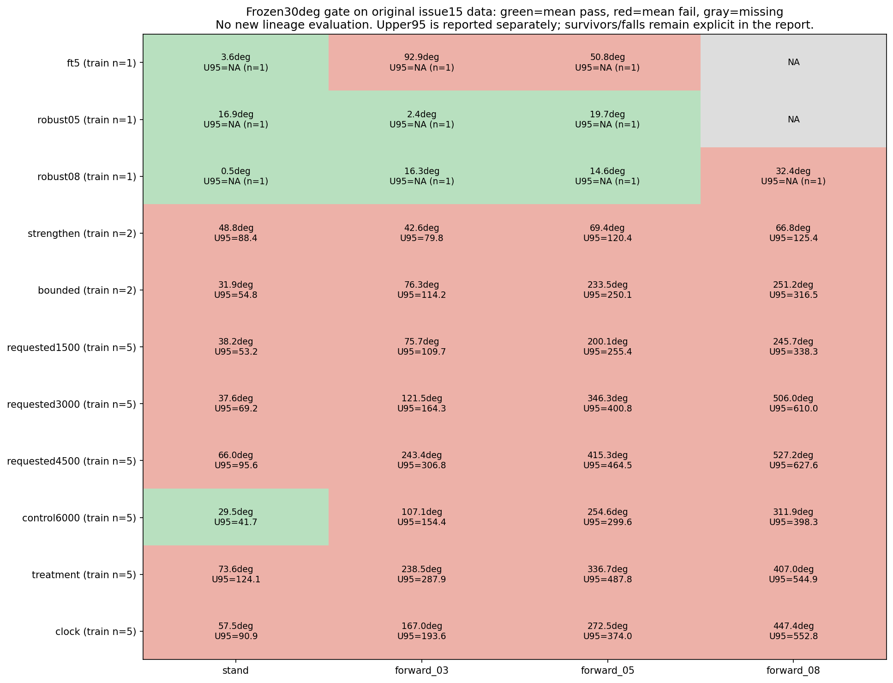
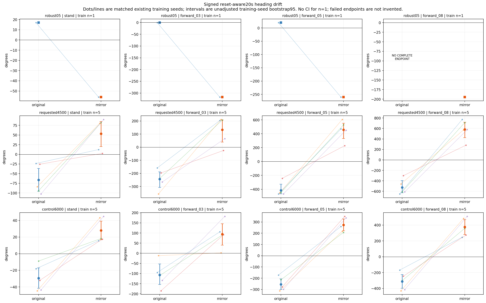
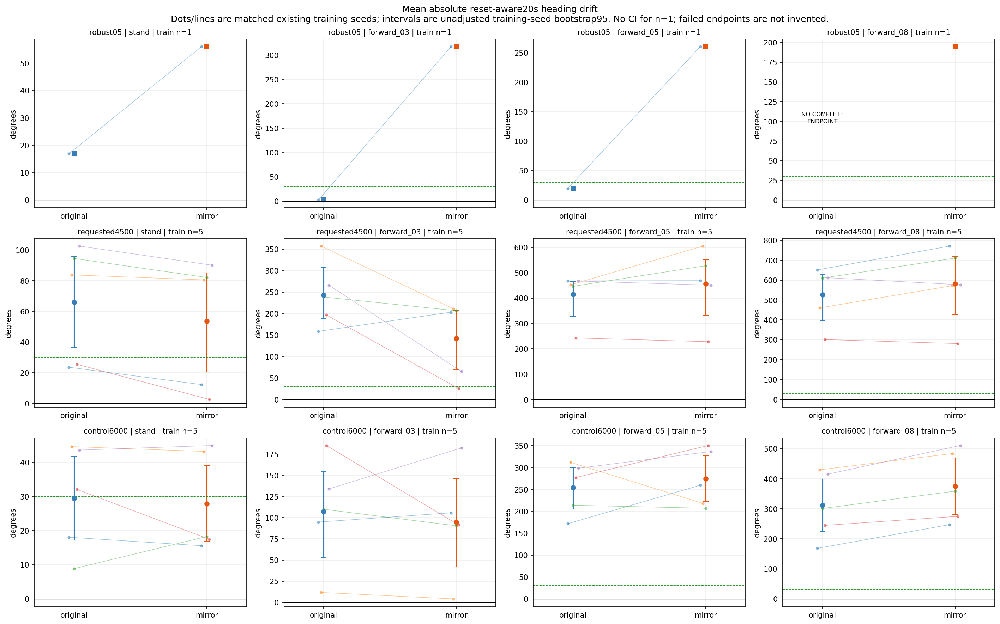
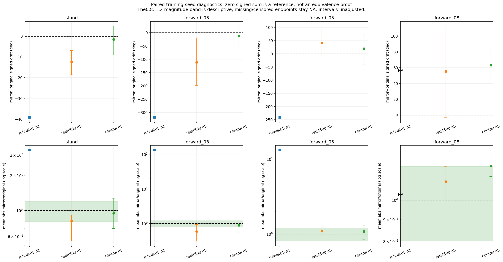
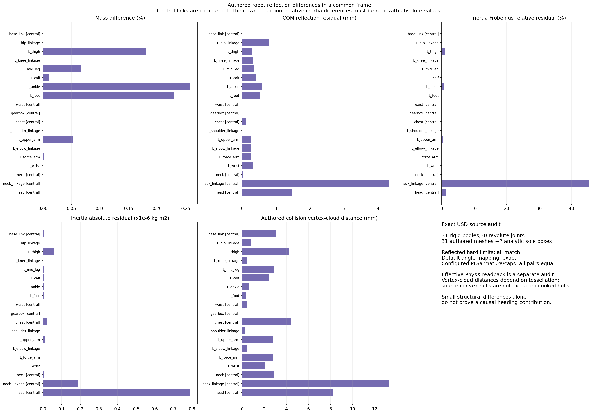
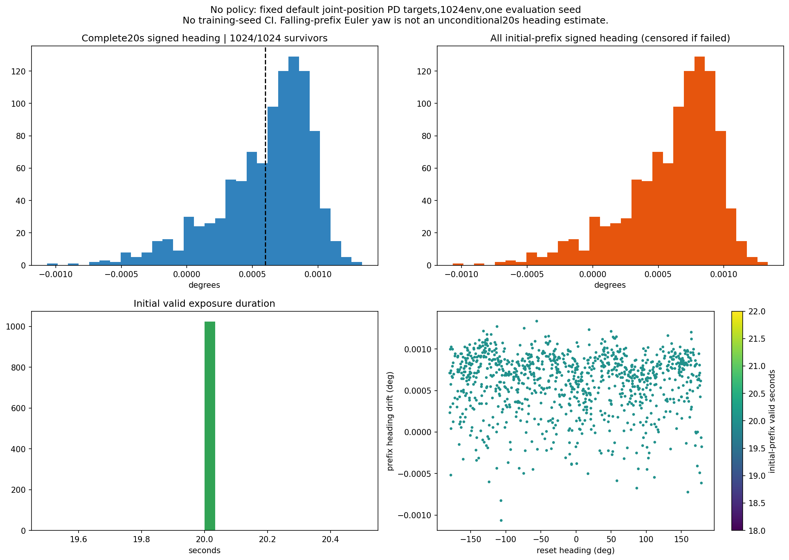
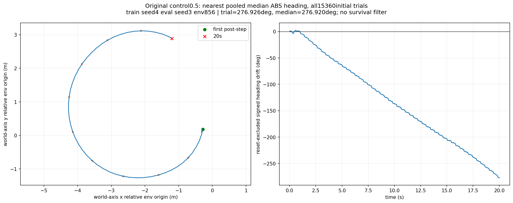

# Issue16: reset-aware heading gate and mirror-source discrimination

Scope: [GitHub issue16](https://github.com/weiguang52/HUMANOID_TW/issues/16). Evaluation and analysis only. Zero training updates, no reward/production configuration/USD changes, and no default-model promotion.

## Finding

A policy-dependent directional bias is demonstrated: all five control6000 seeds reverse direction in every zero-yaw command after policy reflection, and all requested4500 seeds reverse at stand/0.5/0.8 m/s. This supports a learned policy component, not a robot-only explanation. The experiment does not establish that policy bias is the sole cause or quantify the contribution of measured robot asymmetry.

Overall classification: **policy_bias**. This is the observed-evidence classification, with limitations below; authored CAD differences alone do not establish their causal contribution to drift.

- control6000 signed heading at0.5 m/s changes from -254.596 to +274.302 degrees; all five training seeds reverse, mean-absolute ratio1.0774. At0.3 m/s ratio0.8848 and stand0.9472 also satisfy the frozen descriptive magnitude band.
- requested4500 at0.5 m/s changes from -415.314 to +456.151 degrees, ratio1.0983; at0.8 m/s from -527.204 to +582.524 degrees, ratio1.1049. All five seeds reverse in both commands.
- The fixed-default-PD no-policy test has1024/1024 full20s survivors and mean absolute drift0.000638819 degrees. This does not reproduce the hundreds of degrees seen with walking policies.
- The exact USD has measurable mass/COM/inertia/source-collision differences, while reflected limits/defaults and configured/effective PD parameters match. Actual runtime masses/COM/inertias match the authored source within documented tolerances. Structural differences are measured, but their causal heading contribution is not identified.

Limitations:

- The four-way label identifies the demonstrated policy component; it does not mean exclusive policy causation. A causal claim that both sources materially contribute remains unproven without a controlled physical-model intervention.
- requested4500 forward0.3 is mixed: four of five seeds reverse and one remains negative with reduced magnitude; group absolute ratio0.5849 fails the0.8..1.2 band. control6000 forward0.8 reverses all five seeds but ratio1.202746 exceeds1.2; the frozen cutoff is not rounded into a pass.
- The robust05 parent is not a simple preserved large-negative-bias baseline: original forward0.3 signed drift -0.732deg becomes -317.297deg under reflection; forward0.5 +19.709 becomes -260.425deg. This large non-conjugate response is consistent with sensitivity to physical asymmetry or nonlinear policy-environment interaction, and prevents a claim that all later drift is merely inherited unchanged.
- robust05 has only one training seed, hence no training-seed CI; its original forward0.8 has no full20s endpoint and reflected forward0.8 is overwhelmingly censored. Tiny survivor subsets cannot establish normal walking behavior.
- The no-policy result concerns standing at default targets, not a moving gait. Source vertex-cloud differences depend on tessellation and are not exact extracted PhysX-cooked hull differences. Shared ancestry, seed-level rather than trajectory-level pairing and unadjusted bootstrap intervals limit causal interpretation.

Exactly one next proposal (not implemented): **Run one no-training2x2 diagnostic using the same frozen original/reflected policies on the original USD and a separately constructed strictly reflection-symmetric USD, preserving the present commands, denominator rules and heading gate. This isolates the physical-model contribution before choosing a training or model correction.**.

## Frozen design and verified denominator

The 30-degree primary criterion was frozen before formal evaluation: each of stand/0.3/0.5/0.8 m/s must have mean absolute reset-aware quaternion20s heading drift <=30 degrees. Training-seed bootstrap95 upper bounds are reported separately; they do not silently replace the primary mean gate. Missing or survivor-selected endpoints and one-seed uncertainty remain explicit.

34 formal jobs =11 existing models x3 evaluation seeds x6 commands, plus one default-PD no-policy stand job. There are199 command records and203776 initial trials. The four zero-yaw commands in every mirror job and the no-policy job provide133 full all-trial heading-series audits. Each formal job uses1024 environments and20s. No original lineage jobs were rerun. 133 complete command arrays passed independent quaternion-delta reconstruction; max accumulation discrepancy 3.78195546e-06 rad (see exact precision in JSON).

The five original command/reset ordinals plus stand retain issue15 ordering: forward_03,yaw_positive,yaw_negative,forward_05,forward_08,stand. The reflection acts on raw101 actor features before the existing MLP normalizer, with axial/polar signs and all30 actual joint axes, then reflects30 output actions. Critic observations, weights, optimizer and production configuration stay unchanged. Nine unit tests and four final runtime preflights passed; identity wrapping reproduces original metrics/state/RNG exactly.

The initial preflight operator included a temporal half-cycle shift. Pure spatial reflection must leave the limb-independent per-episode scalar clock unchanged. This was corrected and tested before any formal job, with the superseded preflight preserved separately. Global clock means a limb-independent episode clock, not shared wall time across resets. See [amendment](operator_definition_amendment.json), [scope notes](analysis_scope_notes.md), [protocol](protocol_plan.md), [frozen293 input digests](frozen_evaluation_sources.json), [unit tests](mirror_unit_tests.log), and [final preflight audit](smoke_audit.json).

## Original lineage: frozen mean-absolute heading gate

These44 cells reuse committed issue15 data. Survivor20s endpoints are conditional on no reset; prefixes and sums across reset-excluded segments are separate metrics. None of the11 lineage nodes passes all four primary cells.

|Node|Command|Train n|Survivors / original N|Mean abs deg|Train95 upper deg|Mean gate|Endpoint scope|
|---|---|---:|---:|---:|---:|---|---|
|ft5|stand|1|3072/3072|3.633|NA|True|complete_no_reset20s_endpoint|
|ft5|forward_03|1|3072/3072|92.944|NA|False|complete_no_reset20s_endpoint|
|ft5|forward_05|1|322/3072|50.797|NA|False|survivor_selected_endpoint|
|ft5|forward_08|1|0/3072|NA|NA|False|missing_or_censored_in_some_seed|
|robust05|stand|1|3072/3072|16.922|NA|True|complete_no_reset20s_endpoint|
|robust05|forward_03|1|3072/3072|2.404|NA|True|complete_no_reset20s_endpoint|
|robust05|forward_05|1|3072/3072|19.709|NA|True|complete_no_reset20s_endpoint|
|robust05|forward_08|1|0/3072|NA|NA|False|missing_or_censored_in_some_seed|
|robust08|stand|1|3072/3072|0.457|NA|True|complete_no_reset20s_endpoint|
|robust08|forward_03|1|3072/3072|16.300|NA|True|complete_no_reset20s_endpoint|
|robust08|forward_05|1|3072/3072|14.594|NA|True|complete_no_reset20s_endpoint|
|robust08|forward_08|1|3072/3072|32.439|NA|False|complete_no_reset20s_endpoint|
|strengthen|stand|2|6144/6144|48.796|88.421|False|complete_no_reset20s_endpoint|
|strengthen|forward_03|2|6144/6144|42.563|79.757|False|complete_no_reset20s_endpoint|
|strengthen|forward_05|2|6144/6144|69.359|120.406|False|complete_no_reset20s_endpoint|
|strengthen|forward_08|2|6144/6144|66.773|125.395|False|complete_no_reset20s_endpoint|
|bounded|stand|2|6144/6144|31.854|54.819|False|complete_no_reset20s_endpoint|
|bounded|forward_03|2|6144/6144|76.324|114.196|False|complete_no_reset20s_endpoint|
|bounded|forward_05|2|6144/6144|233.549|250.147|False|complete_no_reset20s_endpoint|
|bounded|forward_08|2|6144/6144|251.194|316.500|False|complete_no_reset20s_endpoint|
|requested1500|stand|5|15360/15360|38.247|53.186|False|complete_no_reset20s_endpoint|
|requested1500|forward_03|5|15360/15360|75.664|109.683|False|complete_no_reset20s_endpoint|
|requested1500|forward_05|5|15360/15360|200.136|255.426|False|complete_no_reset20s_endpoint|
|requested1500|forward_08|5|15360/15360|245.701|338.250|False|complete_no_reset20s_endpoint|
|requested3000|stand|5|15360/15360|37.587|69.242|False|complete_no_reset20s_endpoint|
|requested3000|forward_03|5|15360/15360|121.472|164.292|False|complete_no_reset20s_endpoint|
|requested3000|forward_05|5|15360/15360|346.275|400.781|False|complete_no_reset20s_endpoint|
|requested3000|forward_08|5|15360/15360|506.036|610.035|False|complete_no_reset20s_endpoint|
|requested4500|stand|5|15360/15360|65.999|95.592|False|complete_no_reset20s_endpoint|
|requested4500|forward_03|5|15360/15360|243.377|306.784|False|complete_no_reset20s_endpoint|
|requested4500|forward_05|5|15360/15360|415.314|464.541|False|complete_no_reset20s_endpoint|
|requested4500|forward_08|5|15360/15360|527.204|627.565|False|complete_no_reset20s_endpoint|
|control6000|stand|5|15360/15360|29.471|41.739|True|complete_no_reset20s_endpoint|
|control6000|forward_03|5|15360/15360|107.107|154.392|False|complete_no_reset20s_endpoint|
|control6000|forward_05|5|15360/15360|254.596|299.564|False|complete_no_reset20s_endpoint|
|control6000|forward_08|5|15360/15360|311.897|398.341|False|complete_no_reset20s_endpoint|
|treatment|stand|5|15360/15360|73.614|124.127|False|complete_no_reset20s_endpoint|
|treatment|forward_03|5|15360/15360|238.547|287.928|False|complete_no_reset20s_endpoint|
|treatment|forward_05|5|15360/15360|336.658|487.837|False|complete_no_reset20s_endpoint|
|treatment|forward_08|5|15360/15360|406.959|544.948|False|complete_no_reset20s_endpoint|
|clock|stand|5|15360/15360|57.515|90.864|False|complete_no_reset20s_endpoint|
|clock|forward_03|5|15360/15360|167.048|193.580|False|complete_no_reset20s_endpoint|
|clock|forward_05|5|15360/15360|272.521|374.002|False|complete_no_reset20s_endpoint|
|clock|forward_08|5|15360/15360|447.404|552.829|False|complete_no_reset20s_endpoint|

Full signed seed values, failures, prefix drift/exposure and reset-excluded segment metrics are in [lineage_heading_gate.json](lineage_heading_gate.json).

## Mirror comparisons

Each original/mirror training seed is matched; each seed is first averaged over the same three evaluation seeds. Intervals are unadjusted paired training-seed bootstrap95; robust05 has one existing training seed and no training-seed CI. Shared ancestry limits independence and causal identification. Endpoints with no survivors in any seed are not silently discarded.

|Node|Zero-yaw command|Original signed deg [95]|Mirror signed deg [95]|Original mean abs deg [95]|Mirror mean abs deg [95]|Abs M/O|Observed pattern|
|---|---|---:|---:|---:|---:|---:|---|
|robust05|forward_03|-0.732 (n=1; no CI)|-317.297 (n=1; no CI)|2.404 (n=1; no CI)|317.297 (n=1; no CI)|132.005|mixed_or_magnitude_changed|
|robust05|forward_05|19.709 (n=1; no CI)|-260.425 (n=1; no CI)|19.709 (n=1; no CI)|260.425 (n=1; no CI)|13.214|mixed_or_magnitude_changed|
|robust05|forward_08|NA|-194.826 (n=1; no CI)|NA|194.826 (n=1; no CI)|NA|incomplete_or_censored_endpoint_comparison|
|robust05|stand|16.922 (n=1; no CI)|-56.023 (n=1; no CI)|16.922 (n=1; no CI)|56.023 (n=1; no CI)|3.311|mixed_or_magnitude_changed|
|requested4500|forward_03|-243.377 [-306.784, -189.131]|132.251 [39.290, 207.782]|243.377 [189.131, 306.784]|142.341 [69.561, 207.782]|0.585|mixed_or_magnitude_changed|
|requested4500|forward_05|-415.314 [-464.541, -328.290]|456.151 [332.526, 550.652]|415.314 [328.290, 464.541]|456.151 [332.526, 550.652]|1.098|reversal_and_comparable|
|requested4500|forward_08|-527.204 [-627.565, -396.880]|582.524 [425.283, 719.440]|527.204 [396.880, 627.565]|582.524 [425.283, 719.440]|1.105|reversal_and_comparable|
|requested4500|stand|-65.999 [-95.592, -36.406]|53.521 [20.381, 85.019]|65.999 [36.406, 95.592]|53.536 [20.426, 85.019]|0.811|reversal_and_comparable|
|control6000|forward_03|-107.102 [-154.392, -52.799]|94.310 [40.370, 145.872]|107.107 [52.816, 154.392]|94.769 [41.747, 145.872]|0.885|reversal_and_comparable|
|control6000|forward_05|-254.596 [-299.564, -205.463]|274.302 [221.927, 326.677]|254.596 [205.463, 299.564]|274.302 [221.927, 326.677]|1.077|reversal_and_comparable|
|control6000|forward_08|-311.897 [-398.341, -225.452]|375.132 [280.624, 469.641]|311.897 [225.452, 398.341]|375.132 [280.624, 469.641]|1.203|mixed_or_magnitude_changed|
|control6000|stand|-29.471 [-41.739, -17.203]|27.916 [16.886, 39.137]|29.471 [17.203, 41.739]|27.916 [16.886, 39.137]|0.947|reversal_and_comparable|

Magnitude band0.8..1.2 and1-degree signed-direction indeterminacy are descriptive frozen diagnostics. Zero signed M+O is a reference, not an equivalence test. The same-command yaw+/-0.3 controls remain raw turning-performance controls: a true reflection maps the command sign, so their same-command direction cannot diagnose zero-yaw bias reversal. See [complete comparisons, paired sums/differences and ratio CI](mirror_comparisons.json).

|Node|Command|Training seed|Original signed|Mirror signed|Original abs|Mirror abs|Original fall rate|Mirror fall rate|Original prefix s|Mirror prefix s|
|---|---|---:|---:|---:|---:|---:|---:|---:|---:|---:|
|robust05|forward_03|1|-0.732|-317.297|2.404|317.297|0.000|0.000|20.000|20.000|
|robust05|yaw_positive|1|243.006|168.172|243.006|168.172|0.000|0.000|20.000|20.000|
|robust05|yaw_negative|1|-199.071|-283.592|199.071|283.592|0.000|0.000|20.000|20.000|
|robust05|forward_05|1|19.709|-260.425|19.709|260.425|0.000|0.000|20.000|20.000|
|robust05|forward_08|1|NA|-194.826|NA|194.826|1.000|0.999|3.931|4.138|
|robust05|stand|1|16.922|-56.023|16.922|56.023|0.000|0.000|20.000|20.000|
|requested4500|forward_03|1|-158.645|203.194|158.645|203.194|0.000|0.000|20.000|20.000|
|requested4500|forward_03|2|-357.106|211.157|357.106|211.157|0.000|0.000|20.000|20.000|
|requested4500|forward_03|3|-238.534|206.700|238.534|206.700|0.000|0.000|20.000|20.000|
|requested4500|forward_03|4|-196.752|-25.226|196.752|25.226|0.000|0.000|20.000|20.000|
|requested4500|forward_03|5|-265.848|65.428|265.848|65.428|0.000|0.000|20.000|20.000|
|requested4500|yaw_positive|1|249.689|277.401|249.689|277.401|0.000|0.000|20.000|20.000|
|requested4500|yaw_positive|2|183.424|363.755|183.424|363.755|0.000|0.000|20.000|20.000|
|requested4500|yaw_positive|3|157.546|330.884|157.546|330.884|0.000|0.000|20.000|20.000|
|requested4500|yaw_positive|4|248.891|251.212|248.891|251.212|0.000|0.000|20.000|20.000|
|requested4500|yaw_positive|5|220.840|373.065|220.840|373.065|0.000|0.000|20.000|20.000|
|requested4500|yaw_negative|1|-280.963|-256.570|280.963|256.570|0.000|0.000|20.000|20.000|
|requested4500|yaw_negative|2|-362.329|-186.471|362.329|186.471|0.000|0.000|20.000|20.000|
|requested4500|yaw_negative|3|-339.804|-174.735|339.804|174.735|0.000|0.000|20.000|20.000|
|requested4500|yaw_negative|4|-279.813|-237.736|279.813|237.736|0.000|0.000|20.000|20.000|
|requested4500|yaw_negative|5|-376.641|-223.870|376.641|223.870|0.000|0.000|20.000|20.000|
|requested4500|forward_05|1|-467.953|468.801|467.953|468.801|0.000|0.000|20.000|20.000|
|requested4500|forward_05|2|-452.266|605.219|452.266|605.219|0.000|0.000|20.000|20.000|
|requested4500|forward_05|3|-446.535|527.776|446.535|527.776|0.000|0.000|20.000|20.000|
|requested4500|forward_05|4|-242.549|227.947|242.549|227.947|0.000|0.000|20.000|20.000|
|requested4500|forward_05|5|-467.266|451.011|467.266|451.011|0.000|0.000|20.000|20.000|
|requested4500|forward_08|1|-651.429|771.370|651.429|771.370|0.000|0.000|20.000|20.000|
|requested4500|forward_08|2|-460.674|572.088|460.674|572.088|0.000|0.000|20.000|20.000|
|requested4500|forward_08|3|-610.486|711.000|610.486|711.000|0.000|0.000|20.000|20.000|
|requested4500|forward_08|4|-301.190|281.109|301.190|281.109|0.000|0.000|20.000|20.000|
|requested4500|forward_08|5|-612.241|577.053|612.241|577.053|0.000|0.000|20.000|20.000|
|requested4500|stand|1|-23.591|12.290|23.591|12.290|0.000|0.000|20.000|20.000|
|requested4500|stand|2|-83.809|80.554|83.809|80.554|0.000|0.000|20.000|20.000|
|requested4500|stand|3|-94.500|82.136|94.500|82.136|0.000|0.000|20.000|20.000|
|requested4500|stand|4|-25.520|2.493|25.520|2.568|0.000|0.000|20.000|20.000|
|requested4500|stand|5|-102.575|90.134|102.575|90.134|0.000|0.000|20.000|20.000|
|control6000|forward_03|1|-94.818|105.656|94.818|105.656|0.000|0.000|20.000|20.000|
|control6000|forward_03|2|-11.759|1.923|11.788|4.219|0.000|0.000|20.000|20.000|
|control6000|forward_03|3|-109.902|90.422|109.902|90.422|0.000|0.000|20.000|20.000|
|control6000|forward_03|4|-185.128|91.277|185.128|91.277|0.000|0.000|20.000|20.000|
|control6000|forward_03|5|-133.900|182.269|133.900|182.269|0.000|0.000|20.000|20.000|
|control6000|yaw_positive|1|300.183|347.240|300.183|347.240|0.000|0.000|20.000|20.000|
|control6000|yaw_positive|2|205.791|306.517|205.791|306.517|0.000|0.000|20.000|20.000|
|control6000|yaw_positive|3|246.829|302.232|246.829|302.232|0.000|0.000|20.000|20.000|
|control6000|yaw_positive|4|264.887|310.117|264.887|310.117|0.000|0.000|20.000|20.000|
|control6000|yaw_positive|5|264.280|381.415|264.280|381.415|0.000|0.000|20.000|20.000|
|control6000|yaw_negative|1|-333.841|-312.818|333.841|312.818|0.000|0.000|20.000|20.000|
|control6000|yaw_negative|2|-297.733|-221.082|297.733|221.082|0.000|0.000|20.000|20.000|
|control6000|yaw_negative|3|-286.483|-246.417|286.483|246.417|0.000|0.000|20.000|20.000|
|control6000|yaw_negative|4|-321.670|-288.783|321.670|288.783|0.000|0.000|20.000|20.000|
|control6000|yaw_negative|5|-386.008|-272.897|386.008|272.897|0.000|0.000|20.000|20.000|
|control6000|forward_05|1|-171.715|259.560|171.715|259.560|0.000|0.000|20.000|20.000|
|control6000|forward_05|2|-311.959|218.026|311.959|218.026|0.000|0.000|20.000|20.000|
|control6000|forward_05|3|-213.787|207.013|213.787|207.013|0.000|0.000|20.000|20.000|
|control6000|forward_05|4|-277.135|350.365|277.135|350.365|0.000|0.000|20.000|20.000|
|control6000|forward_05|5|-298.385|336.546|298.385|336.546|0.000|0.000|20.000|20.000|
|control6000|forward_08|1|-168.234|247.296|168.234|247.296|0.000|0.000|20.000|20.000|
|control6000|forward_08|2|-430.000|483.873|430.000|483.873|0.000|0.000|20.000|20.000|
|control6000|forward_08|3|-301.007|358.736|301.007|358.736|0.000|0.000|20.000|20.000|
|control6000|forward_08|4|-244.893|274.897|244.893|274.897|0.000|0.000|20.000|20.000|
|control6000|forward_08|5|-415.348|510.860|415.348|510.860|0.000|0.000|20.000|20.000|
|control6000|stand|1|-18.082|15.588|18.082|15.588|0.000|0.000|20.000|20.000|
|control6000|stand|2|-44.662|43.234|44.662|43.234|0.000|0.000|20.000|20.000|
|control6000|stand|3|-8.875|18.283|8.875|18.283|0.000|0.000|20.000|20.000|
|control6000|stand|4|-32.100|17.486|32.100|17.486|0.000|0.000|20.000|20.000|
|control6000|stand|5|-43.636|44.988|43.636|44.988|0.000|0.000|20.000|20.000|

[All job metrics](job_statistics.json), [seed metrics](seed_statistics.json), [group metrics](group_statistics.json), [203776 per-trial rows](per_trial_heading.csv.gz), and [raw audit bindings](analysis_integrity_audit.json) retain the complete denominator and all censoring.

## Exact robot and effective simulator readback

Source USD SHA-256: `24663fd164311931d0ea633bb1e4ceeb7a35bb7f3c02a52e10a94aafa6035816`. All31 bodies,30 revolute joints and33 collision nodes are covered (31 authored descendant meshes with8692878 points plus2 analytic sole boxes). Vertex-cloud Hausdorff distances are tessellation-sensitive source diagnostics; exact PhysX-cooked hulls were not extracted. Central links are compared with their own reflection. Relative inertia residuals must be read with absolute kg m2 residuals.

A separate64-environment zero-step validation reads actual PhysX masses, COM poses, inertia tensors, limits, drive gains, armature and caps after exact scene initialization, before checkpoint loading or policy invocation. It adds zero formal trials. Installed SDK docstrings establish local COM quaternion xyzw and column-major inertia at COM expressed in the rigid-body-prim frame. Authored USD drive attributes and effective ImplicitActuator overrides are kept distinct.

Authored/effective body consistency: **True**; effective joint parameter checks: **True**. See [runtime audit and tolerances](runtime_symmetry_audit.json), [raw readback metadata](runtime_readback/metadata.json), [installed SDK evidence](runtime_readback/installed_sdk_getter_evidence.json), [joint parameter CSV](runtime_joint_parameters.csv), and [source geometry audit](usd_symmetry_audit.json).

|Body|Partner|Mass difference %|COM residual mm|Inertia relative %|Inertia absolute kg m2|Source-cloud distance mm|
|---|---|---:|---:|---:|---:|---:|
|base_link|base_link|0.000|0.006|0.054|4.49306165e-09|3.050|
|left_hip_linkage|right_hip_linkage|0.000|0.801|0.000|0|0.824|
|left_thigh|right_thigh|0.180|0.280|0.913|5.90806734e-08|4.221|
|left_knee_linkage|right_knee_linkage|0.000|0.307|0.000|1.23904331e-13|0.397|
|left_mid_leg|right_mid_leg|0.066|0.359|0.235|5.88078505e-09|2.882|
|left_calf|right_calf|0.011|0.403|0.121|3.58915281e-09|2.453|
|left_ankle|right_ankle|0.257|0.576|0.642|3.12143324e-09|0.641|
|left_foot|right_foot|0.229|0.520|0.124|4.05239058e-09|0.349|
|waist|waist|0.000|0.000|0.000|7.87347279e-13|0.460|
|gearbox|gearbox|0.000|0.000|0.000|1.67394231e-15|0.000|
|chest|chest|0.000|0.102|0.079|1.91371937e-08|4.387|
|left_shoulder_linkage|right_shoulder_linkage|0.000|0.001|0.000|5.84436909e-23|0.232|
|left_upper_arm|right_upper_arm|0.052|0.245|0.495|1.07100864e-08|2.758|
|left_elbow_linkage|right_elbow_linkage|0.000|0.261|0.000|6.11492875e-14|0.438|
|left_force_arm|right_force_arm|0.001|0.262|0.130|1.78150745e-09|2.772|
|left_wrist|right_wrist|0.000|0.316|0.015|8.88602668e-10|2.044|
|neck|neck|0.000|0.016|0.171|3.01756946e-09|2.929|
|neck_linkage|neck_linkage|0.000|4.335|45.270|1.8698222e-07|13.325|
|head|head|0.000|1.477|1.348|7.89407248e-07|8.177|

Complete joint sign/default/limit/PD table (actual axes at authored pose):

|Joint|Partner|Sign|Axis residual deg|Default rad|Reflected default error rad|Hard-limit error deg|Configured PD equal|
|---|---|---:|---:|---:|---:|---:|---|
|left_hip_pitch_joint|right_hip_pitch_joint|-1|0|0.000|0.000|0.000|True|
|left_hip_roll_joint|right_hip_roll_joint|-1|0|0.000|0.000|0.000|True|
|left_hip_yaw_joint|right_hip_yaw_joint|-1|0|0.000|0.000|0.000|True|
|left_knee_pitch_joint|right_knee_pitch_joint|1|0|0.000|0.000|0.000|True|
|left_ankle_yaw_joint|right_ankle_yaw_joint|-1|0|0.000|0.000|0.000|True|
|left_ankle_pitch_joint|right_ankle_pitch_joint|-1|0|0.000|0.000|0.000|True|
|left_foot_roll|right_foot_roll|-1|0|0.000|0.000|0.000|True|
|right_hip_pitch_joint|left_hip_pitch_joint|-1|0|0.000|0.000|0.000|True|
|right_hip_roll_joint|left_hip_roll_joint|-1|0|0.000|0.000|0.000|True|
|right_hip_yaw_joint|left_hip_yaw_joint|-1|0|0.000|0.000|0.000|True|
|right_knee_pitch_joint|left_knee_pitch_joint|1|0|0.000|0.000|0.000|True|
|right_ankle_yaw_joint|left_ankle_yaw_joint|-1|0|0.000|0.000|0.000|True|
|right_ankle_pitch_joint|left_ankle_pitch_joint|-1|0|0.000|0.000|0.000|True|
|right_foot_roll|left_foot_roll|-1|0|0.000|0.000|0.000|True|
|waist_yaw|waist_yaw|-1|0|0.000|0.000|0.000|True|
|waist_roll_joint|waist_roll_joint|-1|9.99316432e-06|0.000|0.000|0.000|True|
|waist_pitch_joint|waist_pitch_joint|1|9.99316432e-06|0.000|0.000|0.000|True|
|left_shoulder_pitch_joint|right_shoulder_pitch_joint|-1|2.0004556e-05|0.000|0.000|0.000|True|
|left_shoulder_roll_joint|right_shoulder_roll_joint|-1|0|-1.571|0.000|0.000|True|
|left_shoulder_yaw_joint|right_shoulder_yaw_joint|-1|0|0.000|0.000|0.000|True|
|left_elbow_pitch_joint|right_elbow_pitch_joint|-1|1.50079711e-05|0.000|0.000|0.000|True|
|left_wrist_pitch|right_wrist_pitch|-1|9.23497398e-06|0.000|0.000|0.000|True|
|right_shoulder_pitch_joint|left_shoulder_pitch_joint|-1|2.0004556e-05|0.000|0.000|0.000|True|
|right_shoulder_roll_joint|left_shoulder_roll_joint|-1|0|1.571|0.000|0.000|True|
|right_shoulder_yaw_joint|left_shoulder_yaw_joint|-1|0|0.000|0.000|0.000|True|
|right_elbow_pitch_joint|left_elbow_pitch_joint|-1|1.50079711e-05|0.000|0.000|0.000|True|
|right_wrist_pitch|left_wrist_pitch|-1|9.23497398e-06|0.000|0.000|0.000|True|
|neck|neck|-1|0|0.000|0.000|0.000|True|
|neck_linkage_roll|neck_linkage_roll|-1|0|0.000|0.000|0.000|True|
|head_pitch|head_pitch|1|0|0.000|0.000|0.000|True|

## No-policy default-PD stand test

One1024-environment20s stand job, no actor called and default joint-position targets asserted after every step. No training-seed CI. This tests default-PD stand behavior, not a straight-walking controller. Falling prefixes do not become unconditional20s heading estimates.

|Metric|Observed value|
|---|---:|
|full20s_heading_survivors|1024.000|
|original_trial_count|1024.000|
|fall_rate|0.000|
|full20s_survivor_heading_signed_mean_degrees|0.001|
|full20s_survivor_heading_mean_abs_degrees|0.001|
|initial_prefix_all_heading_signed_mean_degrees|0.001|
|initial_prefix_all_heading_mean_abs_degrees|0.001|
|initial_prefix_mean_duration_s|20.000|
|all_episode_segments_heading_signed_mean_degrees|0.001|
|all_episode_segments_heading_mean_abs_degrees|0.001|

[No-policy statistics](no_policy_statistics.json) and the raw no_policy/ records preserve all1024 trials and resets.

## Original median-heading representative and colored replay

Selection uses all15360 original control6000 forward0.5 trials, with no survival filter (all happened to survive). Pooled median absolute heading drift=276.920483deg; nearest trial=276.925768deg, signed=-276.925768deg. Training seed4, evaluation seed3, env856. Selection is by heading, not body-yaw MAE.

The one original source-job reconstruction must reproduce every previously recorded original result and moment array exactly before its poses are used. Replay sets saved poses, with no dynamics integration and no changed step counter. Front/side cameras follow position and heading; the overhead follows translation while preserving world heading. Every20s clip has1000 frames at50fps, world-XY trail/heading inset and cumulative reset-excluded heading overlay. The original and colored USD assets are hashed and1876 original attributes remain unchanged.

[Selection and source digests](representative_selection.json), [exact reconstruction audit](reconstruction_state.json), [media source binding](media_source_sha256.json), [automatic video audit](video_quality_audit.json), and [actual manual review](manual_review.json).

|View|Colored original-policy replay|
|---|---|
|front|[front20s video](videos/control6000_front.mp4)|
|side|[side20s video](videos/control6000_side.mp4)|
|overhead|[overhead20s video](videos/control6000_overhead.mp4)|

[Joint colors and legend](joint_colors.json). [Three-view contact sheet](video_contact_sheets/control6000.png).

Generated video plan (exact paths):

```json
[
  {
    "group": "control6000",
    "model": "control6000_s4",
    "env_id": 856,
    "push_seconds": [],
    "selection_metric": "absolute reset-aware quaternion20s heading drift; not body-z yaw MAE",
    "source_policy_mode": "original",
    "views": {
      "front": {
        "path": "/root/gpufree-data/tw_stage1/issue16_20261111/videos/control6000_front.mp4",
        "sha256": "58098e74b80391807a8a443f16735fb8f91f5b1f821ba004579a299e65427459",
        "metadata": "/root/gpufree-data/tw_stage1/issue16_20261111/control6000_front.json",
        "source_trajectory_sha256": "3cef5d46eeac1a79dc0ce458ba3efaf5655f7c5d113ca5d5f6233523b5cea487"
      },
      "side": {
        "path": "/root/gpufree-data/tw_stage1/issue16_20261111/videos/control6000_side.mp4",
        "sha256": "98be21d54162e91c2ea73926f85c3f63a028b56485913e6129804427aaf2ea44",
        "metadata": "/root/gpufree-data/tw_stage1/issue16_20261111/control6000_side.json",
        "source_trajectory_sha256": "3cef5d46eeac1a79dc0ce458ba3efaf5655f7c5d113ca5d5f6233523b5cea487"
      },
      "overhead": {
        "path": "/root/gpufree-data/tw_stage1/issue16_20261111/videos/control6000_overhead.mp4",
        "sha256": "32aad0dfd98be98e33ee2253357ea656b724e3ffbb6708b4710d184138895b7e",
        "metadata": "/root/gpufree-data/tw_stage1/issue16_20261111/control6000_overhead.json",
        "source_trajectory_sha256": "3cef5d46eeac1a79dc0ce458ba3efaf5655f7c5d113ca5d5f6233523b5cea487"
      }
    }
  }
]
```

## Figures















All seven PNG/SVG figures, the three-view contact sheet and six full-resolution critical frames were actually reviewed; exact reviewed-byte hashes are in manual_review.json. [Figure bindings](figure_outputs_sha256.json) retain exact output bytes, including SVG.

## Reproducibility and archive

Use cohort.json for the11 existing checkpoint references/digests, formal_jobs.json for the frozen queue, and frozen_evaluation_sources.json for all293 immutable inputs. The source Git parent is770014ee9a4393da6dff34eced89a04d83e788dd. Production/train/eval source and model state stayed unchanged through formal evaluation. Large source artifacts, if chunked for publication, are reconstructible byte-for-byte using lossless_chunk_manifest.json. No mounted dataset was copied to the local client.

Formal/raw validation: analysis_integrity_audit.json. Source and output binding: analysis_outputs_sha256.json, figure_outputs_sha256.json, media_source_sha256.json. Original baseline source manifest: committed stage1_issue15_20261111/sha256.json. The final Git commit and issue reply provide publication identity; they are not circularly embedded into their own commit.
