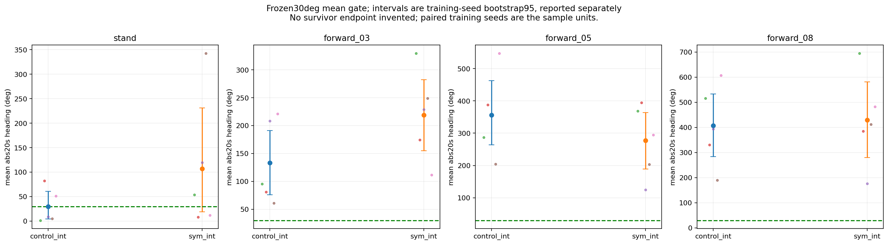
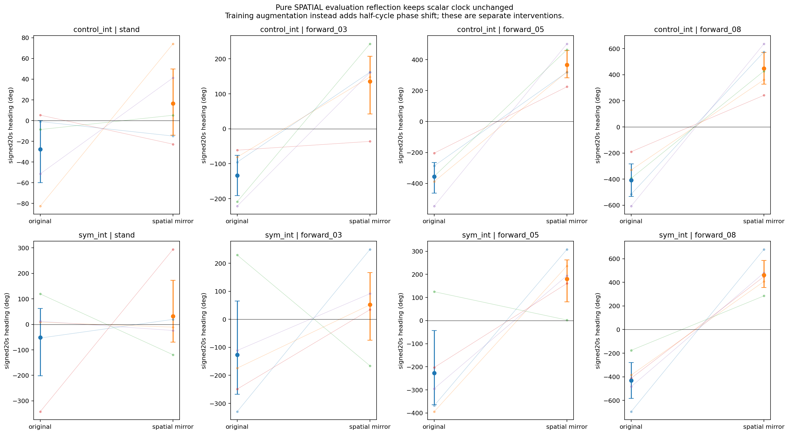
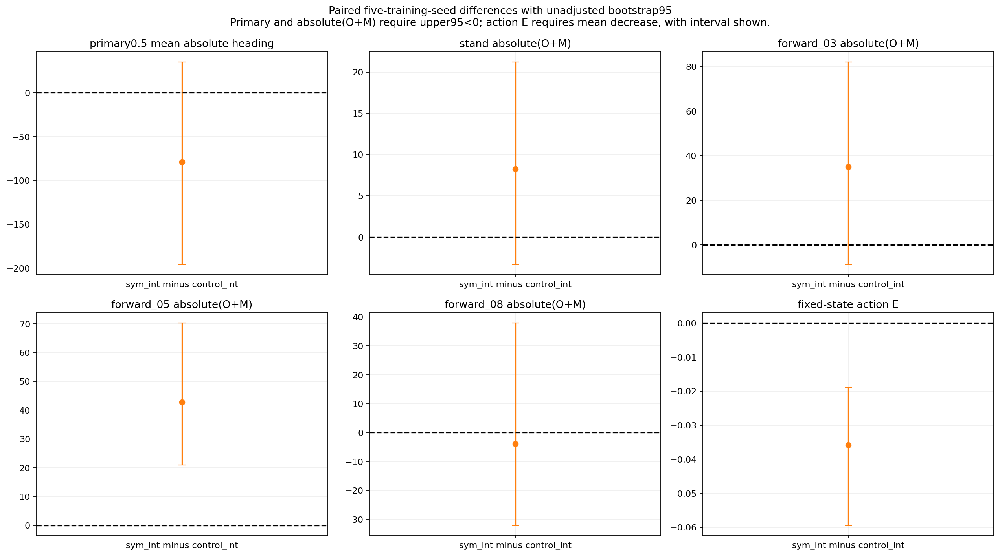
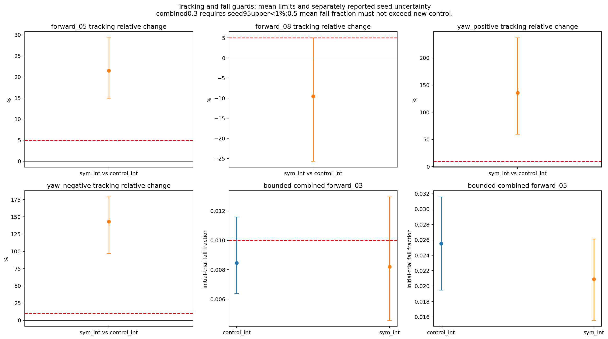
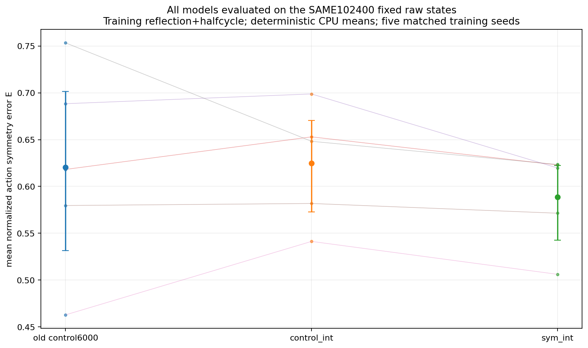
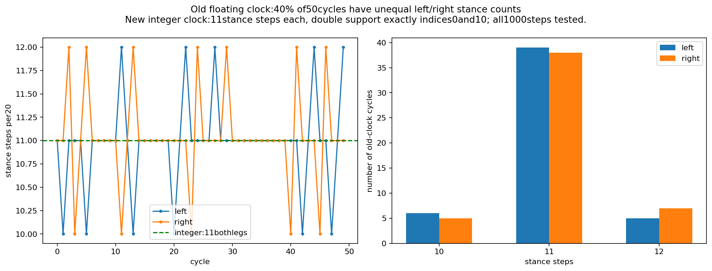

# Issue17: integer gait clock and mirrored half-cycle augmentation

Not accepted: one or more frozen gates fail. Primary pass: False.

This study follows issue17 and decision comment6831246933. Both new groups use the integer20-step clock; control_int has no augmentation and sym_int adds spatial reflection plus a half-cycle phase shift with mirror loss disabled. Original control6000 is reused only as a secondary descriptive reference. The primary comparison is sym_int minus control_int. No checkpoint scan, phase retuning or extra formal updates are permitted.

## Design and preflight

The initial unchanged-floating-clock proposal failed strict reward invariance at phase boundaries. This was reported before training, then the owner authorized the integer clock and a new matched control. Original evidence and both protocol versions are retained. Period0.4s,step0.02s,offsets[0,0.5],threshold0.55 and reward weights stay unchanged. Integer indices give11stance steps per leg in every20-step cycle, with double support exactly at indices0and10. Old CPU floating-clock replay shows40% asymmetric cycles among50; this is a synthetic numerical diagnostic, not an observed training failure rate.

Tests execute all1000integer steps and every contact pattern: both actual reward functions are elementwise invariant after LRswap+10steps. Actor101/critic134/action30 involution, TensorDict ordering and RNG-neutral transforms pass. The original vs disabled entry points reproduce the actual4096-env two-update model/optimizer/RNG/physics states byte-for-byte. Enabled control/augmentation runtime preflights and all18active reward-term audits are preserved. See protocol_plan.md,protocol_amendment.json,reward_invariance_table.md,disabled_two_update_reproduction.json and enabled_preflight_audit.json.

## Formal budget and verification

Five matched requested4500 parents and training seeds,4096environments and1500updates each for control_int and sym_int:10runs and15000formalupdates. Actor/critic/optimizer/std restored exactly; no std reset. Formal training audit verifies all ten final checkpoints, config differences and actual augmentation calls. Each rollout has98304samples; minibatches are24576without augmentation and49152with augmentation. All30000augmented minibatch calls per treatment run are checked.

All90formal evaluation jobs completed: 450 command records,460800 initial trials,330 full all-trial heading arrays independently reconstructed. Clean original and pure-spatial mirror each have six commands; bounded combined has three forward commands. Each uses1024env x3eval seeds x20s. Clean six-command and combined three-command reset ordinals preserve their respective original protocols.

The training transform NEGATES gait sin/cos; pure-spatial evaluation reflection leaves them unchanged. These interventions must not be conflated. Training seeds are the five paired sample units, averaging three evaluation seeds within each; bootstrap95 intervals are unadjusted. No missing seed endpoint is dropped. Reset-aware heading is the sum of wrapped consecutive quaternion-yaw increments excluding reset/terminal frames, then absolute-valued per trial. Full20s endpoints are conditional on survival; prefixes, failure counts and exposure remain separate.

## Actual training durations

|Group|Training seed|Updates|Wall seconds|
|---|---:|---:|---:|
|control_int|1|1500|1690.06|
|sym_int|1|1500|1805.06|
|control_int|2|1500|1690.06|
|sym_int|2|1500|1810.07|
|control_int|3|1500|1670.06|
|sym_int|3|1500|1790.06|
|control_int|4|1500|1705.08|
|sym_int|4|1500|1880.07|
|control_int|5|1500|1670.06|
|sym_int|5|1500|1790.06|

After all training finished, the user authorized removal of unused training weights. Only 150 unreferenced intermediate checkpoints from these ten completed runs were deleted (819983850 bytes). All ten final model/optimizer checkpoints, original parents, historical runs and frozen inputs were preserved and hash-verified. No checkpoint selection or extra updates occurred. Exact deleted paths and SHA256 values remain in [cleanup receipt](unused_intermediate_weight_cleanup_receipt.json) and [inventory](unused_intermediate_weight_inventory.json).

## Primary and every frozen guard

|Gate|Pass|
|---|---|
|primary|False|
|heading_stand|False|
|mirror_stand|False|
|heading_forward_03|False|
|mirror_forward_03|False|
|heading_forward_05|False|
|mirror_forward_05|False|
|heading_forward_08|False|
|mirror_forward_08|False|
|tracking_forward_05|False|
|tracking_forward_08|True|
|tracking_yaw_positive|False|
|tracking_yaw_negative|False|
|combined_f03|False|
|combined_f05|True|
|action_E|True|

Primary paired difference (degrees):

```json
{
  "mean": -78.8561812595016,
  "training_seeds": 5,
  "bootstrap95": [
    -195.79502648721345,
    35.01493707262711
  ],
  "sd": 151.43814801688055
}
```

Full paired diagnostics (including all O+M, E, relative tracking and fall intervals):

```json
{
  "primary": {
    "mean": -78.8561812595016,
    "training_seeds": 5,
    "bootstrap95": [
      -195.79502648721345,
      35.01493707262711
    ],
    "sd": 151.43814801688055
  },
  "abs_O_plus_M_stand": {
    "per_seed": {
      "control_int": [
        15.92134441539691,
        8.456393005665916,
        3.522795473675175,
        17.5510165403419,
        10.149243161764375
      ],
      "sym_int": [
        34.069018650135106,
        2.6084751381827935,
        0.2110463921277841,
        47.96822308145374,
        11.868395930530534
      ]
    },
    "paired_difference": {
      "mean": 8.224873319117137,
      "training_seeds": 5,
      "bootstrap95": [
        -3.3200362258589733,
        21.217508955305266
      ],
      "sd": 15.52758142728229
    }
  },
  "abs_O_plus_M_forward_03": {
    "per_seed": {
      "control_int": [
        66.52586007617727,
        67.0821896334626,
        34.52786111564194,
        97.23673305394544,
        60.21752014118891
      ],
      "sym_int": [
        79.97180531226365,
        122.63149495440342,
        63.049336186762474,
        214.74083027320688,
        20.021749014723852
      ]
    },
    "paired_difference": {
      "mean": 34.965010344188826,
      "training_seeds": 5,
      "bootstrap95": [
        -8.65579745731976,
        81.91104836000508
      ],
      "sd": 57.8579001586692
    }
  },
  "abs_O_plus_M_forward_05": {
    "per_seed": {
      "control_int": [
        32.46294957908668,
        66.49613933870671,
        110.4021932665537,
        20.66210594616416,
        44.09384312881366
      ],
      "sym_int": [
        60.030130313488485,
        157.6694456130866,
        127.04505955055251,
        42.57532399137733,
        100.42763378401156
      ]
    },
    "paired_difference": {
      "mean": 42.726072398638316,
      "training_seeds": 5,
      "bootstrap95": [
        20.935869878565153,
        70.26959690287069
      ],
      "sd": 31.127178680392888
    }
  },
  "abs_O_plus_M_forward_08": {
    "per_seed": {
      "control_int": [
        58.99896510791666,
        30.780078892940764,
        33.923724550383156,
        51.648575858362875,
        30.05021050638686
      ],
      "sym_int": [
        15.491791317273396,
        22.017941392147236,
        109.34947033165358,
        36.6662972995324,
        2.1348152632634196
      ]
    },
    "paired_difference": {
      "mean": -3.948247862424057,
      "training_seeds": 5,
      "bootstrap95": [
        -32.097215697918145,
        37.919940919978856
      ],
      "sd": 46.326253377462415
    }
  },
  "tracking_forward_05": {
    "relative_change": 0.21504379463916523,
    "paired_ratio_bootstrap95": [
      0.14817274698111338,
      0.2928783102067898
    ],
    "paired_difference": {
      "mean": 0.0076980246281153405,
      "training_seeds": 5,
      "bootstrap95": [
        0.005460405403213987,
        0.010162510066507282
      ],
      "sd": 0.003018548269777843
    },
    "bound": 0.05
  },
  "tracking_forward_08": {
    "relative_change": -0.09500449766765717,
    "paired_ratio_bootstrap95": [
      -0.2567278455072648,
      0.05012612570380348
    ],
    "paired_difference": {
      "mean": -0.008919269912720204,
      "training_seeds": 5,
      "bootstrap95": [
        -0.02586134219144883,
        0.004657504537844142
      ],
      "sd": 0.019624569374505428
    },
    "bound": 0.05
  },
  "tracking_yaw_positive": {
    "relative_change": 1.3565495723636722,
    "paired_ratio_bootstrap95": [
      0.5976894796904695,
      2.368341748892876
    ],
    "paired_difference": {
      "mean": 0.17261259390725564,
      "training_seeds": 5,
      "bootstrap95": [
        0.0895721002630647,
        0.27323576967076807
      ],
      "sd": 0.1222772830595238
    },
    "bound": 0.1
  },
  "tracking_yaw_negative": {
    "relative_change": 1.431051102355807,
    "paired_ratio_bootstrap95": [
      0.9708456100885099,
      1.7889087076464767
    ],
    "paired_difference": {
      "mean": 0.16334318455022298,
      "training_seeds": 5,
      "bootstrap95": [
        0.11869567535884665,
        0.20891273276010183
      ],
      "sd": 0.054756155868208596
    },
    "bound": 0.1
  },
  "combined_f03_fall": {
    "mean": 0.008203125,
    "training_seeds": 5,
    "bootstrap95": [
      0.004557291666666667,
      0.012955729166666666
    ],
    "sd": 0.005482876410186872
  },
  "combined_f05_fall": {
    "new": {
      "mean": 0.0208984375,
      "training_seeds": 5,
      "bootstrap95": [
        0.015559895833333334,
        0.026106770833333338
      ],
      "sd": 0.006933670162920096
    },
    "control": {
      "mean": 0.025520833333333336,
      "training_seeds": 5,
      "bootstrap95": [
        0.01946614583333333,
        0.03157552083333333
      ],
      "sd": 0.007892118172114602
    },
    "paired_difference": {
      "mean": -0.0046223958333333325,
      "training_seeds": 5,
      "bootstrap95": [
        -0.009375,
        0.0003255208333333346
      ],
      "sd": 0.006343063910370945
    }
  },
  "action_E": {
    "per_seed": {
      "control_int": [
        0.6529755792440847,
        0.6988049217590014,
        0.5818157089865417,
        0.5413003040786134,
        0.6482308113924228
      ],
      "sym_int": [
        0.623006277596578,
        0.6197774233573,
        0.5714174502072273,
        0.5061490579735255,
        0.6234308038200834
      ],
      "control6000": [
        0.6181957093946403,
        0.6883943344134604,
        0.5796403464474134,
        0.46284306303918127,
        0.753402289248188
      ]
    },
    "paired_difference": {
      "mean": -0.035869262501189936,
      "training_seeds": 5,
      "bootstrap95": [
        -0.05940421970002352,
        -0.019039308055129343
      ],
      "sd": 0.025832435265301396
    }
  }
}
```

## Per-training-seed metrics and denominators

|Protocol/group/command|Seed|Mean abs20s deg|Signed20s deg|Survivors/initialN|Fall rate|Prefix seconds|Mean forward speed|
|---|---:|---:|---:|---:|---:|---:|---:|
|clean:control_int:forward_03|1|95.4846|-95.4846|3072/3072|0|20|0.278047|
|clean:control_int:forward_03|2|81.0394|-81.0394|3072/3072|0|20|0.27431|
|clean:control_int:forward_03|3|208.539|-208.539|3072/3072|0|20|0.279543|
|clean:control_int:forward_03|4|61.1575|-61.1575|3072/3072|0|20|0.288464|
|clean:control_int:forward_03|5|221.17|-221.17|3072/3072|0|20|0.255764|
|clean:control_int:yaw_positive|1|301.58|301.58|3072/3072|0|20|-0.00150811|
|clean:control_int:yaw_positive|2|230.074|230.074|3072/3072|0|20|-0.0153091|
|clean:control_int:yaw_positive|3|280.871|280.871|3072/3072|0|20|-0.0225136|
|clean:control_int:yaw_positive|4|280.729|280.729|3072/3072|0|20|-0.0233025|
|clean:control_int:yaw_positive|5|237.738|237.738|3072/3072|0|20|-0.0161834|
|clean:control_int:yaw_negative|1|306.557|-306.557|3072/3072|0|20|-0.00999228|
|clean:control_int:yaw_negative|2|378.226|-378.226|3072/3072|0|20|-0.0121823|
|clean:control_int:yaw_negative|3|286.347|-286.347|3072/3072|0|20|-0.0208543|
|clean:control_int:yaw_negative|4|258.752|-258.752|3072/3072|0|20|-0.0305938|
|clean:control_int:yaw_negative|5|350.59|-350.59|3072/3072|0|20|-0.0163999|
|clean:control_int:forward_05|1|286.737|-286.737|3072/3072|0|20|0.508051|
|clean:control_int:forward_05|2|388.205|-388.205|3072/3072|0|20|0.486818|
|clean:control_int:forward_05|3|354.303|-354.303|3072/3072|0|20|0.494183|
|clean:control_int:forward_05|4|204.287|-204.287|3072/3072|0|20|0.511106|
|clean:control_int:forward_05|5|546.905|-546.905|3072/3072|0|20|0.485292|
|clean:control_int:forward_08|1|515.472|-515.472|3072/3072|0|20|0.715273|
|clean:control_int:forward_08|2|330.25|-330.25|3072/3072|0|20|0.721344|
|clean:control_int:forward_08|3|393.853|-393.853|3072/3072|0|20|0.728784|
|clean:control_int:forward_08|4|190.446|-190.446|3072/3072|0|20|0.721383|
|clean:control_int:forward_08|5|606.823|-606.823|3072/3072|0|20|0.697015|
|clean:control_int:stand|1|1.52712|-0.972365|3072/3072|0|20|-0.00603911|
|clean:control_int:stand|2|82.6149|-82.6149|3072/3072|0|20|-0.01175|
|clean:control_int:stand|3|8.65938|-8.65938|3072/3072|0|20|-0.0282011|
|clean:control_int:stand|4|5.25113|5.25113|3072/3072|0|20|-0.0308712|
|clean:control_int:stand|5|51.4513|-51.4513|3072/3072|0|20|-0.0244636|
|mirror:control_int:forward_03|1|162.01|162.01|3072/3072|0|20|0.266948|
|mirror:control_int:forward_03|2|148.122|148.122|3072/3072|0|20|0.277848|
|mirror:control_int:forward_03|3|243.067|243.067|3072/3072|0|20|0.28688|
|mirror:control_int:forward_03|4|36.0793|-36.0793|3072/3072|0|20|0.274852|
|mirror:control_int:forward_03|5|160.953|160.953|3072/3072|0|20|0.265446|
|mirror:control_int:yaw_positive|1|305.992|305.992|3072/3072|0|20|-0.0107392|
|mirror:control_int:yaw_positive|2|377.39|377.39|3072/3072|0|20|-0.0119829|
|mirror:control_int:yaw_positive|3|292.075|292.075|3072/3072|0|20|-0.0234972|
|mirror:control_int:yaw_positive|4|243.381|243.381|3072/3072|0|20|-0.0338515|
|mirror:control_int:yaw_positive|5|345.02|345.02|3072/3072|0|20|-0.013748|
|mirror:control_int:yaw_negative|1|319.151|-319.151|3072/3072|0|20|0.000484757|
|mirror:control_int:yaw_negative|2|248.696|-248.696|3072/3072|0|20|-0.0118352|
|mirror:control_int:yaw_negative|3|274.516|-274.516|3072/3072|0|20|-0.0229933|
|mirror:control_int:yaw_negative|4|307.819|-307.819|3072/3072|0|20|-0.0226358|
|mirror:control_int:yaw_negative|5|247.69|-247.69|3072/3072|0|20|-0.0161085|
|mirror:control_int:forward_05|1|319.2|319.2|3072/3072|0|20|0.504792|
|mirror:control_int:forward_05|2|321.709|321.709|3072/3072|0|20|0.473976|
|mirror:control_int:forward_05|3|464.705|464.705|3072/3072|0|20|0.484905|
|mirror:control_int:forward_05|4|224.949|224.949|3072/3072|0|20|0.506789|
|mirror:control_int:forward_05|5|502.811|502.811|3072/3072|0|20|0.471298|
|mirror:control_int:forward_08|1|574.471|574.471|3072/3072|0|20|0.709276|
|mirror:control_int:forward_08|2|361.031|361.031|3072/3072|0|20|0.715338|
|mirror:control_int:forward_08|3|427.777|427.777|3072/3072|0|20|0.73589|
|mirror:control_int:forward_08|4|242.094|242.094|3072/3072|0|20|0.725132|
|mirror:control_int:forward_08|5|636.873|636.873|3072/3072|0|20|0.706818|
|mirror:control_int:stand|1|14.949|-14.949|3072/3072|0|20|-0.00564701|
|mirror:control_int:stand|2|74.1586|74.1586|3072/3072|0|20|-0.0117027|
|mirror:control_int:stand|3|5.13658|5.13658|3072/3072|0|20|-0.0298674|
|mirror:control_int:stand|4|22.8021|-22.8021|3072/3072|0|20|-0.0263329|
|mirror:control_int:stand|5|41.3021|41.3021|3072/3072|0|20|-0.023193|
|combined:control_int:forward_03|1|129.938|-129.898|3048/3072|0.0078125|19.939|0.280479|
|combined:control_int:forward_03|2|146.773|-146.26|3049/3072|0.00748698|19.9444|0.282178|
|combined:control_int:forward_03|3|208.136|-208.136|3028/3072|0.0143229|19.8739|0.289564|
|combined:control_int:forward_03|4|103.602|-103.312|3055/3072|0.00553385|19.9581|0.293256|
|combined:control_int:forward_03|5|255.228|-255.228|3050/3072|0.00716146|19.9402|0.27463|
|combined:control_int:forward_05|1|289.865|-289.865|2993/3072|0.0257161|19.7749|0.490534|
|combined:control_int:forward_05|2|363.825|-363.825|2976/3072|0.03125|19.7589|0.476839|
|combined:control_int:forward_05|3|371.81|-371.81|2965/3072|0.0348307|19.7285|0.484039|
|combined:control_int:forward_05|4|146.653|-146.084|3025/3072|0.0152995|19.8797|0.499302|
|combined:control_int:forward_05|5|523.293|-523.293|3009/3072|0.0205078|19.8413|0.473997|
|combined:control_int:forward_08|1|460.509|-460.509|2851/3072|0.0719401|19.3908|0.711165|
|combined:control_int:forward_08|2|298.164|-298.164|2792/3072|0.0911458|19.1921|0.715911|
|combined:control_int:forward_08|3|458.61|-458.61|2690/3072|0.124349|18.8886|0.718175|
|combined:control_int:forward_08|4|142.823|-136.698|2779/3072|0.0953776|19.17|0.723112|
|combined:control_int:forward_08|5|524.896|-524.896|2764/3072|0.10026|19.0641|0.70468|
|clean:sym_int:forward_03|1|329.483|-329.483|3072/3072|0|20|0.30971|
|clean:sym_int:forward_03|2|174.29|-174.29|3072/3072|0|20|0.294283|
|clean:sym_int:forward_03|3|229.1|229.1|3072/3072|0|20|0.314364|
|clean:sym_int:forward_03|4|249.079|-249.079|3072/3072|0|20|0.306073|
|clean:sym_int:forward_03|5|111.394|-111.394|3072/3072|0|20|0.287838|
|clean:sym_int:yaw_positive|1|187.746|187.746|3072/3072|0|20|-0.0348639|
|clean:sym_int:yaw_positive|2|231.437|231.437|3072/3072|0|20|-0.0378221|
|clean:sym_int:yaw_positive|3|415.115|415.115|3072/3072|0|20|-0.0394521|
|clean:sym_int:yaw_positive|4|113.941|-113.941|3072/3072|0|20|-0.0219039|
|clean:sym_int:yaw_positive|5|236.706|236.706|3072/3072|0|20|-0.0273243|
|clean:sym_int:yaw_negative|1|306.694|-306.694|3072/3072|0|20|-0.0418945|
|clean:sym_int:yaw_negative|2|221.273|-221.273|3072/3072|0|20|-0.0346353|
|clean:sym_int:yaw_negative|3|132.313|-132.313|3072/3072|0|20|-0.0408853|
|clean:sym_int:yaw_negative|4|562.165|-562.165|3072/3072|0|20|-0.00811424|
|clean:sym_int:yaw_negative|5|204.745|-204.745|3072/3072|0|20|-0.0292882|
|clean:sym_int:forward_05|1|368.481|-368.481|3072/3072|0|20|0.523242|
|clean:sym_int:forward_05|2|394.465|-394.465|3072/3072|0|20|0.521158|
|clean:sym_int:forward_05|3|124.894|124.894|3072/3072|0|20|0.499761|
|clean:sym_int:forward_05|4|203.353|-203.353|3072/3072|0|20|0.516414|
|clean:sym_int:forward_05|5|294.963|-294.963|3072/3072|0|20|0.510514|
|clean:sym_int:forward_08|1|694.697|-694.697|3072/3072|0|20|0.72319|
|clean:sym_int:forward_08|2|385.181|-385.181|3072/3072|0|20|0.728245|
|clean:sym_int:forward_08|3|175.896|-175.896|3072/3072|0|20|0.729132|
|clean:sym_int:forward_08|4|411.953|-411.953|3072/3072|0|20|0.706522|
|clean:sym_int:forward_08|5|482.964|-482.964|3072/3072|0|20|0.76474|
|clean:sym_int:stand|1|53.645|-53.645|3072/3072|0|20|-0.0365123|
|clean:sym_int:stand|2|8.45459|8.36246|3072/3072|0|20|-0.0366151|
|clean:sym_int:stand|3|119.458|119.458|3072/3072|0|20|-0.0426944|
|clean:sym_int:stand|4|342.424|-342.424|3072/3072|0|20|-0.0155829|
|clean:sym_int:stand|5|12.1186|12.1186|3072/3072|0|20|-0.0255355|
|mirror:sym_int:forward_03|1|249.511|249.511|3072/3072|0|20|0.304836|
|mirror:sym_int:forward_03|2|51.6583|51.6583|3072/3072|0|20|0.294838|
|mirror:sym_int:forward_03|3|166.051|-166.051|3072/3072|0|20|0.324874|
|mirror:sym_int:forward_03|4|34.3379|34.3379|3072/3072|0|20|0.305237|
|mirror:sym_int:forward_03|5|91.3726|91.3726|3072/3072|0|20|0.293597|
|mirror:sym_int:yaw_positive|1|304.857|304.857|3072/3072|0|20|-0.0404018|
|mirror:sym_int:yaw_positive|2|223.34|223.34|3072/3072|0|20|-0.036435|
|mirror:sym_int:yaw_positive|3|158.265|158.265|3072/3072|0|20|-0.0430766|
|mirror:sym_int:yaw_positive|4|550.643|550.643|3072/3072|0|20|-0.00849206|
|mirror:sym_int:yaw_positive|5|188.024|188.024|3072/3072|0|20|-0.028926|
|mirror:sym_int:yaw_negative|1|227.094|-227.094|3072/3072|0|20|-0.0359522|
|mirror:sym_int:yaw_negative|2|228.198|-228.198|3072/3072|0|20|-0.0377567|
|mirror:sym_int:yaw_negative|3|400.075|-400.075|3072/3072|0|20|-0.0413634|
|mirror:sym_int:yaw_negative|4|65.6832|65.6832|3072/3072|0|20|-0.0273987|
|mirror:sym_int:yaw_negative|5|269.154|-269.154|3072/3072|0|20|-0.01621|
|mirror:sym_int:forward_05|1|308.451|308.451|3072/3072|0|20|0.530799|
|mirror:sym_int:forward_05|2|236.796|236.796|3072/3072|0|20|0.478093|
|mirror:sym_int:forward_05|3|2.91986|2.15109|3072/3072|0|20|0.515064|
|mirror:sym_int:forward_05|4|160.778|160.778|3072/3072|0|20|0.508577|
|mirror:sym_int:forward_05|5|194.535|194.535|3072/3072|0|20|0.500409|
|mirror:sym_int:forward_08|1|679.206|679.206|3072/3072|0|20|0.715438|
|mirror:sym_int:forward_08|2|407.199|407.199|3072/3072|0|20|0.704361|
|mirror:sym_int:forward_08|3|285.245|285.245|3072/3072|0|20|0.722942|
|mirror:sym_int:forward_08|4|448.619|448.619|3072/3072|0|20|0.700734|
|mirror:sym_int:forward_08|5|480.829|480.829|3072/3072|0|20|0.75151|
|mirror:sym_int:stand|1|19.576|19.576|3072/3072|0|20|-0.0398779|
|mirror:sym_int:stand|2|11.0647|-10.9709|3072/3072|0|20|-0.0360665|
|mirror:sym_int:stand|3|119.247|-119.247|3072/3072|0|20|-0.0447788|
|mirror:sym_int:stand|4|294.456|294.456|3072/3072|0|20|-0.0134661|
|mirror:sym_int:stand|5|23.987|-23.987|3072/3072|0|20|-0.0272778|
|combined:sym_int:forward_03|1|305.415|-305.415|3058/3072|0.00455729|19.9607|0.307629|
|combined:sym_int:forward_03|2|219.643|-219.642|3049/3072|0.00748698|19.9315|0.296213|
|combined:sym_int:forward_03|3|107.854|107.392|3019/3072|0.0172526|19.8568|0.310625|
|combined:sym_int:forward_03|4|208.297|-206.381|3062/3072|0.00325521|19.9741|0.303991|
|combined:sym_int:forward_03|5|228.837|-228.756|3046/3072|0.00846354|19.9325|0.295626|
|combined:sym_int:forward_05|1|330.438|-330.438|3032/3072|0.0130208|19.8897|0.506679|
|combined:sym_int:forward_05|2|353.662|-353.662|3001/3072|0.023112|19.8098|0.500821|
|combined:sym_int:forward_05|3|66.9854|7.87107|2981/3072|0.0296224|19.7446|0.494995|
|combined:sym_int:forward_05|4|184.841|-184.27|3027/3072|0.0146484|19.8816|0.503415|
|combined:sym_int:forward_05|5|342.508|-342.508|2998/3072|0.0240885|19.7825|0.501984|
|combined:sym_int:forward_08|1|609.037|-609.037|2860/3072|0.0690104|19.3801|0.705717|
|combined:sym_int:forward_08|2|339.98|-339.98|2819/3072|0.0823568|19.2513|0.722986|
|combined:sym_int:forward_08|3|216.862|-216.862|2813/3072|0.0843099|19.2091|0.722293|
|combined:sym_int:forward_08|4|332.872|-332.843|2794/3072|0.0904948|19.2359|0.715864|
|combined:sym_int:forward_08|5|421.463|-421.463|2725/3072|0.112956|19.0676|0.744319|

All group estimates and training-seed95 bounds remain in group_statistics.json; all450jobstatistics and460800initial-trial rows remain in job_statistics.json and per_trial_heading.csv.gz. No NA is treated as a passed gate.

## Secondary old-control comparison

control_int minus old control6000 is descriptive only and does not determine acceptance.

```json
{
  "stand": {
    "full20s_survivor_heading_mean_abs_degrees": {
      "mean": 0.4297574085752565,
      "training_seeds": 5,
      "bootstrap95": [
        -17.857219414163016,
        21.02397991928519
      ],
      "sd": 24.977833214940357
    },
    "full20s_survivor_heading_signed_mean_degrees": {
      "mean": 1.7816445369836402,
      "training_seeds": 5,
      "bootstrap95": [
        -20.913029007720855,
        22.4971146657587
      ],
      "sd": 28.167099458744193
    },
    "full_xy_error": {
      "mean": -0.0010490713372050056,
      "training_seeds": 5,
      "bootstrap95": [
        -0.012080125555799034,
        0.00932609241218689
      ],
      "sd": 0.01422201924850199
    },
    "full_yaw_error": {
      "mean": -0.015356866182162162,
      "training_seeds": 5,
      "bootstrap95": [
        -0.03167288225604725,
        -0.0027518499725947138
      ],
      "sd": 0.01818666236603026
    },
    "full_vx_mean": {
      "mean": -0.003340537656830591,
      "training_seeds": 5,
      "bootstrap95": [
        -0.024660058347941768,
        0.016632214245904924
      ],
      "sd": 0.02683933994439859
    }
  },
  "forward_03": {
    "full20s_survivor_heading_mean_abs_degrees": {
      "mean": 26.370772138654747,
      "training_seeds": 5,
      "bootstrap95": [
        -54.52185538691107,
        88.2130492747135
      ],
      "sd": 92.24043794801354
    },
    "full20s_survivor_heading_signed_mean_degrees": {
      "mean": -26.37648275317908,
      "training_seeds": 5,
      "bootstrap95": [
        -88.21875988923782,
        54.52185538691107
      ],
      "sd": 92.24375721883001
    },
    "full_xy_error": {
      "mean": 0.006761848429061965,
      "training_seeds": 5,
      "bootstrap95": [
        0.0038960535341623546,
        0.010554462394257325
      ],
      "sd": 0.00444061891182806
    },
    "full_yaw_error": {
      "mean": 0.01351965422684399,
      "training_seeds": 5,
      "bootstrap95": [
        -0.004920364921233822,
        0.028773751924104307
      ],
      "sd": 0.02160096034291121
    },
    "full_vx_mean": {
      "mean": -0.019103468694214955,
      "training_seeds": 5,
      "bootstrap95": [
        -0.03204783112641152,
        -0.010538171639875494
      ],
      "sd": 0.014419091342912154
    }
  },
  "forward_05": {
    "full20s_survivor_heading_mean_abs_degrees": {
      "mean": 101.49136507047237,
      "training_seeds": 5,
      "bootstrap95": [
        2.300034277201354,
        187.3660496409042
      ],
      "sd": 116.57107499941313
    },
    "full20s_survivor_heading_signed_mean_degrees": {
      "mean": -101.49136507047237,
      "training_seeds": 5,
      "bootstrap95": [
        -187.3660496409042,
        -2.300034277201354
      ],
      "sd": 116.57107499941313
    },
    "full_xy_error": {
      "mean": -0.0028138305836943973,
      "training_seeds": 5,
      "bootstrap95": [
        -0.007260798637607815,
        0.0016331374702190204
      ],
      "sd": 0.0058264883242907005
    },
    "full_yaw_error": {
      "mean": 0.0493125763833968,
      "training_seeds": 5,
      "bootstrap95": [
        -0.007284227565464041,
        0.12456388032016452
      ],
      "sd": 0.08500755274320348
    },
    "full_vx_mean": {
      "mean": -0.006808350399807428,
      "training_seeds": 5,
      "bootstrap95": [
        -0.01650048874949963,
        0.0017267341065654086
      ],
      "sd": 0.011801018045976176
    }
  },
  "forward_08": {
    "full20s_survivor_heading_mean_abs_degrees": {
      "mean": 95.47243496640442,
      "training_seeds": 5,
      "bootstrap95": [
        -43.10973846502067,
        235.74858796032612
      ],
      "sd": 182.48105806752372
    },
    "full20s_survivor_heading_signed_mean_degrees": {
      "mean": -95.47243496640442,
      "training_seeds": 5,
      "bootstrap95": [
        -235.74858796032612,
        43.10973846502067
      ],
      "sd": 182.48105806752372
    },
    "full_xy_error": {
      "mean": 0.010137353362230556,
      "training_seeds": 5,
      "bootstrap95": [
        -0.002511918667570873,
        0.022786625392031985
      ],
      "sd": 0.016187930078799373
    },
    "full_yaw_error": {
      "mean": 0.04153845947496464,
      "training_seeds": 5,
      "bootstrap95": [
        -0.04317646353000071,
        0.12625338247992998
      ],
      "sd": 0.1091217977942434
    },
    "full_vx_mean": {
      "mean": -0.012172292048520595,
      "training_seeds": 5,
      "bootstrap95": [
        -0.02678806894273673,
        0.0022800036953567913
      ],
      "sd": 0.018777880083606025
    }
  }
}
```

## Fixed-state action equivariance

All fifteen baseline/new models use the SAME102400raw post-step actor states: five old-control seeds,1024env at20prespecified forward0.5 time points. No survival/error filtering. Source rollouts reproduce all prior recorded metrics and arrays exactly. E is per-state L2(pi(s)-Ma*pi(Ms(s)))/max(L2(pi(s)),1e-8), using the TRAINING half-cycle reflection and deterministic CPU inference. Mean/median/p95, small-denominator count and per-source-seed results are retained in equivariance_statistics.json. This fixed empirical state-set statistic is not a fresh rollout acceptance test.

## New-group representative media

All 15360 initial sym_int forward0.5 trials enter selection; no survival filter. Scope=full20s_all_initial_trials; censored trials=0. Median absolute selection drift=294.974926deg; selected=294.974734deg, trainseed5,evalseed1,env688. If any trial is censored, the selection consistently uses initial-prefix drift for every trial and reports exposure; it does not invent a full20s endpoint.

Exact source reconstruction reproduces recorded metrics and all saved arrays before replay. Videos set saved poses without integrating dynamics; colored USD original attributes and source digests are verified. Front camera follows translation/heading; overhead follows translation with fixed world heading. Both include worldXYtrail, heading, reset annotations and the selection/censoring label.

[Colored front20s](videos/sym_int_front.mp4) | [Colored overhead20s](videos/sym_int_overhead.mp4) | [Joint color legend](joint_colors.json) | [Video QA](video_quality_audit.json)

## Figures













## Interpretation and next action

Do not promote sym_int. At forward0.5, mean absolute20s heading changes from356.0875deg to277.2313deg, but the five-training-seed paired difference is -78.8562deg (bootstrap95 [-195.7950,35.0149]); the required upper bound below zero is not met. All four zero-yaw heading gates fail. The forward0.5 absolute(O+M) residual worsens by42.7261deg (95 [20.9359,70.2696]); none of the four mirror residual gates passes. Fixed-state action E decreases on every matched seed, with paired mean -0.0358693 (95 [-0.0594042,-0.0190393]), but this local empirical improvement does not establish improved closed-loop heading. Clean forward0.5 XY tracking error worsens21.5044% and positive/negative turn yaw errors worsen135.6550%/143.1051%, violating frozen guards. Combined forward0.3 fall mean is0.8203%, but training-seed95 upper1.2956% exceeds1%; forward0.5 fall mean2.0898% is below control2.5521% and passes its mean guard. Training and evaluation execute successfully; scientific acceptance fails.

- Only five matched training seeds are the statistical sample units; confidence intervals are unadjusted bootstrap95, and the large initial-trial count does not create additional independent training seeds.
- Full20s heading is reset-aware and conditional on survival. All initial-trial prefixes, exposure and failures are retained separately; no censored seed is silently dropped. All15360 clean sym_int forward0.5 trials survive, so its representative selection uses genuine full20s endpoints.
- Fixed-state E uses one prespecified102400-state empirical set from old-control rollouts and deterministic CPU inference; it is not evidence of global dynamical symmetry or successful fresh rollouts.
- The integer clock is shared by both new groups. The primary contrast isolates augmentation under that clock; old control6000 is secondary descriptive evidence and does not replace the matched control.
- No body/asymmetric USD causal claim is proved by this experiment. The floating-clock numerical diagnosis and learned-policy rollout failures are distinct observations.

Next action: Stop this symmetry-augmentation hypothesis at the authorized ten runs/15000updates. Do not promote the treatment, add training, scan checkpoints or retune phase. Only recommend a future original/reflected-policy x original/strictly-symmetric-USD2x2 diagnostic, with a separate authorization and frozen protocol; that diagnostic is not executed here.

All models/data/media remain remote. Frozen training/evaluation digests, runtime audits, exact original-state reproduction, raw-data reconstruction, actual manual-review file digests and final lossless Git archive manifest bind the evidence. Failed prior hypotheses and the separate stopped SuperMimic line remain distinct.
