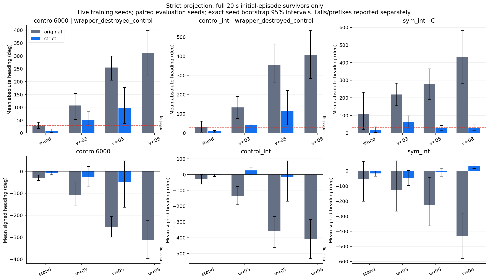
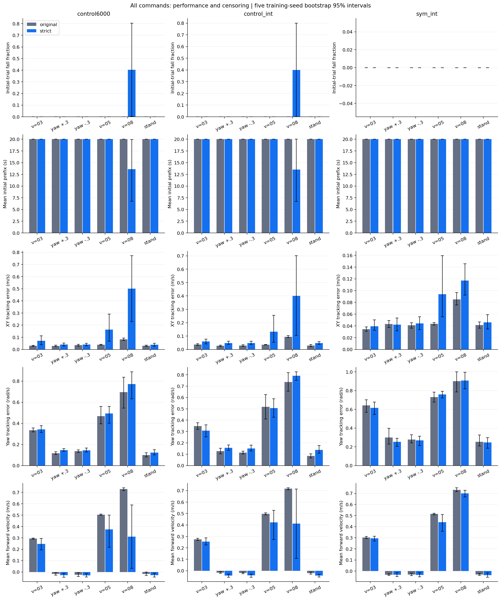
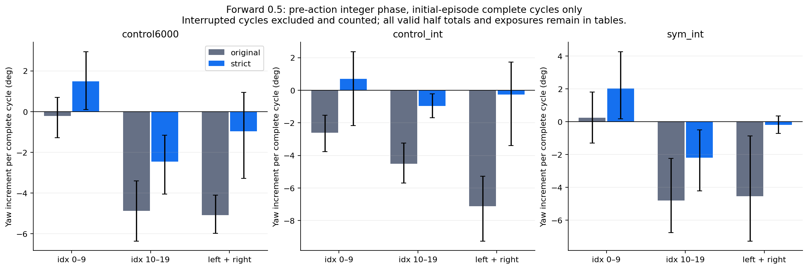

# Issue #18: strict symmetric inference diagnostic

C: intermediate, mixed or insufficient evidence

Evaluation only; zero training. Fifteen existing final checkpoints: control6000, control_int and sym_int, five training seeds each. Reuse 45 original-policy jobs; run 45 new strict-policy jobs. Each job has 1024 environments and six 20 s commands; each model has three evaluation seeds. Total: 540 command records and 552960 initial trials, including 270 new records and 276480 new trials.

The interpretable sym_int cohort reduces forward0.5 mean absolute heading by 90.18% (277.231 to 27.227 deg), with paired difference interval [-328.2212251367451, -158.71008741444865]. This is not A: only one cohort is interpretable and only two of four zero-yaw commands meet30deg. Strict forward0.3 remains62.462deg and forward0.8 remains30.621deg; thresholds are not relaxed.

Both control cohorts exceed the prospective5percentage-point fall-gain guard at forward0.8 and are excluded from causal interpretation. The sym_int complete-cycle sum interval includes zero, which does not establish exact cancellation. This mixed evidence supports C, not a causal declaration that either policy asymmetry or USD asymmetry is the sole cause.

The heading improvement also has performance tradeoffs: sym_int forward0.5 mean vx changes from 0.514218 to 0.439221m/s, while XY error changes from 0.043495 to 0.093764m/s. Heading reduction alone is not full control acceptance; all tracking, falls, prefixes and turn controls remain in the tables.

## Scope and validity

pi_sym(s)=0.5[pi(s)+M_a pi(Ts)]. T is the issue17 spatial reflection plus half-cycle transform: 101 actor inputs, both gait sin/cos negated; M_a reflects 30 actions. T squared and M_a squared are identity. Deterministic actor means; no standard-deviation, reward, configuration or USD edits; no default promotion.

control6000 preserves its legacy floating clock; control_int and sym_int preserve their existing integer clocks. All command order and reset ordinals are unchanged. Strict projection is the policy intervention.

Every policy call checks last_action observations against actual action_manager.action. Every nonterminal applied action is checked against the strict output. Both 64-environment six-command clock preflights passed; all 45 formal jobs check feedback, exact phase reconstruction, model/optimizer immutability and zero training updates. See preflight_audit.json, evaluation_progress.json and per-command feedback files.

Any cohort with mean fall-rate gain strictly above 0.05 in any zero-yaw command is labelled wrapper-destroyed-control and excluded from causal A/B interpretation. All its data remain reported. Algebraic policy equivariance does not prove stable closed-loop trajectories or physical symmetry. The issue17 PPO old-log-probability explanation remains an untested mechanism hypothesis.

## Prospective rules and uncertainty

Classification rules were frozen before formal rollouts: classification_rules.json, SHA256 24e8c9c1f768dab5ec70ed0c6797910f14ff7a119fc1a420441302fa7a6e9ba9.

Average three evaluation seeds within each training seed, then use five training seeds as sample units. Paired differences preserve training-seed correspondence. Enumerate all 5^5=3125 equally weighted bootstrap draws; report unadjusted percentile 95% intervals. Parallel environments are not independent training seeds.

Conservative overall convention, disclosed prospectively: A requires at least two interpretable cohorts and every interpretable cohort passing A; B requires at least one and every interpretable cohort passing B; otherwise C. Per-cohort results are retained, including mixed outcomes.

Per-cohort A additionally requires forward0.5 mean absolute heading reduction at least70%, paired difference95% upper bound below zero, and at least3of4zero-yaw means at most30deg. Per-cohort B, after excluding A and fall-damaged groups, requires forward0.5 absolute heading above100deg or a nonzero complete-cycle half sum under the frozen interval convention. Otherwise C; no extra experiments.

Complete 20 s headings require 1000 valid initial-episode steps and no first fall. Missing endpoints are never filled with prefixes; missing training seeds are retained. Signed heading is the sum of atan2(sin(delta yaw),cos(delta yaw)); absolute heading is taken per trial before averaging. Survivor endpoints are conditional and must be read alongside falls and prefix exposure.

Original control6000 stand recordings contain all-trial heading accumulations and independently audited reference trajectories, but not all-trial instantaneous heading arrays. This source limitation is retained; original rollouts were not rerun. All available full arrays are independently reconstructed.

## Fixed-state equivariance and identity checks

Same issue17 fixed 102400 states for each of 15 actual models. Tolerance 1e-5. Identity outputs are bitwise equal; actor/optimizer files and inference RNG are unchanged.

| Model | States | Max relative E | Max absolute error | Identity bitwise |
| --- | --- | --- | --- | --- |
| control6000_s1 | 102400 | 0 | 0 | True |
| control6000_s2 | 102400 | 0 | 0 | True |
| control6000_s3 | 102400 | 0 | 0 | True |
| control6000_s4 | 102400 | 0 | 0 | True |
| control6000_s5 | 102400 | 0 | 0 | True |
| control_int_s1 | 102400 | 0 | 0 | True |
| sym_int_s1 | 102400 | 0 | 0 | True |
| control_int_s2 | 102400 | 0 | 0 | True |
| sym_int_s2 | 102400 | 0 | 0 | True |
| control_int_s3 | 102400 | 0 | 0 | True |
| sym_int_s3 | 102400 | 0 | 0 | True |
| control_int_s4 | 102400 | 0 | 0 | True |
| sym_int_s4 | 102400 | 0 | 0 | True |
| control_int_s5 | 102400 | 0 | 0 | True |
| sym_int_s5 | 102400 | 0 | 0 | True |

## Cohort classification

| Cohort | Class | Interpretable | Original f0.5 abs deg | Strict f0.5 abs deg | Ratio | Paired diff CI95 deg | Commands <=30 deg /4 |
| --- | --- | --- | --- | --- | --- | --- | --- |
| control6000 | wrapper_destroyed_control | False | 254.596 | 98.212 | 0.386 | [-217.32651638752583, -95.4415638245385] | 1 |
| control_int | wrapper_destroyed_control | False | 356.087 | 115.619 | 0.325 | [-374.9083413890208, -120.0360983154299] | 1 |
| sym_int | C | True | 277.231 | 27.227 | 0.098 | [-328.2212251367451, -158.71008741444865] | 2 |

| Cohort | Stand fall gain | f0.3 gain | f0.5 gain | f0.8 gain |
| --- | --- | --- | --- | --- |
| control6000 | 0.000 | 0.000 | 0.000 | 0.404 |
| control_int | 0.000 | 0.000 | 0.000 | 0.400 |
| sym_int | 0.000 | 0.000 | 0.000 | 0.000 |

## All commands: cohort means and five-training-seed intervals

XY/yaw errors and mean vx use all nonterminal full-horizon samples, including later episodes after a reset. Prefix metrics refer only to the initial episode. Falls count initial trials with a first fall. Turning controls preserve the original same-command reset order, without swapping yaw-positive and yaw-negative resets.

### control6000

| Command | Mode | 20s signed deg | 20s abs deg | Fall fraction | Prefix s | XY m/s | Yaw rad/s | Mean vx m/s | Complete /1024 |
| --- | --- | --- | --- | --- | --- | --- | --- | --- | --- |
| forward_03 | original | -107.102 [-154.392, -52.799] | 107.107 [52.816, 154.392] | 0.000 [0.000, 0.000] | 20.000 [20.000, 20.000] | 0.030 [0.025, 0.034] | 0.335 [0.318, 0.356] | 0.294 [0.289, 0.298] | 1024.000 [1024.000, 1024.000] |
| forward_03 | strict | -24.587 [-71.207, 22.033] | 52.063 [31.249, 83.051] | 0.000 [0.000, 0.000] | 20.000 [20.000, 20.000] | 0.070 [0.038, 0.111] | 0.342 [0.313, 0.378] | 0.247 [0.195, 0.294] | 1024.000 [1024.000, 1024.000] |
| yaw_positive | original | 256.394 [229.187, 282.332] | 256.394 [229.187, 282.332] | 0.000 [0.000, 0.000] | 20.000 [20.000, 20.000] | 0.028 [0.023, 0.035] | 0.118 [0.105, 0.130] | -0.016 [-0.028, -0.005] | 1024.000 [1024.000, 1024.000] |
| yaw_positive | strict | 283.324 [262.100, 303.615] | 283.324 [262.100, 303.615] | 0.000 [0.000, 0.000] | 20.000 [20.000, 20.000] | 0.040 [0.028, 0.052] | 0.146 [0.134, 0.160] | -0.028 [-0.046, -0.011] | 1024.000 [1024.000, 1024.000] |
| yaw_negative | original | -325.147 [-357.920, -298.021] | 325.147 [298.021, 357.920] | 0.000 [0.000, 0.000] | 20.000 [20.000, 20.000] | 0.035 [0.027, 0.043] | 0.136 [0.124, 0.148] | -0.024 [-0.039, -0.006] | 1024.000 [1024.000, 1024.000] |
| yaw_negative | strict | -293.650 [-306.984, -276.812] | 293.650 [276.812, 306.984] | 0.000 [0.000, 0.000] | 20.000 [20.000, 20.000] | 0.040 [0.030, 0.050] | 0.144 [0.128, 0.165] | -0.029 [-0.045, -0.013] | 1024.000 [1024.000, 1024.000] |
| forward_05 | original | -254.596 [-299.564, -205.463] | 254.596 [205.463, 299.564] | 0.000 [0.000, 0.000] | 20.000 [20.000, 20.000] | 0.039 [0.035, 0.042] | 0.468 [0.396, 0.560] | 0.504 [0.498, 0.509] | 1024.000 [1024.000, 1024.000] |
| forward_05 | strict | -48.711 [-164.361, 47.223] | 98.212 [37.062, 176.672] | 0.000 [0.000, 0.000] | 20.000 [20.000, 20.000] | 0.164 [0.068, 0.291] | 0.493 [0.401, 0.560] | 0.374 [0.219, 0.500] | 1024.000 [1024.000, 1024.000] |
| forward_08 | original | -311.897 [-398.341, -225.452] | 311.897 [225.452, 398.341] | 0.000 [0.000, 0.000] | 20.000 [20.000, 20.000] | 0.084 [0.075, 0.093] | 0.695 [0.543, 0.836] | 0.729 [0.716, 0.740] | 1024.000 [1024.000, 1024.000] |
| forward_08 | strict | NA (missing seed retained) | NA (missing seed retained) | 0.404 [0.004, 0.804] | 13.595 [6.761, 19.945] | 0.501 [0.230, 0.772] | 0.772 [0.633, 0.887] | 0.311 [0.032, 0.589] | 609.867 [200.267, 1019.467] |
| stand | original | -29.471 [-41.739, -17.203] | 29.471 [17.203, 41.739] | 0.000 [0.000, 0.000] | 20.000 [20.000, 20.000] | 0.030 [0.025, 0.036] | 0.100 [0.081, 0.121] | -0.017 [-0.030, 0.000] | 1024.000 [1024.000, 1024.000] |
| stand | strict | -6.656 [-15.254, 0.842] | 8.130 [1.763, 15.532] | 0.000 [0.000, 0.000] | 20.000 [20.000, 20.000] | 0.039 [0.027, 0.050] | 0.122 [0.100, 0.150] | -0.028 [-0.045, -0.010] | 1024.000 [1024.000, 1024.000] |

### control_int

| Command | Mode | 20s signed deg | 20s abs deg | Fall fraction | Prefix s | XY m/s | Yaw rad/s | Mean vx m/s | Complete /1024 |
| --- | --- | --- | --- | --- | --- | --- | --- | --- | --- |
| forward_03 | original | -133.478 [-190.981, -75.976] | 133.478 [75.976, 190.981] | 0.000 [0.000, 0.000] | 20.000 [20.000, 20.000] | 0.036 [0.030, 0.043] | 0.348 [0.319, 0.378] | 0.275 [0.265, 0.284] | 1024.000 [1024.000, 1024.000] |
| forward_03 | strict | 25.793 [-9.651, 47.158] | 42.781 [36.563, 47.158] | 0.000 [0.000, 0.000] | 20.000 [20.000, 20.000] | 0.060 [0.042, 0.077] | 0.307 [0.252, 0.358] | 0.255 [0.226, 0.287] | 1024.000 [1024.000, 1024.000] |
| yaw_positive | original | 266.198 [241.766, 289.126] | 266.198 [241.766, 289.126] | 0.000 [0.000, 0.000] | 20.000 [20.000, 20.000] | 0.027 [0.022, 0.032] | 0.127 [0.104, 0.153] | -0.016 [-0.022, -0.008] | 1024.000 [1024.000, 1024.000] |
| yaw_positive | strict | 289.762 [275.991, 305.292] | 289.762 [275.991, 305.292] | 0.000 [0.000, 0.000] | 20.000 [20.000, 20.000] | 0.048 [0.039, 0.061] | 0.156 [0.135, 0.181] | -0.041 [-0.056, -0.030] | 1024.000 [1024.000, 1024.000] |
| yaw_negative | original | -316.095 [-354.323, -279.351] | 316.095 [279.351, 354.323] | 0.000 [0.000, 0.000] | 20.000 [20.000, 20.000] | 0.029 [0.023, 0.036] | 0.114 [0.101, 0.128] | -0.018 [-0.025, -0.012] | 1024.000 [1024.000, 1024.000] |
| yaw_negative | strict | -297.859 [-309.862, -285.857] | 297.859 [285.857, 309.862] | 0.000 [0.000, 0.000] | 20.000 [20.000, 20.000] | 0.048 [0.039, 0.061] | 0.150 [0.128, 0.180] | -0.041 [-0.056, -0.029] | 1024.000 [1024.000, 1024.000] |
| forward_05 | original | -356.087 [-463.132, -264.293] | 356.087 [264.293, 463.132] | 0.000 [0.000, 0.000] | 20.000 [20.000, 20.000] | 0.036 [0.034, 0.037] | 0.517 [0.411, 0.625] | 0.497 [0.488, 0.506] | 1024.000 [1024.000, 1024.000] |
| forward_05 | strict | -13.218 [-169.664, 86.192] | 115.619 [42.597, 220.865] | 0.000 [0.000, 0.000] | 20.000 [20.000, 20.000] | 0.132 [0.053, 0.255] | 0.507 [0.426, 0.589] | 0.423 [0.272, 0.527] | 1024.000 [1024.000, 1024.000] |
| forward_08 | original | -407.369 [-533.238, -283.412] | 407.369 [283.412, 533.238] | 0.000 [0.000, 0.000] | 20.000 [20.000, 20.000] | 0.094 [0.087, 0.103] | 0.737 [0.655, 0.819] | 0.717 [0.707, 0.725] | 1024.000 [1024.000, 1024.000] |
| forward_08 | strict | NA (missing seed retained) | NA (missing seed retained) | 0.400 [0.000, 0.800] | 13.529 [6.697, 20.000] | 0.401 [0.105, 0.701] | 0.792 [0.751, 0.825] | 0.413 [0.107, 0.713] | 614.400 [204.800, 1024.000] |
| stand | original | -27.689 [-60.054, -0.020] | 29.901 [4.443, 60.909] | 0.000 [0.000, 0.000] | 20.000 [20.000, 20.000] | 0.029 [0.022, 0.037] | 0.085 [0.067, 0.104] | -0.020 [-0.029, -0.012] | 1024.000 [1024.000, 1024.000] |
| stand | strict | -4.991 [-12.299, 3.517] | 9.057 [4.440, 12.738] | 0.000 [0.000, 0.000] | 20.000 [20.000, 20.000] | 0.047 [0.038, 0.058] | 0.139 [0.109, 0.176] | -0.042 [-0.054, -0.032] | 1024.000 [1024.000, 1024.000] |

### sym_int

| Command | Mode | 20s signed deg | 20s abs deg | Fall fraction | Prefix s | XY m/s | Yaw rad/s | Mean vx m/s | Complete /1024 |
| --- | --- | --- | --- | --- | --- | --- | --- | --- | --- |
| forward_03 | original | -127.029 [-267.406, 65.365] | 218.669 [155.012, 282.364] | 0.000 [0.000, 0.000] | 20.000 [20.000, 20.000] | 0.034 [0.031, 0.038] | 0.642 [0.570, 0.701] | 0.302 [0.294, 0.311] | 1024.000 [1024.000, 1024.000] |
| forward_03 | strict | -47.062 [-97.308, 3.183] | 62.462 [27.617, 97.308] | 0.000 [0.000, 0.000] | 20.000 [20.000, 20.000] | 0.039 [0.033, 0.050] | 0.615 [0.545, 0.678] | 0.294 [0.271, 0.313] | 1024.000 [1024.000, 1024.000] |
| yaw_positive | original | 191.413 [24.210, 332.906] | 236.989 [160.939, 333.959] | 0.000 [0.000, 0.000] | 20.000 [20.000, 20.000] | 0.043 [0.037, 0.049] | 0.300 [0.229, 0.396] | -0.032 [-0.038, -0.026] | 1024.000 [1024.000, 1024.000] |
| yaw_positive | strict | 226.118 [194.076, 258.160] | 226.118 [194.076, 258.160] | 0.000 [0.000, 0.000] | 20.000 [20.000, 20.000] | 0.042 [0.032, 0.053] | 0.254 [0.204, 0.292] | -0.034 [-0.050, -0.015] | 1024.000 [1024.000, 1024.000] |
| yaw_negative | original | -285.438 [-425.808, -179.078] | 285.438 [179.078, 425.808] | 0.000 [0.000, 0.000] | 20.000 [20.000, 20.000] | 0.041 [0.036, 0.045] | 0.277 [0.241, 0.328] | -0.031 [-0.040, -0.019] | 1024.000 [1024.000, 1024.000] |
| yaw_negative | strict | -243.965 [-272.284, -212.840] | 243.965 [212.840, 272.284] | 0.000 [0.000, 0.000] | 20.000 [20.000, 20.000] | 0.044 [0.034, 0.055] | 0.268 [0.213, 0.313] | -0.034 [-0.052, -0.014] | 1024.000 [1024.000, 1024.000] |
| forward_05 | original | -227.274 [-364.171, -43.049] | 277.231 [189.303, 364.171] | 0.000 [0.000, 0.000] | 20.000 [20.000, 20.000] | 0.043 [0.041, 0.046] | 0.731 [0.677, 0.783] | 0.514 [0.506, 0.521] | 1024.000 [1024.000, 1024.000] |
| forward_05 | strict | -9.222 [-35.913, 17.470] | 27.227 [12.547, 41.906] | 0.000 [0.000, 0.000] | 20.000 [20.000, 20.000] | 0.094 [0.055, 0.159] | 0.759 [0.721, 0.791] | 0.439 [0.357, 0.508] | 1024.000 [1024.000, 1024.000] |
| forward_08 | original | -430.138 [-581.600, -279.656] | 430.138 [279.656, 581.600] | 0.000 [0.000, 0.000] | 20.000 [20.000, 20.000] | 0.085 [0.076, 0.097] | 0.900 [0.785, 1.000] | 0.730 [0.715, 0.749] | 1024.000 [1024.000, 1024.000] |
| forward_08 | strict | 30.204 [15.223, 45.559] | 30.621 [16.057, 45.797] | 0.000 [0.000, 0.000] | 20.000 [20.000, 20.000] | 0.117 [0.093, 0.145] | 0.906 [0.819, 0.996] | 0.699 [0.667, 0.728] | 1024.000 [1024.000, 1024.000] |
| stand | original | -51.226 [-202.110, 62.618] | 107.220 [18.958, 231.037] | 0.000 [0.000, 0.000] | 20.000 [20.000, 20.000] | 0.041 [0.036, 0.047] | 0.253 [0.208, 0.326] | -0.031 [-0.039, -0.022] | 1024.000 [1024.000, 1024.000] |
| stand | strict | -17.457 [-35.290, -1.870] | 18.359 [3.673, 35.290] | 0.000 [0.000, 0.000] | 20.000 [20.000, 20.000] | 0.046 [0.035, 0.059] | 0.248 [0.185, 0.298] | -0.037 [-0.055, -0.017] | 1024.000 [1024.000, 1024.000] |

## Forward 0.5 half-cycle yaw decomposition

Bin each post-step quaternion yaw increment by PRE-action episode_length_buf modulo20: idx0..9 left, idx10..19 right. Exclude terminal/reset transitions. Old phase is reconstructed from recorded valid/reset masks: all 46080 original forward0.5 trials have 1000 valid steps without resets. New jobs save actual counters and verify reconstruction at every step.

Complete-cycle means use only uninterrupted 20-step cycles in initial episodes; reset gaps are never joined. Average complete cycles within each evaluation job, then evaluation seeds within training seed. Left, right and their sum use exactly the same complete cycles. Retain partial-cycle valid steps and all-valid/prefix half totals and exposures to disclose instability rather than showing complete cycles alone.

| Cohort | Mode | Left deg/cycle | Right deg/cycle | Sum deg/cycle | Complete cycles/job | Partial valid steps/job |
| --- | --- | --- | --- | --- | --- | --- |
| control6000 | original | -0.205 [-1.285, 0.705] | -4.887 [-6.368, -3.406] | -5.092 [-5.991, -4.109] | 51200.000 [51200.000, 51200.000] | 0.000 [0.000, 0.000] |
| control6000 | strict | 1.488 [0.111, 2.952] | -2.462 [-4.047, -1.164] | -0.974 [-3.287, 0.944] | 51200.000 [51200.000, 51200.000] | 0.000 [0.000, 0.000] |
| control_int | original | -2.617 [-3.768, -1.541] | -4.504 [-5.698, -3.240] | -7.122 [-9.263, -5.286] | 51200.000 [51200.000, 51200.000] | 0.000 [0.000, 0.000] |
| control_int | strict | 0.692 [-2.168, 2.372] | -0.957 [-1.689, -0.225] | -0.264 [-3.393, 1.724] | 51200.000 [51200.000, 51200.000] | 0.000 [0.000, 0.000] |
| sym_int | original | 0.251 [-1.300, 1.802] | -4.797 [-6.763, -2.242] | -4.545 [-7.283, -0.861] | 51200.000 [51200.000, 51200.000] | 0.000 [0.000, 0.000] |
| sym_int | strict | 2.020 [0.175, 4.280] | -2.204 [-4.227, -0.506] | -0.184 [-0.718, 0.349] | 51200.000 [51200.000, 51200.000] | 0.000 [0.000, 0.000] |

### full_horizon: mean totals per initial trial

| Cohort | Mode | Left total deg | Right total deg | Left exposure s | Right exposure s |
| --- | --- | --- | --- | --- | --- |
| control6000 | original | -10.244 [-64.249, 35.275] | -244.352 [-318.409, -170.296] | 10.000 [10.000, 10.000] | 10.000 [10.000, 10.000] |
| control6000 | strict | 74.405 [5.528, 147.584] | -123.117 [-202.356, -58.202] | 10.000 [10.000, 10.000] | 10.000 [10.000, 10.000] |
| control_int | original | -130.864 [-188.384, -77.073] | -225.224 [-284.884, -161.991] | 10.000 [10.000, 10.000] | 10.000 [10.000, 10.000] |
| control_int | strict | 34.615 [-108.406, 118.612] | -47.833 [-84.433, -11.233] | 10.000 [10.000, 10.000] | 10.000 [10.000, 10.000] |
| sym_int | original | 12.563 [-64.984, 90.110] | -239.837 [-338.161, -112.080] | 10.000 [10.000, 10.000] | 10.000 [10.000, 10.000] |
| sym_int | strict | 100.985 [8.769, 213.992] | -110.207 [-211.371, -25.307] | 10.000 [10.000, 10.000] | 10.000 [10.000, 10.000] |

### initial_prefix: mean totals per initial trial

| Cohort | Mode | Left total deg | Right total deg | Left exposure s | Right exposure s |
| --- | --- | --- | --- | --- | --- |
| control6000 | original | -10.244 [-64.249, 35.275] | -244.352 [-318.409, -170.296] | 10.000 [10.000, 10.000] | 10.000 [10.000, 10.000] |
| control6000 | strict | 74.405 [5.528, 147.584] | -123.117 [-202.356, -58.202] | 10.000 [10.000, 10.000] | 10.000 [10.000, 10.000] |
| control_int | original | -130.864 [-188.384, -77.073] | -225.224 [-284.884, -161.991] | 10.000 [10.000, 10.000] | 10.000 [10.000, 10.000] |
| control_int | strict | 34.615 [-108.406, 118.612] | -47.833 [-84.433, -11.233] | 10.000 [10.000, 10.000] | 10.000 [10.000, 10.000] |
| sym_int | original | 12.563 [-64.984, 90.110] | -239.837 [-338.161, -112.080] | 10.000 [10.000, 10.000] | 10.000 [10.000, 10.000] |
| sym_int | strict | 100.985 [8.769, 213.992] | -110.207 [-211.371, -25.307] | 10.000 [10.000, 10.000] | 10.000 [10.000, 10.000] |

## Colored front and overhead source-state videos

Select the nearest-median trial from all 15360 strict sym_int initial trials. No survivor filtering; if censoring exists, disclose and use the all-trial initial-prefix selection scope rather than silently calling it a complete-20s median.

{"model": "sym_int_s3", "training_seed": 3, "eval_seed": 2, "env_id": 502, "selection_metric": "absolute reset-aware20s heading for all initial trials", "selection_scope": "full20s_all_initial_trials", "censored_initial_trials": 0, "group_median_absolute_heading_degrees": 33.00310796902757}

[Front video](videos/sym_int_front.mp4) | [Overhead video](videos/sym_int_overhead.mp4)

Capture the chosen projected-policy job deterministically and compare formal results and every existing NPZ array bitwise. This reconstruction does not add formal samples or rerun original policies. Replay exact saved poses without integrating dynamics; both views share the same trajectory. Front follows translation and heading; overhead follows translation with fixed world heading. Both show world XY trail and heading. Verify unchanged authored and display-colored USD hashes. Artifacts remain on the remote data disk.

## Exactly one next-step recommendation; not implemented here

Do the original/reflected-policy x original/strictly-symmetric-USD 2x2 diagnostic, keeping current weights fixed, to distinguish policy and model/simulation factors. Structural equivariance alone does not prove USD asymmetry.

## Reproduction and evidence

run_issue18_evaluations.py: bounded 45-job queue and frozen inputs. analyze_issue18.py: all 540 records and 552960 initial trials, seed pairing and censoring. validate_issue18_projection.py: all original fixed states and actual checkpoints. test_issue18_analysis.py: reset, phase, wrap, complete-cycle and missing-seed checks.

Evidence: formal_inputs_frozen.json, original_reuse_manifest.json, raw_analysis_audit.json, projection_validation.json, video_quality_audit.json, manual_visual_review.json and sha256.json. [All seed tables](seed_tables.md), machine-readable job/seed/cohort JSON, per_trial_heading.csv.gz, half_cycle_raw NPZs and formal raw moments are archived.

Issue17 historical primary failure is preserved. Zero training and no default promotion in issue18; SuperMimic remains stopped.
