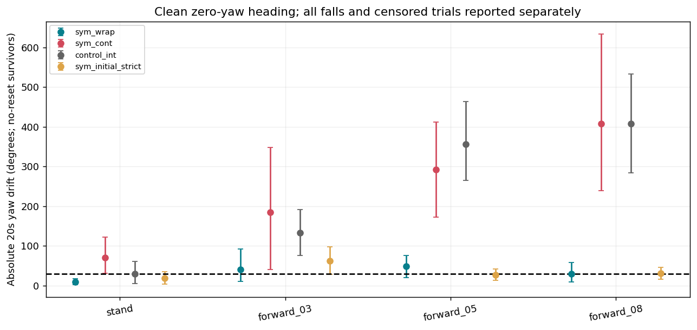
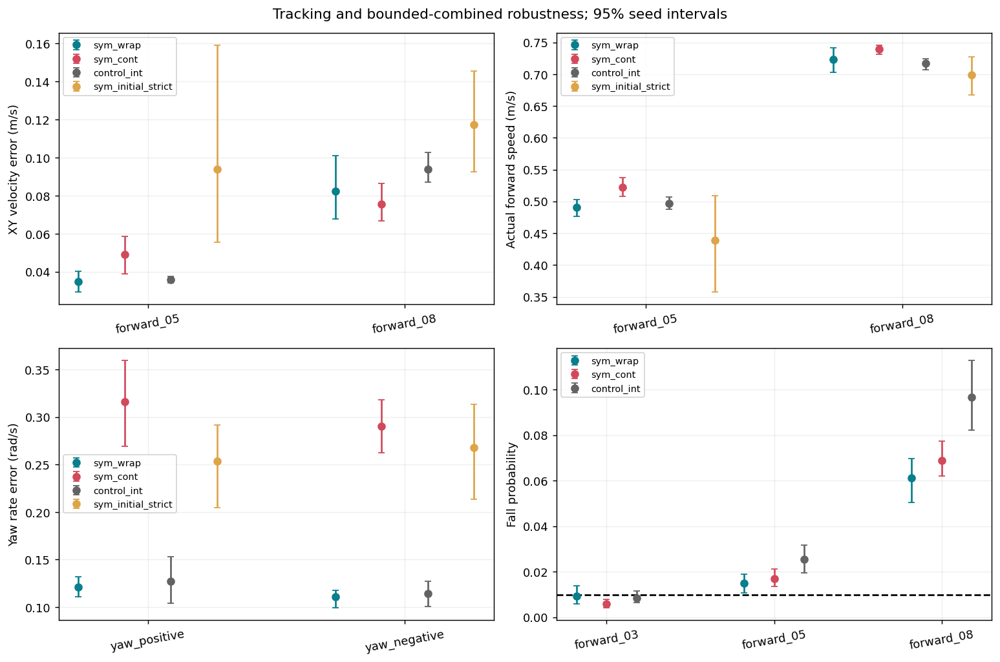
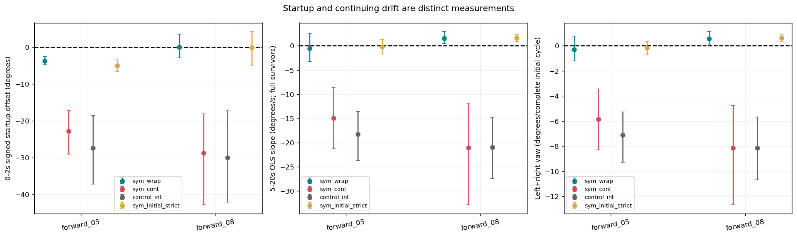
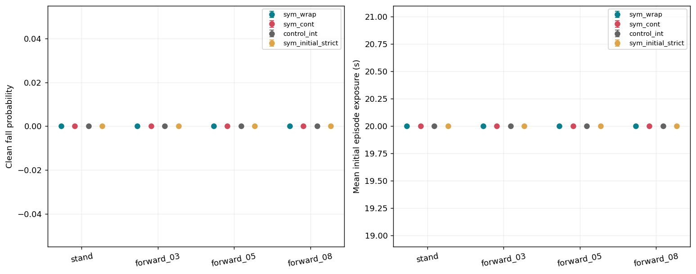

# Issue19: strictly symmetric actor matched continuation

## Outcome

heading_not_met_persistent_drift_and_nonzero_halfcycle. All acceptance criteria met: False. Primary: False; heading: False; tracking: True; robustness: False.
No default configuration was promoted. One next recommendation, not implemented: Next issue: original/reflected policy x original/strict symmetric USD 2x2 diagnostic.
The issue background interpretations about policy asymmetry, physical causes and PPO mechanisms remain hypotheses. This intervention alone does not prove those causes. Issue17 scientific acceptance failure and the stopped SuperMimic status remain preserved.

## Infrastructure interruption and authorized retry

The first sym_cont_s1 attempt was interrupted by a data-disk-full infrastructure error during Git maintenance. It logged1392 updates (at most one further unlogged update may have executed), retained only an update-8 checkpoint, and produced no final model. Its logs, metrics and checkpoint remain in infrastructure_interruption/ and never enter formal result denominators. The user explicitly authorized rerunning this arm from the same original parent and seed for exactly1500 updates. There was no checkpoint selection or hyperparameter change. This failed computation is disclosed separately from the15000 successful formal model updates and six required preflight updates; see budget_accounting.json and the authorization receipt. The final cohort remains exactly five seeds per group.

## Frozen scope and methods

Two groups, sym_wrap/sym_cont, each five paired training seeds. Both resume the same issue17 sym_int final actor, critic and optimizer:4096 environments,1500 additional updates/model. No std reset, checkpoint selection, parameter scan or extension of the1500-update successful-model budget. One explicitly authorized infrastructure retry is accounted separately below. Critic, rewards and environment distributions remain unchanged. Both retain original sym_int mirror augmentation. Checkpoint logging frequency is reduced equally to conserve disk; final checkpoints determine evaluation.
Rules SHA256: 9f5fd7739785427abee1ed67adf66b103cb0df262f5380fc652bfe6c39174d33. Five training seeds are bootstrap units; three evaluation seeds are averaged within each. All3125 paired seed resamples form percentile95% intervals. Individual intervals are not simultaneous family-wise coverage.
Deterministic evaluation:1024 environments x3 evaluation seeds x20s; same paired reset seeds/command ordinals as references. Formal new count:60 jobs,270 command records,276480 initial trials. Reused references:45 jobs (issue17 control_int clean/combined and issue18 initial sym_int strict clean). Combined audit:105 jobs,495 records,506880 trials. Preflight and media reconstruction are excluded from formal denominators. No reference rollouts are rerun.
Full20s heading endpoints use no-reset survivors. Censored initial prefixes are retained with exposure, never extrapolated to20s. Clean falls, all-valid segments and prefix metrics are reported alongside survivor endpoints. See raw_analysis_audit.json for historical missing instantaneous series.

## Actor, std and PPO

Mean:0.5*(mu(s)+Ma*mu(Ts)), using shared MLP weights in both branches. T/Ma match issue17/18, including gait sin/cos negation. Sampling, log-probability, entropy and KL all use this mean and the same shared diagonal Gaussian. Left/right std has one parameter per reflection orbit (18 parameters); central orbits remain independent.
Initial shared std is the arithmetic parent std mean. Dimension-reduced std Adam first/second moments use orbit means with step retained; all other restored parameters and optimizer states remain unchanged. Full-state loading is audited before this explicit constrained-parameter migration.
For this equivariant mean and orbit-equal std, p(Ma*a|T*s)=p(a|s): Ma is a signed permutation with absolute determinant1. Repeating original old log-probabilities for mirrored PPO samples is therefore self-consistent for sym_wrap, up to floating-point summation. The control retains original sym_int augmentation semantics.
Five initial actors pass102400-state equivariance (max0), bitwise initial issue18-strict equality, probability/entropy/gradient checks and single-graph two-forward ONNX export. All three4096-env two-update preflights pass; disabled model/optimizer/RNG/environment states match prior continuation bitwise. Final actors are revalidated and exported to onnx/, with101 inputs/30 outputs.

## Main results: mean [training-seed95% CI]

|Protocol|Group|Command|Abs20s yaw deg|Fall rate|XY error m/s|Yaw error rad/s|Actual vx m/s|Initial exposure s|
|---|---|---|---:|---:|---:|---:|---:|---:|
|clean|control_int|forward_03|133.478 [75.9757, 190.981]|0 [0, 0]|0.0364549 [0.0301158, 0.0425293]|0.34849 [0.318731, 0.37755]|0.275225 [0.264677, 0.28355]|20 [20, 20]|
|clean|control_int|forward_05|356.087 [264.293, 463.132]|0 [0, 0]|0.0357975 [0.03412, 0.0374749]|0.517303 [0.410576, 0.624845]|0.49709 [0.487681, 0.506499]|20 [20, 20]|
|clean|control_int|forward_08|407.369 [283.412, 533.238]|0 [0, 0]|0.0938826 [0.0871001, 0.102839]|0.736704 [0.655305, 0.818818]|0.71676 [0.706746, 0.724594]|20 [20, 20]|
|clean|control_int|stand|29.9008 [4.44317, 60.9095]|0 [0, 0]|0.0292499 [0.0217804, 0.0367195]|0.0845102 [0.0673503, 0.104138]|-0.020265 [-0.0285216, -0.0116137]|20 [20, 20]|
|clean|control_int|yaw_negative|316.095 [279.351, 354.323]|0 [0, 0]|0.0289815 [0.0226801, 0.0355815]|0.114142 [0.100722, 0.127563]|-0.0180045 [-0.0249163, -0.0121498]|20 [20, 20]|
|clean|control_int|yaw_positive|266.198 [241.766, 289.126]|0 [0, 0]|0.026835 [0.0216938, 0.0315625]|0.127244 [0.103892, 0.152756]|-0.0157634 [-0.0215631, -0.00846942]|20 [20, 20]|
|clean|sym_cont|forward_03|185.256 [40.6351, 347.736]|0 [0, 0]|0.0408397 [0.0346978, 0.0469816]|0.707458 [0.671308, 0.75044]|0.312702 [0.296415, 0.328988]|20 [20, 20]|
|clean|sym_cont|forward_05|292.221 [172.849, 411.592]|0 [0, 0]|0.0490538 [0.0390007, 0.0586391]|0.773681 [0.70636, 0.848154]|0.522567 [0.507613, 0.537521]|20 [20, 20]|
|clean|sym_cont|forward_08|407.775 [238.55, 633.484]|0 [0, 0]|0.0755145 [0.0666138, 0.0865082]|0.893361 [0.827028, 0.949352]|0.739394 [0.731398, 0.745873]|20 [20, 20]|
|clean|sym_cont|stand|70.4061 [30.6439, 121.83]|0 [0, 0]|0.0299672 [0.0266608, 0.0353732]|0.288356 [0.248797, 0.321888]|-0.00771829 [-0.0225948, 0.00582986]|20 [20, 20]|
|clean|sym_cont|yaw_negative|308.916 [220.587, 394.531]|0 [0, 0]|0.0313226 [0.0274346, 0.0355497]|0.290523 [0.262743, 0.318311]|-0.0096852 [-0.023915, 0.0043906]|20 [20, 20]|
|clean|sym_cont|yaw_positive|175.011 [130.688, 227.596]|0 [0, 0]|0.0287361 [0.0245169, 0.0335256]|0.315883 [0.269585, 0.359614]|-0.00151784 [-0.0114137, 0.00862685]|20 [20, 20]|
|clean|sym_initial_strict|forward_03|62.4623 [27.617, 97.3076]|0 [0, 0]|0.0392872 [0.0327166, 0.0500955]|0.615398 [0.545293, 0.677595]|0.293978 [0.271035, 0.312716]|20 [20, 20]|
|clean|sym_initial_strict|forward_05|27.2269 [12.5474, 41.9063]|0 [0, 0]|0.093764 [0.0554737, 0.159248]|0.759338 [0.721057, 0.791264]|0.439221 [0.357465, 0.508489]|20 [20, 20]|
|clean|sym_initial_strict|forward_08|30.6211 [16.0569, 45.7969]|0 [0, 0]|0.117277 [0.0926037, 0.145481]|0.906278 [0.81869, 0.995785]|0.698648 [0.66698, 0.727691]|20 [20, 20]|
|clean|sym_initial_strict|stand|18.3586 [3.67313, 35.2902]|0 [0, 0]|0.0461376 [0.034669, 0.0589867]|0.247564 [0.184987, 0.297743]|-0.0372166 [-0.0552799, -0.0172005]|20 [20, 20]|
|clean|sym_initial_strict|yaw_negative|243.965 [212.84, 272.284]|0 [0, 0]|0.0441662 [0.0336123, 0.0553837]|0.26823 [0.21333, 0.313234]|-0.0340542 [-0.0518695, -0.0143483]|20 [20, 20]|
|clean|sym_initial_strict|yaw_positive|226.118 [194.076, 258.16]|0 [0, 0]|0.0422741 [0.0315111, 0.0534715]|0.253623 [0.204403, 0.291812]|-0.0339533 [-0.0502596, -0.0148039]|20 [20, 20]|
|clean|sym_wrap|forward_03|40.9524 [11.0278, 91.855]|0 [0, 0]|0.0337969 [0.0287384, 0.0391263]|0.283176 [0.265244, 0.303032]|0.290215 [0.281069, 0.299361]|20 [20, 20]|
|clean|sym_wrap|forward_05|48.0439 [20.2313, 75.8565]|0 [0, 0]|0.034811 [0.0293408, 0.0402812]|0.43917 [0.374887, 0.494]|0.490839 [0.476165, 0.50261]|20 [20, 20]|
|clean|sym_wrap|forward_08|28.8628 [9.27186, 57.4295]|0 [0, 0]|0.0824916 [0.067616, 0.101218]|0.638934 [0.517886, 0.759982]|0.723598 [0.703095, 0.740935]|20 [20, 20]|
|clean|sym_wrap|stand|8.76218 [2.79018, 17.9234]|0 [0, 0]|0.0184017 [0.0163481, 0.0204061]|0.0981531 [0.0832455, 0.109263]|-0.0074262 [-0.0123655, 0.000383521]|20 [20, 20]|
|clean|sym_wrap|yaw_negative|316.335 [302.959, 328.775]|0 [0, 0]|0.018905 [0.0165906, 0.0217571]|0.11067 [0.0996182, 0.118005]|-0.00368408 [-0.00961826, 0.0035424]|20 [20, 20]|
|clean|sym_wrap|yaw_positive|303.133 [276.329, 325.988]|0 [0, 0]|0.0198887 [0.017366, 0.0231371]|0.121059 [0.110784, 0.132303]|-0.00291092 [-0.00876872, 0.00478634]|20 [20, 20]|
|combined|control_int|forward_03|168.735 [122.771, 220.751]|0.00846354 [0.00638021, 0.0115885]|0.0481829 [0.0449055, 0.0510257]|0.365119 [0.340375, 0.389863]|0.284021 [0.278479, 0.289962]|19.9311 [19.901, 19.9507]|
|combined|control_int|forward_05|339.089 [232.58, 446.311]|0.0255208 [0.0194661, 0.0315755]|0.0539123 [0.0520269, 0.055915]|0.572442 [0.500357, 0.644526]|0.484942 [0.477142, 0.493056]|19.7967 [19.7499, 19.8479]|
|combined|control_int|forward_08|377 [237.428, 485.884]|0.0966146 [0.0822917, 0.11276]|0.105813 [0.102161, 0.110056]|0.779477 [0.699978, 0.851082]|0.714609 [0.708676, 0.719735]|19.1411 [18.9939, 19.2857]|
|combined|sym_cont|forward_03|206.658 [110.098, 305.021]|0.00585938 [0.00429688, 0.0078125]|0.050876 [0.0488479, 0.0525447]|0.713496 [0.672626, 0.762345]|0.310662 [0.305436, 0.315889]|19.9537 [19.9369, 19.967]|
|combined|sym_cont|forward_05|290.284 [208.149, 380.381]|0.0169271 [0.0136068, 0.021224]|0.0585982 [0.0553816, 0.0612183]|0.840665 [0.760843, 0.923816]|0.509849 [0.504379, 0.515319]|19.8649 [19.833, 19.8949]|
|combined|sym_cont|forward_08|355.603 [246.734, 514.432]|0.0688151 [0.0619141, 0.0772135]|0.0936264 [0.0874411, 0.100569]|0.947382 [0.876803, 1.01773]|0.730244 [0.726165, 0.735305]|19.3818 [19.3043, 19.4473]|
|combined|sym_wrap|forward_03|80.7898 [53.7043, 107.861]|0.00924479 [0.00598958, 0.0138021]|0.0467434 [0.044629, 0.0487082]|0.328236 [0.312903, 0.343293]|0.298341 [0.2898, 0.306638]|19.9276 [19.8827, 19.9563]|
|combined|sym_wrap|forward_05|61.8711 [50.5542, 73.188]|0.0149089 [0.010612, 0.0190104]|0.051311 [0.0487548, 0.0538672]|0.454421 [0.39451, 0.514332]|0.492952 [0.488978, 0.497018]|19.8769 [19.8367, 19.9171]|
|combined|sym_wrap|forward_08|39.7751 [31.9913, 48.8186]|0.0611979 [0.0504557, 0.0697266]|0.0954038 [0.0868584, 0.10521]|0.661997 [0.56981, 0.754183]|0.721504 [0.710513, 0.731593]|19.428 [19.3571, 19.5054]|

Primary paired sym_wrap-minus-sym_cont95% CI: [-353.9517766388484, -144.90261512299594] degrees.
Full acceptance values, thresholds, diagnostics and recommendation: [scientific_conclusion.json](scientific_conclusion.json).

## Startup versus continuing yaw

Startup is signed unwrapped yaw from reset t=0 to2.00s (100 post-step samples). Late per-trial OLS uses t=5.00 through20.00s (751 samples). Full slopes require the initial episode to survive20s. Separate censored-prefix slopes retain at least two available late samples and expose counts/duration. Reset jumps are excluded and episodes never joined. Startup plus15*slope is not a claimed reconstruction of total20s yaw:2-5s is separate.
Half-cycles use actual pre-action episode_length_buf%20 (left0..9,right10..19) and post-step wrapped yaw increments, excluding terminal steps. Complete cycles are from initial episodes only; partial/all-valid totals and exposure are retained. Missing historical phase arrays are reconstructed from saved reset masks, never new simulation.

|Protocol|Group|Command|Startup signed deg|Late slope deg/s|Late abs slope deg/s|Left deg/cycle|Right deg/cycle|Sum deg/cycle|
|---|---|---|---:|---:|---:|---:|---:|---:|
|clean|control_int|forward_05|-27.4475 [-37.1735, -18.5142]|-18.2458 [-23.6487, -13.6324]|18.2458 [13.6324, 23.6487]|-2.61728 [-3.76768, -1.54146]|-4.50447 [-5.69768, -3.23982]|-7.12175 [-9.26263, -5.28587]|
|clean|control_int|forward_08|-30.0057 [-42.088, -17.2742]|-20.9669 [-27.3682, -14.8571]|20.9669 [14.8571, 27.3682]|-2.86688 [-4.90938, -1.08522]|-5.2805 [-6.07369, -4.30642]|-8.14738 [-10.6648, -5.66824]|
|clean|sym_cont|forward_05|-22.8427 [-29.0383, -17.2294]|-14.9328 [-21.2512, -8.6145]|14.9328 [8.6145, 21.2512]|-0.35659 [-1.35821, 0.64503]|-5.48782 [-7.0226, -3.95304]|-5.84441 [-8.23184, -3.45698]|
|clean|sym_cont|forward_08|-28.8048 [-42.8436, -18.1394]|-21.0456 [-32.8653, -11.8294]|21.0456 [11.8294, 32.8653]|-1.52563 [-4.12675, 0.797338]|-6.62988 [-8.91624, -3.79508]|-8.15551 [-12.6697, -4.77099]|
|clean|sym_initial_strict|forward_05|-4.97416 [-6.68134, -3.45302]|-0.192632 [-1.68097, 1.29571]|1.5096 [0.681821, 2.17734]|2.0197 [0.175385, 4.27984]|-2.20414 [-4.22742, -0.506134]|-0.184438 [-0.718267, 0.34939]|
|clean|sym_initial_strict|forward_08|-0.0822573 [-4.9438, 4.25122]|1.60881 [0.869932, 2.34768]|1.65174 [0.954755, 2.34873]|1.93765 [-0.228778, 4.93132]|-1.33356 [-4.41199, 0.965814]|0.604085 [0.304466, 0.911183]|
|clean|sym_wrap|forward_05|-3.74542 [-4.79334, -2.5289]|-0.524593 [-3.20285, 2.45957]|2.71403 [1.12401, 4.30405]|2.18395 [1.31648, 2.85122]|-2.48616 [-3.24959, -1.66629]|-0.302214 [-1.20853, 0.765036]|
|clean|sym_wrap|forward_08|-0.0283522 [-2.95613, 3.53252]|1.51012 [0.433013, 2.95564]|1.57517 [0.558105, 3.00023]|2.84503 [0.652234, 4.80373]|-2.29444 [-4.07676, -0.282822]|0.550596 [0.132746, 1.12648]|
|combined|control_int|forward_05|-27.5603 [-37.6377, -17.8449]|-17.2781 [-22.6952, -11.8981]|17.2838 [11.9154, 22.6952]|-1.9562 [-2.93709, -0.837704]|-4.81901 [-6.20776, -3.43026]|-6.77521 [-8.92303, -4.64359]|
|combined|control_int|forward_08|-31.9995 [-44.7209, -19.2781]|-19.0804 [-24.6125, -12.0671]|19.1364 [12.1792, 24.6125]|-1.86491 [-3.46618, -0.263648]|-5.63095 [-6.69447, -4.51658]|-7.49587 [-9.6944, -4.65192]|
|combined|sym_cont|forward_05|-27.8047 [-34.0451, -22.9825]|-14.5536 [-19.203, -10.2273]|14.5546 [10.2304, 19.203]|0.174764 [-1.05029, 1.26049]|-5.98256 [-6.63943, -5.32569]|-5.80779 [-7.61066, -4.16511]|
|combined|sym_cont|forward_08|-31.5201 [-43.6162, -22.5612]|-17.9771 [-26.2387, -12.084]|17.9796 [12.0913, 26.2387]|-0.866991 [-2.9798, 0.84015]|-6.24203 [-7.53789, -5.07771]|-7.10902 [-10.269, -4.94329]|
|combined|sym_wrap|forward_05|-6.27056 [-6.87228, -5.3912]|-2.3714 [-3.11733, -1.62547]|3.28223 [2.70117, 3.8633]|1.57314 [0.732738, 2.48629]|-2.55091 [-3.21571, -1.9713]|-0.977776 [-1.23856, -0.716988]|
|combined|sym_wrap|forward_08|-5.43673 [-8.86003, -2.30374]|0.306646 [0.00146643, 0.611825]|2.18204 [1.82394, 2.56522]|1.75602 [0.309143, 3.37326]|-1.75787 [-3.44418, -0.293282]|-0.00184883 [-0.0985865, 0.0948888]|

## Training and final models

|Group|Seed|Updates|Final iteration|Wall seconds|SHA256|
|---|---:|---:|---:|---:|---|
|sym_wrap|1|1500|14992|1950.07|9a7b87d298c91d10fe2a515ee7034a4fcb2c554f69a3809680cffa0a963b231f|
|sym_cont|2|1500|14992|1825.12|1a811c85fb3787469d34997156ecfd7f0aeda9d800355e6c2fefe1dfea246cea|
|sym_wrap|2|1500|14992|1985.07|66f954ba35bd8bb49318c0759f1b267ed8edc4dae46bf76f7284e3ae961ad5ef|
|sym_cont|3|1500|14992|1875.08|38ff548f1cacb18e4c87802200d06e706511e9837cc91b4725e905234190e01b|
|sym_wrap|3|1500|14992|2090.09|327844928cc4fb599a1c57414e837b2beaeb612bfe8179466f1fcaf381343c87|
|sym_cont|4|1500|14992|2015.08|fec7221f76d4ffc8ed32fd6abf62ba4e1d4551587da403e3c8a23995f7439d9a|
|sym_wrap|4|1500|14992|2060.09|4a80e71f753bb4af958de6d9aab1bbe8cf69b3192c16207430f1c657db93abac|
|sym_cont|5|1500|14992|1895.09|7274eeb4ec96021ba9fa3d922e35316acfb2142386b9f7899322ebef036c3efe|
|sym_wrap|5|1500|14992|1985.09|cff988bde710d0daddad6c92f18ebdd5445356dc1cf2b0dc6492bfbd08d97288|
|sym_cont|1|1500|14992|1850.07|8df88e25a85b13603b602ce1500360809d21d834308a22ffb498db6630e70742|

## Initial std before and after sharing

|Seed|Joint|Parent std|Shared initial std|
|---:|---|---:|---:|
|1|left_hip_pitch_joint|0.0467607|0.0486517|
|1|right_hip_pitch_joint|0.0505428|0.0486517|
|1|waist_yaw|0.0949711|0.0949711|
|1|left_hip_roll_joint|0.0453906|0.0446271|
|1|right_hip_roll_joint|0.0438636|0.0446271|
|1|waist_roll_joint|0.0573536|0.0573536|
|1|left_hip_yaw_joint|0.0902953|0.0985664|
|1|right_hip_yaw_joint|0.106837|0.0985664|
|1|waist_pitch_joint|0.0623355|0.0623355|
|1|left_knee_pitch_joint|0.100548|0.0971998|
|1|right_knee_pitch_joint|0.0938518|0.0971998|
|1|left_shoulder_pitch_joint|0.419944|0.413312|
|1|neck|0.417344|0.417344|
|1|right_shoulder_pitch_joint|0.40668|0.413312|
|1|left_ankle_yaw_joint|0.0931046|0.109094|
|1|right_ankle_yaw_joint|0.125084|0.109094|
|1|left_shoulder_roll_joint|0.401395|0.413811|
|1|neck_linkage_roll|0.397184|0.397184|
|1|right_shoulder_roll_joint|0.426226|0.413811|
|1|left_ankle_pitch_joint|0.143521|0.144681|
|1|right_ankle_pitch_joint|0.145841|0.144681|
|1|left_shoulder_yaw_joint|0.457742|0.448547|
|1|head_pitch|0.412531|0.412531|
|1|right_shoulder_yaw_joint|0.439353|0.448547|
|1|left_foot_roll|0.327354|0.330871|
|1|right_foot_roll|0.334388|0.330871|
|1|left_elbow_pitch_joint|0.48571|0.477622|
|1|right_elbow_pitch_joint|0.469534|0.477622|
|1|left_wrist_pitch|0.442521|0.442176|
|1|right_wrist_pitch|0.44183|0.442176|
|2|left_hip_pitch_joint|0.0451583|0.0480201|
|2|right_hip_pitch_joint|0.0508819|0.0480201|
|2|waist_yaw|0.119309|0.119309|
|2|left_hip_roll_joint|0.0446551|0.0446229|
|2|right_hip_roll_joint|0.0445906|0.0446229|
|2|waist_roll_joint|0.0734173|0.0734173|
|2|left_hip_yaw_joint|0.116944|0.115932|
|2|right_hip_yaw_joint|0.114919|0.115932|
|2|waist_pitch_joint|0.0641211|0.0641211|
|2|left_knee_pitch_joint|0.0882694|0.0897454|
|2|right_knee_pitch_joint|0.0912214|0.0897454|
|2|left_shoulder_pitch_joint|0.434815|0.412941|
|2|neck|0.467735|0.467735|
|2|right_shoulder_pitch_joint|0.391067|0.412941|
|2|left_ankle_yaw_joint|0.12139|0.114717|
|2|right_ankle_yaw_joint|0.108043|0.114717|
|2|left_shoulder_roll_joint|0.423225|0.418707|
|2|neck_linkage_roll|0.416478|0.416478|
|2|right_shoulder_roll_joint|0.414188|0.418707|
|2|left_ankle_pitch_joint|0.141617|0.146427|
|2|right_ankle_pitch_joint|0.151237|0.146427|
|2|left_shoulder_yaw_joint|0.436655|0.426965|
|2|head_pitch|0.447491|0.447491|
|2|right_shoulder_yaw_joint|0.417275|0.426965|
|2|left_foot_roll|0.341551|0.334859|
|2|right_foot_roll|0.328168|0.334859|
|2|left_elbow_pitch_joint|0.478687|0.484059|
|2|right_elbow_pitch_joint|0.489432|0.484059|
|2|left_wrist_pitch|0.443648|0.444147|
|2|right_wrist_pitch|0.444646|0.444147|
|3|left_hip_pitch_joint|0.0431161|0.0495676|
|3|right_hip_pitch_joint|0.0560191|0.0495676|
|3|waist_yaw|0.0994721|0.0994721|
|3|left_hip_roll_joint|0.0471121|0.0464503|
|3|right_hip_roll_joint|0.0457886|0.0464503|
|3|waist_roll_joint|0.0613105|0.0613105|
|3|left_hip_yaw_joint|0.0986371|0.112483|
|3|right_hip_yaw_joint|0.126328|0.112483|
|3|waist_pitch_joint|0.0713731|0.0713731|
|3|left_knee_pitch_joint|0.094201|0.0984623|
|3|right_knee_pitch_joint|0.102724|0.0984623|
|3|left_shoulder_pitch_joint|0.429327|0.430607|
|3|neck|0.435134|0.435134|
|3|right_shoulder_pitch_joint|0.431888|0.430607|
|3|left_ankle_yaw_joint|0.104929|0.112544|
|3|right_ankle_yaw_joint|0.120158|0.112544|
|3|left_shoulder_roll_joint|0.406977|0.410895|
|3|neck_linkage_roll|0.410984|0.410984|
|3|right_shoulder_roll_joint|0.414812|0.410895|
|3|left_ankle_pitch_joint|0.143397|0.154082|
|3|right_ankle_pitch_joint|0.164767|0.154082|
|3|left_shoulder_yaw_joint|0.44019|0.434972|
|3|head_pitch|0.395997|0.395997|
|3|right_shoulder_yaw_joint|0.429754|0.434972|
|3|left_foot_roll|0.332716|0.336202|
|3|right_foot_roll|0.339687|0.336202|
|3|left_elbow_pitch_joint|0.499226|0.49442|
|3|right_elbow_pitch_joint|0.489613|0.49442|
|3|left_wrist_pitch|0.406853|0.417087|
|3|right_wrist_pitch|0.427321|0.417087|
|4|left_hip_pitch_joint|0.0491943|0.0494478|
|4|right_hip_pitch_joint|0.0497013|0.0494478|
|4|waist_yaw|0.11479|0.11479|
|4|left_hip_roll_joint|0.0462145|0.0455695|
|4|right_hip_roll_joint|0.0449246|0.0455695|
|4|waist_roll_joint|0.0687003|0.0687003|
|4|left_hip_yaw_joint|0.119633|0.11703|
|4|right_hip_yaw_joint|0.114427|0.11703|
|4|waist_pitch_joint|0.0646722|0.0646722|
|4|left_knee_pitch_joint|0.091091|0.0965185|
|4|right_knee_pitch_joint|0.101946|0.0965185|
|4|left_shoulder_pitch_joint|0.42935|0.422503|
|4|neck|0.429354|0.429354|
|4|right_shoulder_pitch_joint|0.415657|0.422503|
|4|left_ankle_yaw_joint|0.115418|0.117633|
|4|right_ankle_yaw_joint|0.119848|0.117633|
|4|left_shoulder_roll_joint|0.400836|0.389447|
|4|neck_linkage_roll|0.417691|0.417691|
|4|right_shoulder_roll_joint|0.378057|0.389447|
|4|left_ankle_pitch_joint|0.140663|0.137509|
|4|right_ankle_pitch_joint|0.134355|0.137509|
|4|left_shoulder_yaw_joint|0.418008|0.420314|
|4|head_pitch|0.416755|0.416755|
|4|right_shoulder_yaw_joint|0.42262|0.420314|
|4|left_foot_roll|0.330747|0.337082|
|4|right_foot_roll|0.343417|0.337082|
|4|left_elbow_pitch_joint|0.4655|0.473752|
|4|right_elbow_pitch_joint|0.482003|0.473752|
|4|left_wrist_pitch|0.417466|0.427463|
|4|right_wrist_pitch|0.43746|0.427463|
|5|left_hip_pitch_joint|0.0463529|0.0489076|
|5|right_hip_pitch_joint|0.0514622|0.0489076|
|5|waist_yaw|0.101868|0.101868|
|5|left_hip_roll_joint|0.0457745|0.0475612|
|5|right_hip_roll_joint|0.049348|0.0475612|
|5|waist_roll_joint|0.072943|0.072943|
|5|left_hip_yaw_joint|0.109967|0.107902|
|5|right_hip_yaw_joint|0.105836|0.107902|
|5|waist_pitch_joint|0.0651057|0.0651057|
|5|left_knee_pitch_joint|0.088348|0.0964858|
|5|right_knee_pitch_joint|0.104624|0.0964858|
|5|left_shoulder_pitch_joint|0.42003|0.434343|
|5|neck|0.439537|0.439537|
|5|right_shoulder_pitch_joint|0.448655|0.434343|
|5|left_ankle_yaw_joint|0.102357|0.106393|
|5|right_ankle_yaw_joint|0.110429|0.106393|
|5|left_shoulder_roll_joint|0.427524|0.409716|
|5|neck_linkage_roll|0.430088|0.430088|
|5|right_shoulder_roll_joint|0.391908|0.409716|
|5|left_ankle_pitch_joint|0.13266|0.145117|
|5|right_ankle_pitch_joint|0.157574|0.145117|
|5|left_shoulder_yaw_joint|0.413014|0.428077|
|5|head_pitch|0.419637|0.419637|
|5|right_shoulder_yaw_joint|0.443141|0.428077|
|5|left_foot_roll|0.349422|0.345106|
|5|right_foot_roll|0.34079|0.345106|
|5|left_elbow_pitch_joint|0.490694|0.501867|
|5|right_elbow_pitch_joint|0.513039|0.501867|
|5|left_wrist_pitch|0.45361|0.451131|
|5|right_wrist_pitch|0.448651|0.451131|

Final std and ONNX errors: [final_model_validation.json](final_model_validation.json). Full gates: actor_pretraining_validation.json, preflight_validation.json and evaluation_preflight_validation.json.

## Figures and video

Representative: nearest absolute-heading median across all15360 sym_wrap initial0.5m/s trials, without a survival filter. With censoring, initial prefixes and exposure are explicit. See representative_selection.json. The formal job is reconstructed exactly and all saved arrays compared bitwise; rendering replays saved poses and integrates no new dynamics.
[Front](videos/sym_wrap_front.mp4) | [Side](videos/sym_wrap_side.mp4) | [Overhead](videos/sym_wrap_overhead.mp4) | [Joint color legend](joint_colors.json). Same20s saved trajectory in all views, with worldXY trail. Front/side follow translation and heading; near-overhead follows translation at fixed world heading. Colors use the precolored derivative of the exact experiment USD with physical attributes unchanged. HumanML3D NPY is N/A for stage1 velocity-command tracking.
Automatic encoding/frame/color checks and actual manual plot/frame/attachment review must pass separately before delivery.

## Complete evidence

[All seed tables](seed_tables.md); per_trial_heading_decomposition.csv.gz contains endpoints, startup, slopes, censoring and exposure. decomposition_raw/ retains per-trial arrays; evaluation/ retains raw moments, masks, phases, feedback audits and traces. Full scalar dictionaries: job_statistics.json, seed_statistics.json, group_statistics.json and paired_comparisons.json.
Reference bytes remain in previously committed archives, bound by reference_reuse_manifest.json. Missing historical instantaneous series remains unavailable. GitHub and Notion record progress and results; Linear is not used. A failed behavioral gate remains a scientific result, not a successful acceptance claim.
