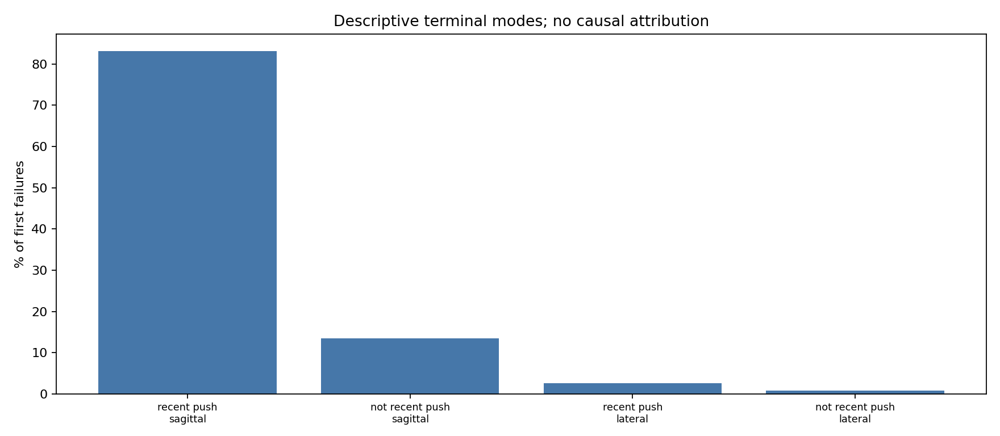
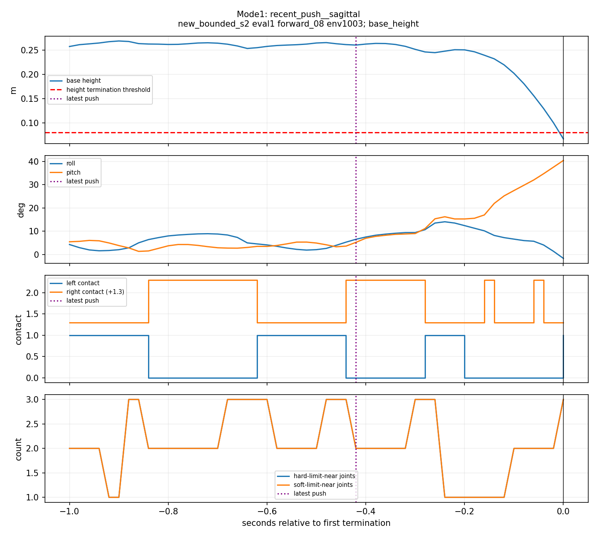
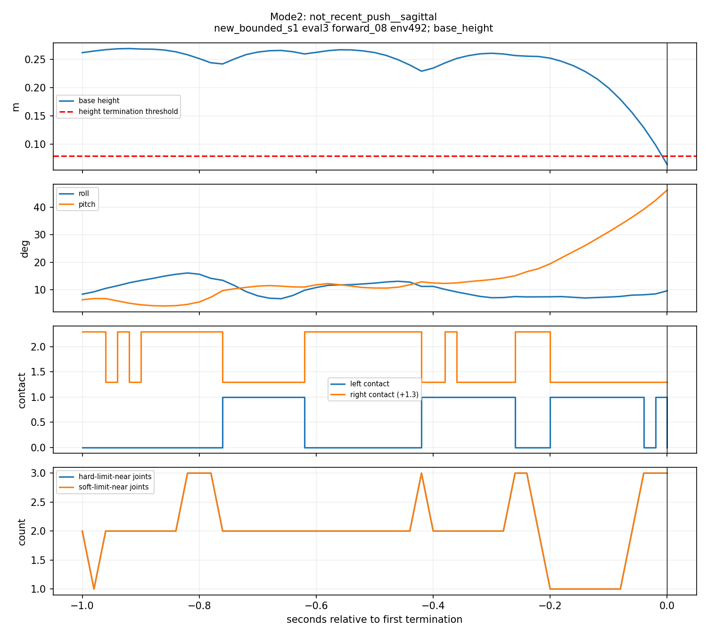

# Issue #7: high-resolution challenge evaluation and first-failure analysis

Issue: https://github.com/weiguang52/HUMANOID_TW/issues/7 . Base36e38ee. User confirmed analysis only: no retraining and no default/observation/reward changes.

## Protocol and uncertainty

Four fixed checkpoints: issue6 bounded-strengthen training seeds1/2 and issue5 strengthened-push seeds1/2. Same bounded combined challenge for all: nominal mass*U(0.5,1.5), friction static[0.4,1.4]/dynamic[0.3,1.2], evaluation pushes +/-0.3m/s, observation noise, random per-episode0/20ms action delay. Training push +/-0.45m/s is not used as the evaluation push.

Each policy uses1024 environments,3evaluation seeds,0.3/0.5/0.8m/s,20s per command, deterministic action selection and paired reset seed=eval_seed*1000+command_index.12jobs,36command estimates,36864trials. Larger batches use different random streams from the historical128-env runs; they improve resolution but are not exact historical episode replays.

95% intervals use the binomial Wilson score formula, checked against SciPy at boundary/interior counts. One fall now changes the estimate by0.09765625percentage points. Per-seed intervals are conditional on a fixed policy/task; pooled3072-trial intervals do not capture between-training-seed uncertainty or guarantee independence of shared pseudo-random streams. They must not be read as a general deployment guarantee or a paired-policy difference test.

## Pooled fall rates with95% intervals

Each row combines the three evaluation seeds, denominator3072; all per-seed rows follow below and in rates_wilson95.csv.

| Model | Speed command | Falls | Rate | Wilson95% interval |
|---|---|---:|---:|---|
| new_bounded_s1 | forward_03 | 41/3072 | 1.335% | [0.985%, 1.805%] |
| new_bounded_s1 | forward_05 | 121/3072 | 3.939% | [3.307%, 4.686%] |
| new_bounded_s1 | forward_08 | 473/3072 | 15.397% | [14.164%, 16.717%] |
| new_bounded_s2 | forward_03 | 25/3072 | 0.814% | [0.552%, 1.199%] |
| new_bounded_s2 | forward_05 | 230/3072 | 7.487% | [6.608%, 8.472%] |
| new_bounded_s2 | forward_08 | 650/3072 | 21.159% | [19.751%, 22.639%] |
| old_strengthen_s1 | forward_03 | 26/3072 | 0.846% | [0.578%, 1.237%] |
| old_strengthen_s1 | forward_05 | 104/3072 | 3.385% | [2.802%, 4.085%] |
| old_strengthen_s1 | forward_08 | 470/3072 | 15.299% | [14.070%, 16.616%] |
| old_strengthen_s2 | forward_03 | 21/3072 | 0.684% | [0.448%, 1.043%] |
| old_strengthen_s2 | forward_05 | 144/3072 | 4.688% | [3.995%, 5.493%] |
| old_strengthen_s2 | forward_08 | 520/3072 | 16.927% | [15.643%, 18.294%] |

No policy demonstrates a pooled upper95% bound below1% even at0.3m/s. At0.5/0.8m/s failures remain substantial. This analysis does not establish a robustness improvement from issue6 retraining.

## Per-evaluation-seed rates

| Model | Eval seed | Command | Falls/1024 | Rate | Wilson95% interval |
|---|---:|---|---:|---:|---|
| new_bounded_s1 | 1 | forward_03 | 12 | 1.172% | [0.672%, 2.037%] |
| new_bounded_s1 | 1 | forward_05 | 38 | 3.711% | [2.715%, 5.052%] |
| new_bounded_s1 | 1 | forward_08 | 141 | 13.770% | [11.794%, 16.016%] |
| new_bounded_s1 | 2 | forward_03 | 10 | 0.977% | [0.531%, 1.788%] |
| new_bounded_s1 | 2 | forward_05 | 48 | 4.688% | [3.554%, 6.160%] |
| new_bounded_s1 | 2 | forward_08 | 151 | 14.746% | [12.706%, 17.049%] |
| new_bounded_s1 | 3 | forward_03 | 19 | 1.855% | [1.191%, 2.880%] |
| new_bounded_s1 | 3 | forward_05 | 35 | 3.418% | [2.468%, 4.716%] |
| new_bounded_s1 | 3 | forward_08 | 181 | 17.676% | [15.461%, 20.132%] |
| new_bounded_s2 | 1 | forward_03 | 9 | 0.879% | [0.463%, 1.662%] |
| new_bounded_s2 | 1 | forward_05 | 55 | 5.371% | [4.150%, 6.926%] |
| new_bounded_s2 | 1 | forward_08 | 205 | 20.020% | [17.683%, 22.580%] |
| new_bounded_s2 | 2 | forward_03 | 7 | 0.684% | [0.332%, 1.404%] |
| new_bounded_s2 | 2 | forward_05 | 84 | 8.203% | [6.674%, 10.044%] |
| new_bounded_s2 | 2 | forward_08 | 212 | 20.703% | [18.333%, 23.292%] |
| new_bounded_s2 | 3 | forward_03 | 9 | 0.879% | [0.463%, 1.662%] |
| new_bounded_s2 | 3 | forward_05 | 91 | 8.887% | [7.294%, 10.787%] |
| new_bounded_s2 | 3 | forward_08 | 233 | 22.754% | [20.291%, 25.421%] |
| old_strengthen_s1 | 1 | forward_03 | 8 | 0.781% | [0.396%, 1.534%] |
| old_strengthen_s1 | 1 | forward_05 | 30 | 2.930% | [2.060%, 4.151%] |
| old_strengthen_s1 | 1 | forward_08 | 140 | 13.672% | [11.703%, 15.912%] |
| old_strengthen_s1 | 2 | forward_03 | 7 | 0.684% | [0.332%, 1.404%] |
| old_strengthen_s1 | 2 | forward_05 | 38 | 3.711% | [2.715%, 5.052%] |
| old_strengthen_s1 | 2 | forward_08 | 166 | 16.211% | [14.081%, 18.594%] |
| old_strengthen_s1 | 3 | forward_03 | 11 | 1.074% | [0.601%, 1.913%] |
| old_strengthen_s1 | 3 | forward_05 | 36 | 3.516% | [2.550%, 4.829%] |
| old_strengthen_s1 | 3 | forward_08 | 164 | 16.016% | [13.897%, 18.388%] |
| old_strengthen_s2 | 1 | forward_03 | 11 | 1.074% | [0.601%, 1.913%] |
| old_strengthen_s2 | 1 | forward_05 | 45 | 4.395% | [3.300%, 5.830%] |
| old_strengthen_s2 | 1 | forward_08 | 159 | 15.527% | [13.438%, 17.874%] |
| old_strengthen_s2 | 2 | forward_03 | 4 | 0.391% | [0.152%, 1.000%] |
| old_strengthen_s2 | 2 | forward_05 | 51 | 4.980% | [3.808%, 6.489%] |
| old_strengthen_s2 | 2 | forward_08 | 175 | 17.090% | [14.908%, 19.517%] |
| old_strengthen_s2 | 3 | forward_03 | 6 | 0.586% | [0.269%, 1.272%] |
| old_strengthen_s2 | 3 | forward_05 | 48 | 4.688% | [3.554%, 6.160%] |
| old_strengthen_s2 | 3 | forward_08 | 186 | 18.164% | [15.923%, 20.643%] |

## Recorded first failures

All2825first true terminations have an up-to1s window ending at the terminal pre-reset state.2758have the complete51samples;67early terminations have only available episode history (39..50samples), explicitly marked by validity masks. No pre-episode history is fabricated.51samples at50Hz span1s. Termination-manager recording occurs after physics/termination computation and before auto-reset. All2825first failures were base_height terminations (threshold0.08m), not timeout or base_contact. The exact termination term list is recorded per environment. Subsequent auto-reset episodes do not add trials.

RawNPZs and metadata under traces/ contain root pose/velocity, all joint positions, base height/roll/pitch, foot force/contact/cycle phase, hard/soft joint-limit proximity, current action delay, actual last push delta-v in world/body axes, elapsed push time/contact at push and commands. Push intervals are5..8s, so at most one push occurs in the1s window; older/no-push cases remain explicit. Cycle phase is onset-based and marked-1until a previous cycle is available. Hard/soft limit proximity uses0.02rad; separate touching proxy0.001rad and outside-range tolerance1e-5 are recomputed from raw positions. These flags are not direct constraint-force measurements. Relative trace paths accompany original remote paths in failure_events.csv.

The64-env recorded/plain smoke had12falls in both and identical continuous metrics (maximum difference0). The push wrapper invokes the original sampler once, without extra RNG draws; measured push deltas were checked. Wilson tests passed. Checkpoint hashes were verified unchanged after evaluation.

## Failure-mode proportions

Frozen primary categories cross push recency (latest push within1s vs older/no push) with terminal Euler tilt dominance (sagittal if abs(pitch)>abs(roll), lateral otherwise; near-upright below5degrees). A mode is dominant only at>=50%overall and ranked first for each of4policies. This is a descriptive endpoint/temporal label, not a causal mechanism.

| Mode | First failures | Share |
|---|---:|---:|
| recent_push__sagittal | 2348 | 83.115% |
| not_recent_push__sagittal | 381 | 13.487% |
| recent_push__lateral | 74 | 2.619% |
| not_recent_push__lateral | 22 | 0.779% |

Dominant descriptive mode: **recent_push__sagittal**. The recent-push sagittal mode is71.181%,85.746%,82.000%,91.679%within new_s1/new_s2/old_s1/old_s2 respectively. mode_by_policy_speed.csv exposes command-level heterogeneity.

## Grouped diagnostics (case shares, not causal risks)

| Feature | Group | Failures | Share of all failures |
|---|---|---:|---:|
| push_direction_body | forward | 1850 | 65.487% |
| push_direction_body | left | 386 | 13.664% |
| push_direction_body | right | 349 | 12.354% |
| push_direction_body | no_push | 196 | 6.938% |
| push_direction_body | backward | 44 | 1.558% |
| push_magnitude_bin | ge0.30 | 1586 | 56.142% |
| push_magnitude_bin | 0.15to0.30 | 1005 | 35.575% |
| push_magnitude_bin | no_push | 196 | 6.938% |
| push_magnitude_bin | lt0.15 | 38 | 1.345% |
| delay_ms | 20 | 1877 | 66.442% |
| delay_ms | 0 | 948 | 33.558% |
| contact_at_push | left_only | 1500 | 53.097% |
| contact_at_push | right_only | 1100 | 38.938% |
| contact_at_push | no_push | 196 | 6.938% |
| contact_at_push | double | 22 | 0.779% |
| contact_at_push | flight | 7 | 0.248% |
| contact_at_failure | flight | 2071 | 73.310% |
| contact_at_failure | left_only | 637 | 22.549% |
| contact_at_failure | right_only | 104 | 3.681% |
| contact_at_failure | double | 13 | 0.460% |
| hard_limit_any_last1s | True | 2825 | 100.000% |
| soft_limit_any_last1s | True | 2825 | 100.000% |
| hard_limit_touch_proxy_last1s | True | 2825 | 100.000% |
| outside_hard_limits_last1s | True | 2821 | 99.858% |
| outside_hard_limits_last1s | False | 4 | 0.142% |

Push magnitude is horizontal world delta-v norm; bins are<0.15,0.15..0.30,>=0.30m/s. Direction is the dominant signed body-frame component of the latest push. Older pushes remain labeled as older; no-push trials are separate. Push-direction/magnitude/contact-at-push case tables lack nonfailure push-event denominators and must not be called relative risks. Flight at termination can be a consequence of collapse.

Joint proximity is nondiscriminating here: every failure window has a near-limit joint, while99.994%of at-risk steps already have at least one soft-limit-near joint. Tiny outside-range tolerances/normal gait constraints do not establish that hard-stop impact caused the collapse.

## Delay trial denominators and exposure

The randomized episode delay is recorded before any failure/reset. The following pooled counts mix all speeds/evaluation seeds within each policy; detailed stratified rates/CIs are in delay_trial_rates.csv.

| Model | Delay ms | Falls / at-risk trials | Rate | Wilson95% interval |
|---|---:|---:|---:|---|
| new_bounded_s1 | 0 | 180/4651 | 3.870% | [3.353%, 4.464%] |
| new_bounded_s1 | 20 | 455/4565 | 9.967% | [9.132%, 10.870%] |
| new_bounded_s2 | 0 | 384/4651 | 8.256% | [7.499%, 9.082%] |
| new_bounded_s2 | 20 | 521/4565 | 11.413% | [10.523%, 12.368%] |
| old_strengthen_s1 | 0 | 201/4651 | 4.322% | [3.774%, 4.945%] |
| old_strengthen_s1 | 20 | 399/4565 | 8.740% | [7.955%, 9.595%] |
| old_strengthen_s2 | 0 | 183/4651 | 3.935% | [3.413%, 4.532%] |
| old_strengthen_s2 | 20 | 502/4565 | 10.997% | [10.122%, 11.937%] |

Across all four policies,0ms:948/18604=5.096%;20ms:1877/18260=10.279%. The direction agrees in all four policies. This is conditional descriptive evidence for investigating actuator-feedback timing, not proof of a unique delay cause. At-risk step exposures for delay/contact/current soft-limit proximity/recent push are saved in failure_mode_summary.json; multiplying by0.02gives environment-seconds. Case-window limit flags must not be directly compared to instantaneous exposure as a causal hazard.

## Representative evidence and colored videos

Representatives were selected by the frozen full-window/median-failure-time rule, not by apparent visual severity. Each video replays exact recorded root and joint states ending at the first pre-reset termination. It is a kinematic display with no physics integration or policy rerun;51frames/50fps cover51end-inclusive samples spanning1s (encoded duration1.02s). The overlay explicitly states recorded-state replay. No source HumanML3D NPY exists for these stage1 velocity commands.

### Mode1: recent_push__sagittal

Source: new_bounded_s2, eval seed1, forward_08, env1003; failure at12.28s.

[Colored front](videos/mode1_front.mp4) / [colored side](videos/mode1_side.mp4).

### Mode2: not_recent_push__sagittal

Source: new_bounded_s1, eval seed3, forward_08, env492; failure at8.00s.

[Colored front](videos/mode2_front.mp4) / [colored side](videos/mode2_side.mp4).

Exact precolored USD retains1876original attributes and non-material relationships; no runtime material binding. Cameras follow translation and heading. Joint legend: joint_colors.json. Video audit and manual review verify encoding/framing/colors/small-part attachment. Rendering does not create another evaluation result or validate a new dynamics trajectory.

## Single next-step proposal; not implemented

See [next_step_proposal.md](next_step_proposal.md). Change only the policy last_action observation parameter to action_name=JointPositionAction, exposing the previously applied delay-selected command rather than the environment-wide last requested action. Input dimension/architecture stay unchanged. Hold critic inputs/rewards/randomization/training budget fixed in a future controlled test. Current observation and default configurations remain unchanged.

## Delivery and limits

No training occurred in this issue; four input checkpoint hashes remain unchanged. All artifacts were generated remotely. Archived logs remove ANSI/trailing whitespace; raw originals remain remote. No mounted files were copied to local storage. Notion replaces Linear: https://www.notion.so/403325d8231d8172995bf19510b8d760 . The issue reply records analysis completion without claiming the low-speed performance target is achieved.
