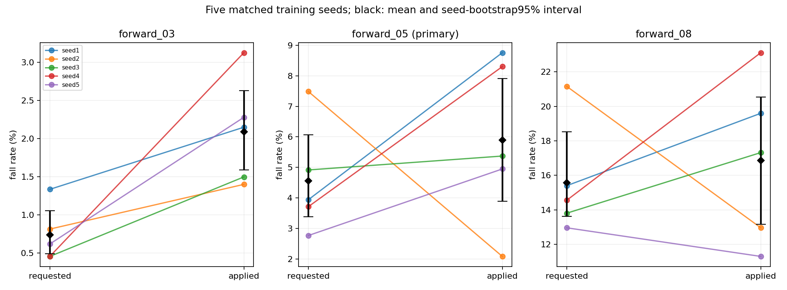
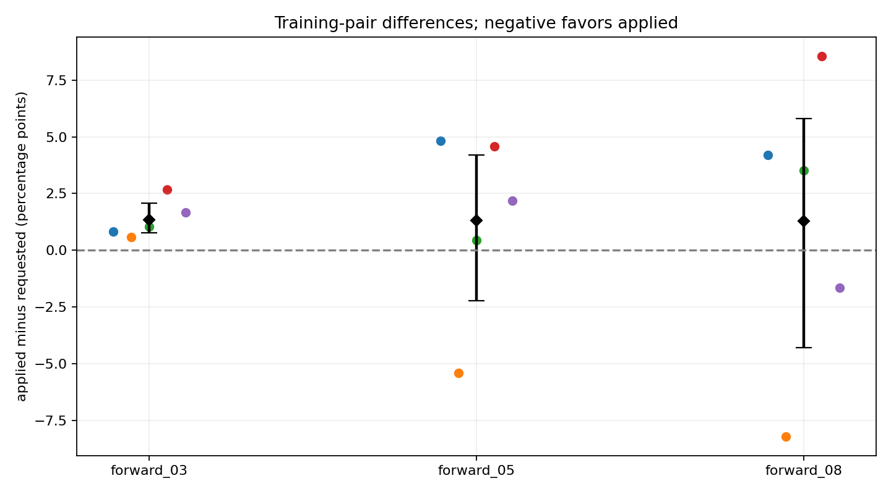
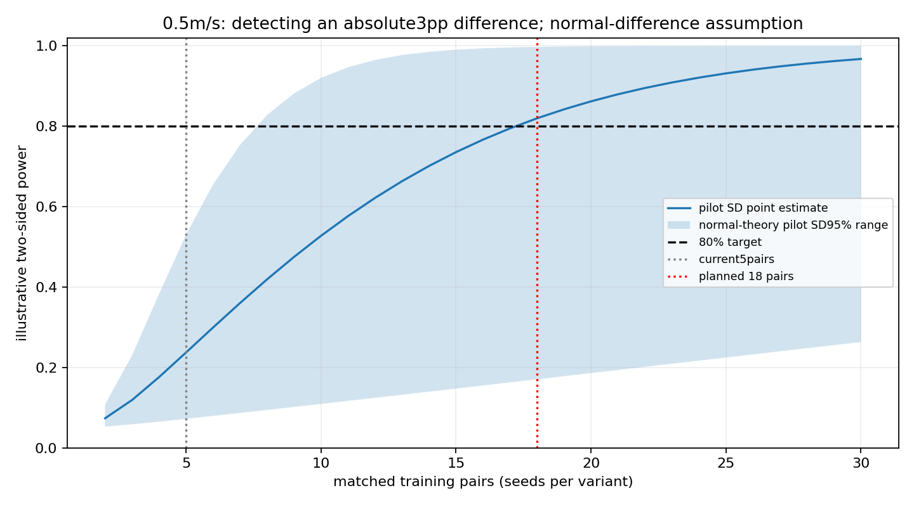

# Issue #9: requested vs applied, five training seeds per variant

Issue: https://github.com/weiguang52/HUMANOID_TW/issues/9 . Base6d691ae. No configuration or default changes.

## Cohort and provenance

Existing requested seeds1/2 are issue6 bounded-strengthen checkpoints evaluated under issue7; existing applied seeds1/2 are issue8. Fixed new training seeds3/4/5 were run in order requested3,applied3,requested4,applied4,requested5,applied5. All ten policies share the exact robust05 seed1 parent SHA256 c200e355d29fda60225761550ea80642bb222778ce50c00ae3deb3d95fa7a38d.

Each of six new runs uses4096 environments,1500updates, full optimizer resume, no std reset or checkpoint selection. Bounded mass*U(0.5,1.5), training pushes+/-0.45m/s, original friction/noise/random0/20ms delay, architecture/rewards/critic unchanged. Requested vs applied retains only the previously defined policy last_action difference. Six saved-config and three matched-pair audits verify allowed seed/name changes and the one existing observation difference. Training/configuration source bytes match6d691ae.

All policies use the unchanged issue7 evaluation:bounded combined,1024 environments,3evaluation seeds,0.3/0.5/0.8m/s,20s, deterministic policy and paired resets. Evaluation pushes remain+/-0.3m/s. New18jobs/55296trials plus archived36864trials give92160 total observed trials, but the statistical sample size is FIVE training pairs, not92160independent training samples.

## Five-vs-five individual training-seed rates

Each rate pools exactly3072evaluation trials within one trained policy and speed.

| Command | Training seed | Requested falls/rate | Applied falls/rate | Applied-requested (pp) |
|---|---:|---|---|---:|
| forward_03 | 1 | 41/3072; 1.335% | 66/3072; 2.148% | +0.814 |
| forward_03 | 2 | 25/3072; 0.814% | 43/3072; 1.400% | +0.586 |
| forward_03 | 3 | 14/3072; 0.456% | 46/3072; 1.497% | +1.042 |
| forward_03 | 4 | 14/3072; 0.456% | 96/3072; 3.125% | +2.669 |
| forward_03 | 5 | 19/3072; 0.618% | 70/3072; 2.279% | +1.660 |
| forward_05 | 1 | 121/3072; 3.939% | 269/3072; 8.757% | +4.818 |
| forward_05 | 2 | 230/3072; 7.487% | 64/3072; 2.083% | -5.404 |
| forward_05 | 3 | 151/3072; 4.915% | 165/3072; 5.371% | +0.456 |
| forward_05 | 4 | 114/3072; 3.711% | 255/3072; 8.301% | +4.590 |
| forward_05 | 5 | 85/3072; 2.767% | 152/3072; 4.948% | +2.181 |
| forward_08 | 1 | 473/3072; 15.397% | 602/3072; 19.596% | +4.199 |
| forward_08 | 2 | 650/3072; 21.159% | 398/3072; 12.956% | -8.203 |
| forward_08 | 3 | 424/3072; 13.802% | 532/3072; 17.318% | +3.516 |
| forward_08 | 4 | 447/3072; 14.551% | 710/3072; 23.112% | +8.561 |
| forward_08 | 5 | 398/3072; 12.956% | 347/3072; 11.296% | -1.660 |

## Training-seed group means and sample standard deviations

| Command | Variant | Mean | Sample SD (pp,ddof1) | Seed-bootstrap95% mean interval |
|---|---|---:|---:|---|
| forward_03 | requested | 0.736% | 0.366 | [0.488%, 1.055%] |
| forward_03 | applied | 2.090% | 0.696 | [1.589%, 2.630%] |
| forward_05 | requested | 4.564% | 1.804 | [3.379%, 6.068%] |
| forward_05 | applied | 5.892% | 2.724 | [3.887%, 7.904%] |
| forward_08 | requested | 15.573% | 3.251 | [13.613%, 18.516%] |
| forward_08 | applied | 16.855% | 4.822 | [13.164%, 20.547%] |

## Matched-seed differences and frozen conclusion

Exact empirical bootstrap enumerates all5^5=3125with-replacement training-index vectors. The same indices resample requested/applied together. Linear2.5/97.5percentiles define intervals. Numerical values within1e-12rate units of zero/threshold equality are treated as equality to avoid floating-point false exclusions.3125resamples are not3125new training seeds. Group intervals are NOT binomial intervals obtained by pooling trials. With equal denominators, means happen to equal pooled point rates, but uncertainty is calculated from five seed rates. The observed between-policy SD also contains finite evaluation error under the fixed3072-trial protocol; it is not a decomposition of pure optimizer variance. The intervals are conditional on the chosen evaluation streams and shared parent.

| Command | Mean applied-requested (pp) | Paired-difference SD (pp) | Paired seed-bootstrap95% (pp) | Excludes0 | Interpretation |
|---|---:|---:|---|---|---|
| forward_03 | +1.354 | 0.837 | [+0.768, +2.064] | True | conditional bootstrap evidence supports a higher applied fall rate (against applied) |
| forward_05 | +1.328 | 4.172 | [-2.233, +4.199] | False | cannot distinguish requested and applied at the current training-seed count |
| forward_08 | +1.283 | 6.425 | [-4.277, +5.807] | False | cannot distinguish requested and applied at the current training-seed count |

**Prespecified primary0.5m/s conclusion: cannot distinguish requested and applied at the current training-seed count.** Other speeds retain their separate conclusions and are not promoted into a universal all-speed claim. The three intervals are not a simultaneous familywise95%guarantee. With only five observed pairs, empirical percentile tail/coverage uncertainty remains substantial; results are conditional on this shared parent.

## Low/mid-speed group-mean threshold

| Variant | 0.3m/s mean95% upper | 0.5m/s mean95% upper | BOTH strictly<1% |
|---|---:|---:|---|
| requested | 1.055% | 6.068% | False |
| applied | 2.630% | 7.904% | False |

Any group meets both thresholds: False. Defaults promoted: NO, regardless of result.

## Training-seed count to detect an absolute3pp effect

Planning uses a two-sided alpha0.05,80%power noncentral-t model. Main design is matched training pairs, using observed sampleSD of applied-requested. N pairs means N seeds PER configuration (2Ntraining runs). Independent equal-size group planning is a sensitivity estimate using pooled groupSD. This is planning for a future separately authorized study, not additional training launched here.

| Command | Pilot paired SD (pp) | Estimated matched pairs needed | Pair-count sensitivity from SD95% bounds | Additional pairs beyond current5 | Independent seeds per arm |
|---|---:|---:|---|---:|---:|
| forward_03 | 0.837 | 3 | [3, 8] | 0 | 3 |
| forward_05 | 4.172 | 18 | [8, 128] | 13 | 11 |
| forward_08 | 6.425 | 38 | [15, 300] | 33 | 31 |

The SD range uses the normal-theory chi-square interval from only five pilot differences. Its pair-count range is a sensitivity calculation, not a calibrated confidence interval for required N. Normality/constant variance, near-boundary fall rates, sparse pilot tails and the shared parent can all invalidate precise planning claims. A zero pilot SD is reported as not reliably estimable. The absolute effect0.03is three percentage points, not a3%relative change.

## Independent-parent check

Only three byte-identical copies of the seed1 robust05 final checkpoint were found in accessible training/archive roots. No different-source robust05 training-seed checkpoint is available. Therefore the optional parent-source comparison is MISSING, not silently replaced with a robust08 child or another curriculum stage. See parent_availability_audit.json for roots, explicit run-name criteria, highest numeric checkpoints and hashes. Five seeds conditional on one parent do not establish independent full-pipeline replication or parent-robust effects.

## Validation and artifacts

Five statistics tests cover joint paired resampling, exact resample count, sampleSD, identical-group CI, two-sided null power and planning behavior. All six new checkpoints have1500logged updates, final iteration8995, finite tensors and baseline-compatible actor/critic shapes. All ten input checkpoint hashes and baseline CSV manifests are checked. Raw first-failure records, pre-reset states, actual push bounds/delay labels and video audits accompany the study; these diagnostics do not change the training-seed statistical unit.

## Colored worst-command front/side videos

Six new models each have20s colored front/side diagnostics at their highest pooled-fall command, tie0.3/0.5/0.8. Videos use one environment and do not replace1024-env acceptance. Cameras follow translation and heading; exact precolored USD preserves original physics/non-material relationships, with no runtime material binding. Joint legend: joint_colors.json. Velocity commands have no sourceHumanML3D NPY.
- [applied_s3_worst_front_forward_08_front](videos/applied_s3_worst_front_forward_08_front.mp4)
- [applied_s3_worst_side_forward_08_side](videos/applied_s3_worst_side_forward_08_side.mp4)
- [applied_s4_worst_front_forward_08_front](videos/applied_s4_worst_front_forward_08_front.mp4)
- [applied_s4_worst_side_forward_08_side](videos/applied_s4_worst_side_forward_08_side.mp4)
- [applied_s5_worst_front_forward_08_front](videos/applied_s5_worst_front_forward_08_front.mp4)
- [applied_s5_worst_side_forward_08_side](videos/applied_s5_worst_side_forward_08_side.mp4)
- [requested_s3_worst_front_forward_08_front](videos/requested_s3_worst_front_forward_08_front.mp4)
- [requested_s3_worst_side_forward_08_side](videos/requested_s3_worst_side_forward_08_side.mp4)
- [requested_s4_worst_front_forward_08_front](videos/requested_s4_worst_front_forward_08_front.mp4)
- [requested_s4_worst_side_forward_08_side](videos/requested_s4_worst_side_forward_08_side.mp4)
- [requested_s5_worst_front_forward_08_front](videos/requested_s5_worst_front_forward_08_front.mp4)
- [requested_s5_worst_side_forward_08_side](videos/requested_s5_worst_side_forward_08_side.mp4)

Existing seeds1/2 reference videos remain in their original versioned bundles:
- [requested seed1 front](../stage1_issue6_20261109/videos/bounded_strengthen_s1_worst_front_forward_08_front.mp4)
- [requested seed1 side](../stage1_issue6_20261109/videos/bounded_strengthen_s1_worst_side_forward_08_side.mp4)
- [requested seed2 front](../stage1_issue6_20261109/videos/bounded_strengthen_s2_worst_front_forward_08_front.mp4)
- [requested seed2 side](../stage1_issue6_20261109/videos/bounded_strengthen_s2_worst_side_forward_08_side.mp4)
- [applied seed1 front](../stage1_issue8_20261109/videos/applied_s1_worst_front_forward_08_front.mp4)
- [applied seed1 side](../stage1_issue8_20261109/videos/applied_s1_worst_side_forward_08_side.mp4)
- [applied seed2 front](../stage1_issue8_20261109/videos/applied_s2_worst_front_forward_08_front.mp4)
- [applied seed2 side](../stage1_issue8_20261109/videos/applied_s2_worst_side_forward_08_side.mp4)

## Tracking

All artifacts were generated remotely. Raw original logs remain on the data disk; archive logs strip ANSI/trailing whitespace. No mounted files are copied to local storage. Notion replaces Linear: https://www.notion.so/403325d8231d8172995bf19510b8d760 . Issue reply reports the primary/secondary seed-level conclusions and illustrative3pp planning estimate. No default configuration is promoted.
